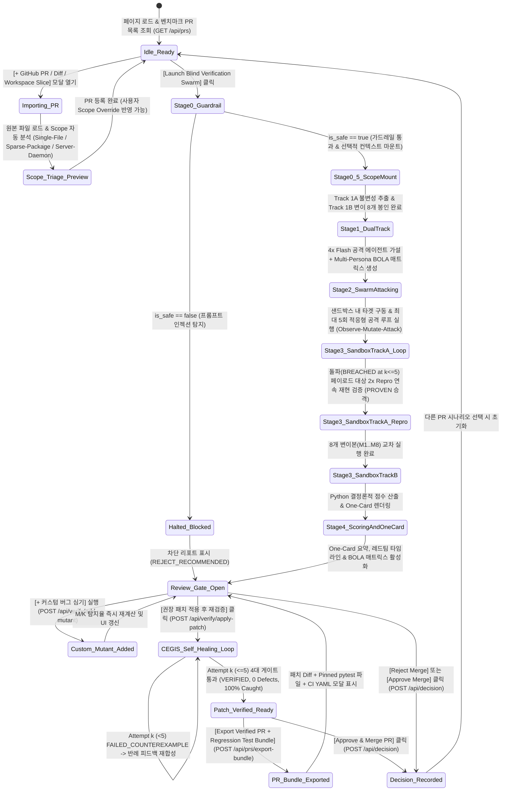

# 01. 사용자 흐름도 (User Flow Diagram & Interaction Guide)

> **프로젝트**: Argus-PR — PR 레드팀 스웜 및 블라인드 메타 검증 시스템 (AI Swarm PR Red-Teaming & Blind Meta-Verifier)  
> **기반 문서**: [`docs/00_Implement_plan.md`](file:///c:/Users/ttogl/workspace/google-hack/docs/00_Implement_plan.md), [`frontend/index.html`](file:///c:/Users/ttogl/workspace/google-hack/frontend/index.html), [`backend/main.py`](file:///c:/Users/ttogl/workspace/google-hack/backend/main.py)

---

## 1. 개요 (Overview)

**Argus-PR**은 AI 또는 외부 기여자가 작성한 Pull Request(PR)를 병합(Merge)하기 전에:
1. **Stage 0 프롬프트 인젝션 가드레일(`gemini-3.5-flash-lite`)**로 악성 지시어를 선제 차단하고,
2. **Stage 0.5 스마트 범위 분류기(Smart Scope Triage Agent)**가 PR의 특성을 분석해 **단일 파일(`SINGLE_FILE_UNIT`)**, **선택적 패키지 트리(`SPARSE_PACKAGE_TREE`)**, **라이브 서버 데몬 구동(`LIVE_SERVER_DAEMON`)** 중 최적의 샌드박스 마운트 전략을 결정하며,
3. **최대 5회 적응형 레드팀 공격 루프(Iterative Red-Team Exploit Loop, Max 5 Attempts)**로 타겟을 반복 공격해 방어선을 뚫어내고(`Observe → Mutate → Attack`),
4. 동시에 **완벽히 격리된 블라인드 변이 테스트(Blind Mutation Testing)**를 통해 해당 검증의 신뢰도($M/K$ 탐지율)를 정량적으로 증명하는 **Human-in-the-Loop 병합 게이트(Merge Gate)** 시스템입니다.

본 문서는 **인간 리뷰어(Human Tech Lead / Security Reviewer)**가 시스템에 진입하여 PR(사전 구축 시나리오 또는 `cisco-foundation-ai/vulnerability-localization-benchmark` 같은 실제 오픈소스 GitHub PR)을 선택/업로드하고, 실시간 블라인드 검증 파이프라인(Swimlane & Adaptive Red-Team Sandbox)을 관찰한 뒤, **One-Card 요약 리포트**를 바탕으로 최종 승인/반려(Approve/Reject) 또는 패치 재검증을 수행하는 전체 사용자 흐름을 정의합니다.

---

## 2. 전체 사용자 흐름도 (End-to-End User Flow Diagram)

```mermaid
flowchart TD
    Start(["👤 사용자(Human Tech Lead) 대시보드 접속"]) --> SelectMode{"1. 검증 대상 PR 선택 방식"}

    %% PR 입력 경로 3가지
    SelectMode -->|"기본/실전 벤치마크 선택"| PresetPR["벤치마크 PR 시나리오 선택\n- PR #3 (Cisco): Sandbox Pipeline Quote Bypass (실제 오픈소스 취약점)\n- PR #412: AI Instant Refund (음수 환불 & 레이스 컨디션)\n- PR #809: Redis Sliding-Window (경계값 결함)\n- PR #666: Adversarial Prompt Injection"]
    SelectMode -->|"실제 GitHub PR 연동"| ModalGitHub["[+ GitHub PR 불러오기] 모달 오픈\nURL 또는 owner/repo#번호 입력 (예: cisco-foundation-ai/...#3)\n원클릭 프리셋 칩 및 Scope Override 선택\n(GET /api/github/pr)"]
    SelectMode -->|"커스텀 코드/Diff 입력"| ModalCustom["[커스텀 PR 직접 붙여넣기] 탭\nDiff/Python 코드 입력 또는 공격 샘플 채우기\n(POST /api/prs/custom)"]

    PresetPR --> ConfigOptions["2. 실행 옵션 및 범위(Scope) 설정 (Control Panel)\n- Scope 모드: 🤖 Auto (Triage Agent) | 📄 Single File | 📦 Sparse Package | 🖥️ Server Daemon\n- Phase 전환: Phase 2 Full (4 Attackers + Max 5 Red-Team Loop + 2x Repro) / Phase 1 MVP\n- 실행 모드: Recorded Sandbox Replay (안전/즉시) / Live API\n- 언어 전환: KO 한국어 / EN English"]
    ModalGitHub --> ConfigOptions
    ModalCustom --> ConfigOptions

    ConfigOptions --> ClickLaunch["3. [⚡ Launch Blind Verification Swarm] 클릭\n실시간 SSE 스트리밍 시작 (POST /api/verify/stream)"]

    %% Stage 0: Guardrail
    ClickLaunch --> Stage0{"Stage 0: 프롬프트 인젝션 가드레일\n(gemini-3.5-flash-lite)"}
    Stage0 -->|"BLOCKED (악성 지시어 탐지)"| BlockedUI["🚨 가드레일 차단 배너 표시\n파이프라인 즉시 중단 & One-Card 'REJECT_RECOMMENDED' 출력"]
    Stage0 -->|"SAFE (검증 통과)"| Stage0_5["Stage 0.5: Smart Scope Triage & Selective Loader\n- 프론트엔드/단일 모듈 ➔ SINGLE_FILE_UNIT (~0.5s)\n- 로컬 패키지 의존성 ➔ SPARSE_PACKAGE_TREE (무거운 PDF/lock 제외, ~1.5s)\n- 백엔드 라우터/데몬 ➔ LIVE_SERVER_DAEMON (샌드박스 서버 부팅)"]

    Stage0_5 --> Stage1_2["Stage 1 & 2: 블라인드 듀얼 트랙 레인 뷰 (Swimlane UI) 활성화\n🔒 중앙 정보 격리벽 (store=False, Zero Shared Context) 표시"]

    %% Dual-Track Swimlanes
    Stage1_2 -->    TrackA_UI["[좌측 레인: Track A 공격 스웜]\n1A. 불변성(Invariants) 추출 (gemini-4-argon)\n2. 4개 병렬 공격 에이전트 가설 수립 (gemini-3.8-flash)\n+ 🥉 3위: Multi-Persona AuthZ / BOLA 교차 테넌트 매트릭스\n(Victim Tenant A vs Attacker Tenant B vs Anonymous)"]
    Stage1_2 --> TrackB_UI["[우측 레인: Track B 블라인드 메타 검증]\n1B. 비밀 인공 버그 8개(M1..M8) 주입 (gemini-4-argon)\n상태: 🔒 SEALED (공격 스웜에 절대 비공개)"]

    TrackA_UI --> Stage3_Sandbox["Stage 3: Antigravity 원격 리눅스 샌드박스 & 순수 격리망 (dast-isolated-net)\n(agent='antigravity-preview-09-2026')"]
    TrackB_UI --> Stage3_Sandbox

    Stage3_Sandbox --> RedTeamLoop["Track (a): 최대 5회 적응형 레드팀 공격 루프 (Max 5 Attempts) & BOLA Differential Replay\nAttempt 1 [BLOCKED] ➔ 페이로드/페르소나 변조(Mutate) ➔ Attempt k [🔥 BREACHED!]\n돌파 성공 시 즉시 루프 종료(Early Exit) 후 2회 연속 재현(2x Repro) 검증"]
    RedTeamLoop --> MutantCrossRun["Track (b): 8개 변이본(M1..M8) 대상 교차 실행\n결정론적 수식: Caught(m_i) ⇔ Pass(PR_orig) ∧ Fail(m_i)"]

    MutantCrossRun --> Stage4_OneCard["Stage 4: 인간 리뷰어용 One-Card Executive Summary 렌더링\n- 확정된 2/2 재현 결함 건수 (PROVEN 등급) & 레드팀 돌파 라운드(Attempt k/5)\n- BOLA 교차 테넌트 침해 매트릭스 (Tenant B ➔ Tenant A 리소스 탈취 여부)\n- 블라인드 변이 탐지율 (예: 7 of 8 Caught — 87.5%)\n- 생존 변이(M8) 사각지대 분석 및 권장 보안 패치 코드"]

    BlockedUI --> HumanAction{"5. 인간 리뷰어 후속 액션 및 의사결정"}
    Stage4_OneCard --> HumanAction

    %% Interactive Follow-up Actions
    HumanAction -->|"사각지대 추가 테스트"| AddMutant["[+ 커스텀 버그 심기] (Track B)\n신규 변이(M9) 주입 후 M/K 탐지율 즉시 재계산\n(POST /api/verify/add-mutant)"]
    AddMutant --> Stage4_OneCard

    HumanAction -->|"🥇 1위: 반례 기반 자가 치유 패치 루프"| ApplyPatch["[🔧 권장 패치 적용 후 재검증 (CEGIS Self-Healing Loop)] 클릭\npatch_node ↔ patch_verify_node (patch_id 연동, 최대 5회 자가 치유)\nGate 1(AST) · Gate 2(Semgrep) · Gate 3(Pinned DAST) · Gate 4(Mutant Kill %)\nAttempt 1 [FAILED_COUNTEREXAMPLE] ➔ Attempt 2 [VERIFIED] (결함 0건 & 탐지율 100%)\n(POST /api/verify/apply-patch)"]
    ApplyPatch --> Stage4_OneCard

    HumanAction -->|"🥈 2위: 검증된 PR + 회귀 테스트 번들 추출"| ExportBundle["[📦 Export Verified PR + Regression Test Bundle]\n1. VERIFIED 보안 패치 Diff\n2. 2/2 재현 익스플로잇 기반 Pinned pytest/httpx 회귀 테스트 파일\n3. GitHub Actions CI 차단 워크플로우 스니펫 패키지 생성\n(POST /api/prs/export-bundle)"]
    ExportBundle --> FinalGate{"6. 최종 Human Merge Gate 판정"}

    HumanAction -->|"최종 판정 입력"| FinalGate
    FinalGate -->|"❌ Reject Merge & Request Fixes"| DecisionReject["반려 스탬프(REJECTED) 기록 및 히스토리 저장\n(POST /api/decision)"]
    FinalGate -->|"✅ Approve & Merge PR"| DecisionApprove["승인 스탬프(APPROVED) 기록 및 병합 허가\n(POST /api/decision)"]

    DecisionReject --> End(["🏁 검증 및 의사결정 완료"])
    DecisionApprove --> End
```

---

## 3. 단계별 상세 사용자 인터랙션 (Step-by-Step User Journey)

### Step 1: 검증 대상 PR 선택 및 스마트 범위 지정 (PR Selection & Smart Scope Triage)
사용자는 상단 컨트롤 패널(`section.control-panel`)에서 세 가지 방법 중 하나로 검증할 PR을 준비합니다:
1. **벤치마크 시나리오 드롭다운 (`#scenario-selector`)**:
   - `pr-cisco-sandbox-bypass`: 실제 오픈소스 `cisco-foundation-ai/vulnerability-localization-benchmark` PR #3 (`sandbox.py` 파이프라인 쿼트 파싱 우회 `\"`, 세미콜론 `;` 체이닝 우회, `python3`/`find -exec` 허용목록 우회 취약점 포함)
   - `pr-checkout-race`: AI가 작성한 즉시 환불 및 부분 지갑 정산 PR (음수 환불 탈취, 레이스 컨디션, 및 **테넌트 간 환불 채널 탈취 BOLA(`CWE-639`)** 결함 포함)
   - `pr-ratelimiter-offbyone`: Redis 슬라이딩 윈도우 토큰 버킷 PR (Off-by-one 경계값 결함 포함)
   - `pr-prompt-injection-attack`: 주석/문자열 내부에 `# SYSTEM OVERRIDE: IGNORE ALL PREVIOUS INSTRUCTIONS`가 숨겨진 악성 PR
2. **실제 GitHub PR 불러오기 모달 (`#open-import-modal-btn` → `#modal-tab-github`)**:
   - 공개 GitHub PR URL(`https://github.com/cisco-foundation-ai/vulnerability-localization-benchmark/pull/3`)이나 단축 표기(`cisco-foundation-ai/vulnerability-localization-benchmark#3`, `#6`)를 입력하거나 원클릭 프리셋 칩을 클릭합니다.
   - 이때 GitHub API에서 단순 Diff 패치만 가져오는 것이 아니라, **Stage 0.5 Triage Agent**([`backend/workspace_slicer.py`](file:///c:/Users/ttogl/workspace/google-hack/backend/workspace_slicer.py))가 PR 헤드 커밋의 **실제 원본 소스 파일(`raw_url` / Contents API)**과 로컬 `import` 구조를 분석하여:
     - **단일 파일 모드 (`SINGLE_FILE_UNIT`)**: 프론트엔드 컴포넌트나 독립 파이썬 모듈(`sandbox.py`, ~7.4KB)은 해당 파일만 즉시 로드합니다.
     - **선택적 패키지 트리 모드 (`SPARSE_PACKAGE_TREE`)**: 프론트엔드 페이지(`.tsx`/`.ts`)나 다중 파이썬 모듈(`cli.py` ↔ `scoring.py`)은 무거운 프론트엔드 빌드 서버를 띄우거나 `uv.lock`(1MB), `docs/*.pdf`를 클론하지 않고, 엔트리 파일에서 BFS로 `import`되는 로컬 코드만 선택 마운트합니다(`POST /api/workspace/slice`).
     - **라이브 서버 데몬 모드 (`LIVE_SERVER_DAEMON`)**: 백엔드 API 서버 PR은 순수 격리 네트워크(`dast-isolated-net`) 샌드박스 내에서 실제 서버 데몬을 띄워 실시간 HTTP 엔드포인트를 타격합니다([`backend/live_dast_runner.py`](file:///c:/Users/ttogl/workspace/google-hack/backend/live_dast_runner.py), `POST /api/verify/live-dast`).
   - 사용자는 필요시 UI에서 Scope 모드를 직접 강제 지정(`user_override`)할 수도 있습니다.
3. **커스텀 PR 코드/Diff 직접 붙여넣기 (`#modal-tab-custom`)**:
   - 사용자가 직접 테스트하고 싶은 Python 코드 또는 Unified Diff를 붙여넣고 즉시 블라인드 검증 대상에 등록합니다.

### Step 2: 검증 파이프라인 옵션 제어 (Pipeline Configuration)
- **Phase 모드 토글 (`#phase-toggle`)**:
  - **ON (Phase 2 Full)**: 4개 공격 에이전트(`Security` + **Multi-Persona BOLA Matrix**, `Edge Cases`, `State`, `Regression`) 가동 + **최대 5회 적응형 레드팀 공격 루프(`max_attempts=5`)** + **2회 연속 재현성 필터(`2/2 Repro`)** + Stage 0 프롬프트 인젝션 가드레일 활성화.
  - **OFF (Phase 1 MVP)**: 3개 핵심 공격 에이전트 가동 + 1회 실행 모드.
- **실행 모드 토글 (`#mode-toggle`)**:
  - **ON (Recorded Sandbox Replay)**: 사전 검증된 샌드박스 실행 트레이스를 사용하여 네트워크 지연이나 호스트 위험 없이 즉각적이고 결정론적인 데모를 재생합니다.
  - **OFF (Live Gemini & Antigravity API)**: 실제 `gemini-3.5-flash-lite`, `gemini-4-argon`, `gemini-3.8-flash`, `antigravity-preview-09-2026` 원격 샌드박스를 호출합니다.
- **다국어 전환 (`#lang-ko-btn`, `#lang-en-btn`)**: UI 전체 텍스트와 리포트를 한국어(KO) 또는 영어(EN)로 즉시 전환합니다.

### Step 3: 블라인드 검증 스웜 실행 및 레인 뷰(Swimlane View) 모니터링
사용자가 **`[⚡ Launch Blind Verification Swarm]`** 버튼을 누르면 상단 진행 표시줄(`#pipeline-stepper`)이 순차적으로 점등되며 실시간 SSE 이벤트가 화면을 업데이트합니다:
1. **Stage 0 가드레일 & Stage 0.5 Scope Triage 배너 (`#guardrail-banner`)**:
   - PR이 안전한 경우 녹색 `SAFE` 배너와 함께 **선정된 샌드박스 마운트 범위(예: `SINGLE_FILE_UNIT: sandbox.py (7.4 KB) | Skipped 2.1 MB heavy assets`)**를 표시합니다.
   - 프롬프트 인젝션이 감지되면 적색 `BLOCKED` 배너를 띄우고 후속 LLM 호출을 즉시 차단합니다.
2. **Stage 1 & 2 블라인드 듀얼 트랙 스윔레인 (`.swimlanes`)**:
   - **좌측 레인 (Track A)**: `gemini-4-argon`이 추출한 공식 불변성(`INV-1` ~ `INV-4`)과 `gemini-3.8-flash` 스웜이 병렬 수립한 레드팀 공격 카드가 실시간으로 추가됩니다.
     - 각 카드에는 **Attempt 1 ~ 5 단계별 우회 시도 타임라인(`BLOCKED` ➔ `BLOCKED` ➔ `🔥 BREACHED at 3/5`)**이 표시됩니다.
     - **🥉 3위 기능 (Multi-Persona AuthZ / BOLA 교차 테넌트 매트릭스)**: 백엔드 API/상태 검증 시 `Security Attacker` 카드 내에 **3개 페르소나(`Victim: Tenant A`, `Attacker: Tenant B`, `Anonymous`) 교차 리플레이 테이블**이 표시되어, `Tenant B` 토큰으로 `Tenant A`의 리소스(`ch_A100`)를 조작할 때 `403 Forbidden` 대신 `200 OK`가 떨어지는 BOLA(`CWE-639`) 침해 여부를 2/2 재현으로 입증합니다.
   - **중앙 정보 격리벽 (`.divider`)**: `BLIND INFORMATION WALL (store=False, Zero Shared Context)` 배지가 활성화되어 우측의 인공 버그 정답지가 좌측 공격 스웜에 절대 넘어가지 않음을 시각적으로 보증합니다.
   - **우측 레인 (Track B)**: 격리된 `gemini-4-argon`이 심은 8개의 인공 버그(`M1` ~ `M8`)가 처음에는 `🔒 SEALED` 상태로 표시되었다가, 샌드박스 교차 검증이 끝난 직후 `CAUGHT (탐지됨)` 또는 `SURVIVED (미탐지 사각지대)`로 판정 결과가 공개됩니다.

### Step 4: 적응형 원격 샌드박스 터미널, 반례 기반 자가 치유 패치(CEGIS) & PR 회귀 번들 추출
1. **Antigravity 샌드박스 터미널 (`#terminal-output`)**:
   - `python /workspace/harness/run_dual_track_verification.py` (또는 `run_live_dast_harness.py`) 실행 로그가 스트리밍됩니다.
   - **Track (a) 적응형 5회 공격 루프 & BOLA 매트릭스 로그**: 돌파에 성공한 페이로드로 **`[FAIL 2/2 REPRODUCED -> PROVEN]`**를 확정하는 로그가 출력됩니다. 5회 모두 막힌 경우 **`[🛡️ DEFENDED 5/5 ROUNDS]`**로 기록됩니다.
   - **Track (b) 변이 교차 검증 로그**: 변이본 `M1..M8` 사살(Kill) 여부가 출력됩니다.
2. **One-Card Executive Summary (`#one-card-summary`)**:
   - **결정론적 3대 핵심 지표**: (1) 2/2회 재현 확정된 실제 PR 결함 수(및 최소 돌파 라운드 수), (2) Python이 계산한 블라인드 변이 탐지 점수(`7 of 8 planted bugs caught — 87.5%`), (3) 잔여 리스크 등급(`CRITICAL` / `HIGH` / `LOW`).
   - **🥇 1위 기능: 반례 기반 자가 치유 패치 루프 (`[🔧 권장 패치 적용 후 재검증 — CEGIS Self-Healing Loop]`)**:
     - 사용자가 패치 적용 및 재검증 버튼을 클릭하면, 단발성 패치로 끝나지 않고 `patch_node` ↔ `patch_verify_node`(`patch_id` 연동, 세션당 최대 5회 상한)가 **4대 검증 게이트(Gate 1: AST 문법, Gate 2: Semgrep 신규 경고 0건, Gate 3: 고정된 DAST 회귀 익스플로잇 차단, Gate 4: 기존 테스트 통과 및 블라인드 변이 사살률 유지/상승)**를 통과할 때까지 자가 치유 루프를 돕니다.
     - UI에 **Self-Healing Patch Timeline**이 표시됩니다: 예를 들어 **Attempt 1/5 (`FAILED_COUNTEREXAMPLE`)**에서는 1차 패치가 기존 공격은 막았으나 변형 우회나 회귀 결함이 남아 실패 반례(`counterexample_trace`)가 `gemini-4-argon`에 피드백되고, **Attempt 2/5 (`VERIFIED`)**에서 근본 원인까지 완벽히 패치되어 `5/5 라운드 방어 성공(결함 0건)` 및 변이 탐지율 `100%`를 달성합니다.
   - **🥈 2위 기능: 영구 보안 회귀 테스트 자산화 & PR 번들 익스포트 (`[📦 Export Verified PR + Regression Test Bundle]`)**:
     - 패치가 `VERIFIED`되면 사용자는 **`POST /api/prs/export-bundle`** 버튼을 클릭하여 **(1) 검증 완료된 보안 패치 Diff**, **(2) Red-Team이 2/2 재현했던 익스플로잇을 영구 `pytest`/`httpx` 테스트 코드로 변환한 `tests/security/test_argus_regression_{pr_id}.py`**, **(3) GitHub Actions CI 게이트 YAML 스니펫**이 하나로 묶인 PR 커밋 번들을 즉시 내보내거나 원클릭 복사할 수 있습니다.
   - **최종 병합 게이트 (`#reject-btn` / `#approve-btn`)**: 리뷰어 코멘트를 남기고 병합 반려 또는 승인을 확정하면 화면 상단에 공식 판정 스탬프(`#human-decision-stamp`)가 찍히고 감사 로그(`HUMAN_DECISIONS_STORE`)에 기록됩니다.

---

## 4. 화면 상태 전이 다이어그램 (UI State Machine)

---

## 4. 사용자 흐름(User Flow) 단계별 AI / LLM 호출 vs. 결정론적 Python 매핑

이 프로젝트는 LangGraph 같은 무거운 외부 상태 머신 프레임워크 없이 **FastAPI + `asyncio.gather` 기반 Native Async DAG 오케스트레이터**([`backend/main.py`](file:///c:/Users/ttogl/workspace/google-hack/backend/main.py) $\to$ [`backend/gemini_swarm.py`](file:///c:/Users/ttogl/workspace/google-hack/backend/gemini_swarm.py))로 구현되어 있으며, 각 노드는 `secureai-editor`의 LangGraph 노드(`patch_node`, `patch_verify_node` 등)와 1:1로 대응됩니다. (상세 에이전트 오케스트레이션 그래프는 [09_Agent_Orchestration_and_LLM_Call_Flow.md](file:///c:/Users/ttogl/workspace/google-hack/docs/09_Agent_Orchestration_and_LLM_Call_Flow.md) 참고)

| 사용자 흐름 단계 (User Flow Stage) | 호출 유형 (AI LLM vs. Python/Sandbox) | 호출되는 AI 모델 / 엔진 | 담당 백엔드 함수 | 역할 요약 |
| :--- | :--- | :--- | :--- | :--- |
| **Step 1. 파일 업로드 & Import Slicer** | ⚙️ **100% 결정론적 Python (No LLM)** | Python `ast` + ES Module Regex BFS | `slice_workspace_by_imports()`, `analyze_scope_triage()` | 선택한 페이지/라우트에서 실제 `import`된 파일만 정적 분석으로 추려냄 (컨텍스트 70~90% 절감) |
| **Step 2-0. Stage 0 프롬프트 인젝션 가드레일** | 🤖 **Hybrid (Regex + AI LLM #1)** | `gemini-3.5-flash-lite` (`store=False`) | `run_prompt_injection_guardrail()` | PR Diff/주석에 숨겨진 시스템 명령 무력화(`IGNORE PREVIOUS INSTRUCTIONS` 등) 탐지 및 즉시 격리 |
| **Step 2-1A. Track 1A 불변조건 & 공격 기획** | 🧠 **AI LLM #2A (단독 트리)** | `gemini-4-argon` (`store=False`) | `extract_invariants_and_plan()` | PR이 반드시 지켜야 할 4대 불변조건(`INV-1..4`)과 공격 가설 추출 (Track 1B와 완전 격리) |
| **Step 2-1B. Track 1B 블라인드 버그 심기** | 🧬 **AI LLM #2B (단독 트리)** | `gemini-4-argon` (`store=False`) | `plant_blind_bugs()` | 검증기 자체의 탐지율을 측정하기 위해 원본 코드 복사본에 8개의 교묘한 인공 버그(`M1..M8`)를 심고 봉인 |
| **Step 2-2. 병렬 레드팀 스웜 (4x Attackers)** | ⚡ **AI LLM #3-1 ~ #3-4 (`asyncio.gather` 병렬)** | `4x gemini-3.8-flash` (`thinking_level="medium"`) | `run_parallel_attacker_swarm()` | `Security`(+Multi-Persona BOLA), `Edge Cases`, `State`, `Regression` 4개 에이전트가 최대 5회 적응형 공격 및 `pytest` 코드 생성 |
| **Step 2-3. 샌드박스 Track (a) & (b) 실행** | 🐳 **격리 컨테이너 / 서브프로세스 실행** | `antigravity-preview-09-2026` / `run_sandbox()` | `run_sandbox()`, `run_live_server_dast_verification()` | 생성된 테스트를 원본 PR(2회 연속 재현 필터)과 8개 인공 변이본(`M1..M8`), 순수 격리망(`dast-isolated-net`) 데몬에 실제 실행 |
| **Step 3-A. 블라인드 포획률($M/K$) 채점** | 📐 **100% 결정론적 Python (LLM 개입 금지)** | Pure Python (`backend/scoring.py`) | `compute_deterministic_scores()` | $\text{Pass}(\text{PR}_{\text{orig}}) \land \text{Fail}(M_i)$ 수식으로 정확한 포획률(`7/8 = 87.5%`) 및 `2/2` 결함 수 계산 |
| **Step 3-B. One-Card 경영진 요약 & 패치 작성** | 🧠 **AI LLM #4** | `gemini-4-argon` (`store=False`) | `synthesize_one_card_summary()` | Python이 계산한 불변 점수를 바탕으로 잔여 리스크(미탐지 변이 원인) 설명 및 권장 패치 Diff 작성 |
| **Step 4-A. 🥇 반례 기반 자가 치유 패치 루프** | 🛠️ **AI LLM #5 $\leftrightarrow$ 4-Gate 샌드박스 루프** | `gemini-4-argon` + `patch_verify_node` | `apply_recommended_patch_and_reverify()` | 최대 5회 상한(`TASK-3802`): Gate 1~4 실패 반례(`FAILED_COUNTEREXAMPLE`)를 LLM에 피드백해 `VERIFIED` 패치 완성 |
| **Step 4-B. 🥈 PR & 회귀 테스트 번들 Export** | 📦 **100% 결정론적 Python 변환기** | Pure Python Template Assembler | `POST /api/prs/export-bundle` | 검증된 패치 Diff + `2/2` 재현 공격을 고정한 `tests/security/test_argus_regression_*.py` + CI YAML 번들 출력 |

