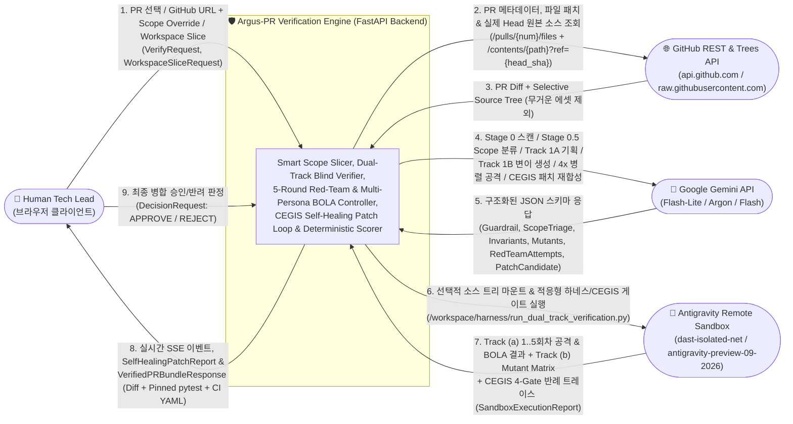
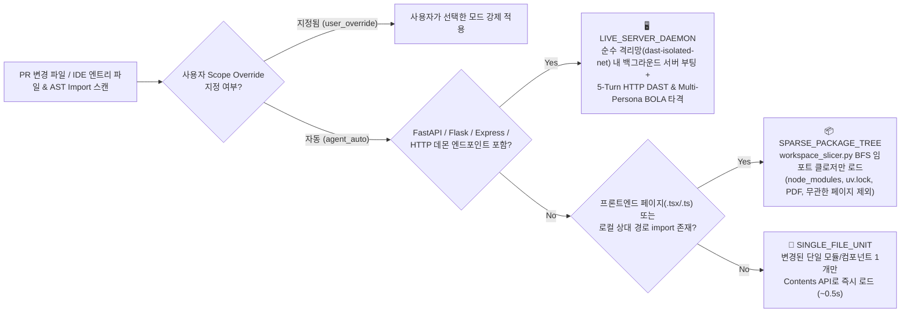
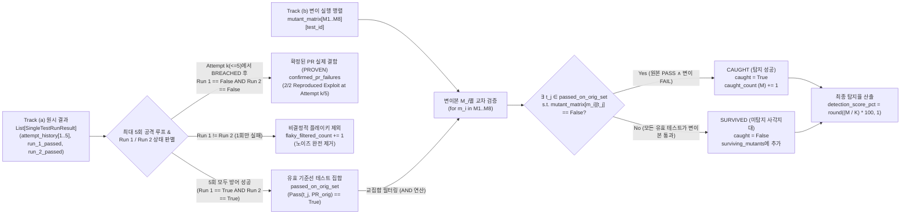

# 02. 데이터 흐름도 (Data Flow Diagram & Information Wall Specification)

> **프로젝트**: Argus-PR — PR 레드팀 스웜 및 블라인드 메타 검증 시스템  
> **기반 문서**: [`docs/00_Implement_plan.md`](file:///c:/Users/ttogl/workspace/google-hack/docs/00_Implement_plan.md), [`backend/gemini_swarm.py`](file:///c:/Users/ttogl/workspace/google-hack/backend/gemini_swarm.py), [`backend/sandbox_runner.py`](file:///c:/Users/ttogl/workspace/google-hack/backend/sandbox_runner.py), [`backend/scoring.py`](file:///c:/Users/ttogl/workspace/google-hack/backend/scoring.py)

---

## 1. 데이터 흐름 설계의 4대 핵심 원칙

Argus-PR의 데이터 아키텍처는 일반 LLM 코드 리뷰 도구의 한계(환각, 자가 채점 편향, 프롬프트 인젝션 취약성, 무거운 전체 레포 클론 오버헤드, 1회성 정적 테스트의 얕은 검증)를 극복하기 위해 다음 **4가지 데이터 격리 및 실행 무결성 규칙**을 엄격히 강제합니다:

1. **Untrusted Input Perimeter & Smart Scope Triage (비신뢰 입력 방어벽 및 스마트 컨텍스트 로더)**
   - 외부에서 유입된 PR Diff, 코드, 주석, 커밋 메시지는 **신뢰할 수 없는 입력(`Untrusted Payload`)**으로 취급하며, 반드시 `gemini-3.5-flash-lite` 기반 **Stage 0 Guardrail**을 통과해 `is_safe == True`로 판정된 경우에만 상위 프론티어 모델(`gemini-4-argon`)로 전달됩니다.
   - 이어서 **Stage 0.5 Scope Triage**가 파일 확장자 및 로컬 `import` 의존성 그래프를 분석하여 불필요한 대용량 에셋(`uv.lock`, `data/manifest.csv`, `docs/*.pdf` 등)을 배제하고 **`SINGLE_FILE_UNIT`**, **`SPARSE_PACKAGE_TREE`**, **`LIVE_SERVER_DAEMON`** 중 최적의 실행 컨텍스트만 샌드박스에 마운트합니다.
2. **Strict Information Wall (`store=False` 블라인드 정보 격리벽)**
   - **Track 1A (`extract_invariants_and_plan`)**와 **Track 1B (`plant_blind_bugs`)**는 완전히 독립된 `gemini-4-argon` API 호출로 실행되며 세션/메모리를 공유하지 않습니다 (`store=False`).
   - Track 1B가 생성한 `BlindMutantSet (M1..M8)` 데이터는 Track 1A나 `gemini-3.8-flash` 공격 스웜(`run_parallel_attacker_swarm`)으로 **절대 흐르지 않으며**, 오직 원격 샌드박스(`Track 3B`)와 결정론적 채점기(`scoring.py`)에만 주입됩니다.
3. **Adaptive Multi-Turn Red-Team Feedback Loop & Multi-Persona BOLA Differential Replay (최대 5회 적응형 공격 루프 및 다중 페르소나 인가 검증)**
   - Track A의 레드팀 에이전트는 정적 테스트를 1회 생성하고 끝나는 것이 아니라, 샌드박스 내 구동 중인 타겟 모듈/서버로부터 **실행 관찰값(`sandbox_observation`: 차단 사유, 정규식 필터 메시지, HTTP 상태 코드, 예외 트레이스)**을 피드백 받아 최대 `max_attempts = 5` 회차까지 페이로드를 변조(`Observe → Mutate → Attack`)합니다.
   - 특히 백엔드 API/상태 검증 시 **3개 샌드박스 페르소나(`Victim: Tenant A`, `Attacker: Tenant B`, `Anonymous`)**를 생성하여 교차 테넌트 리플레이(`Cross-Actor Differential Replay`)를 수행함으로써 정적 분석이 절대 찾지 못하는 BOLA/IDOR(`CWE-639`) 취약점을 적발합니다.
   - 특정 회차 $k \le 5$에서 방어선이 뚫리면(`BREACHED`), 즉시 루프를 조기 종료(Early Exit)하고 해당 익스플로잇 페이로드의 **2회 연속 재현성(2/2 Reproducibility)**을 검증하여 `PROVEN` 등급으로 승격합니다.
4. **Deterministic Metric Authority (결정론적 수치 산출 권한 분리)**
   - LLM은 절대 점수나 탐지율을 계산하지 않습니다. 오직 순수 Python 엔진([`backend/scoring.py`](file:///c:/Users/ttogl/workspace/google-hack/backend/scoring.py))만이 샌드박스 실행 매트릭스(`pr_test_results`, `mutant_matrix`)를 입력받아 $\text{Caught}(m_i) \iff \exists t_j \in T : \text{Pass}(t_j, \text{PR}_{\text{orig}}) \land \text{Fail}(t_j, m_i)$ 수식을 계산하고, 확정된 불변(Immutable) 숫자를 최종 요약기(`synthesize_one_card_summary`)에 전달합니다.
5. **Counterexample-Guided Self-Healing Patch Loop (CEGIS) & Pinned Regression Export (반례 기반 최대 5회 자가 치유 패치 및 회귀 테스트 자산화)**
   - 패치 적용 시(`patch_node` ↔ `patch_verify_node`, `patch_id` 연동), 패치 코드가 **4대 검증 게이트(Gate 1: AST 문법, Gate 2: Semgrep 신규 경고 0건, Gate 3: 고정된 DAST 익스플로잇 차단, Gate 4: 기존 테스트 및 블라인드 변이 탐지율 유지/상승)** 중 하나라도 실패하면, 해당 실패 반례(`FAILED_COUNTEREXAMPLE`)를 `gemini-4-argon` 패치 생성기로 역피드백하여 세션당 최대 5회까지 자가 치유합니다.
   - 검증 완료(`VERIFIED`) 시 2/2 재현되었던 익스플로잇을 영구 `pytest`/`httpx` 회귀 테스트 파일(`tests/security/test_argus_regression_*.py`)로 변환해 패치 Diff 및 CI YAML과 함께 PR 번들로 내보냅니다.

---

## 2. 컨텍스트 다이어그램 (Level 0 DFD)

외부 엔티티(인간 리뷰어, GitHub REST/Contents/Trees API, Google Gemini API, Antigravity Remote Sandbox)와 **Argus-PR 시스템** 간의 최상위 데이터 입출력을 나타냅니다.

---

## 3. 상세 데이터 파이프라인 흐름도 (Level 1 DFD, Scope Triage, Information Wall & CEGIS Loop)

각 프로세스 단계별로 어떤 Pydantic 모델(`backend/models.py`)이 생성되고 어디로 전달되는지, **Smart Scope Triage**, **5회 적응형 레드팀 루프 + Multi-Persona BOLA**, **정보 격리벽(Information Wall)**, 그리고 **CEGIS 자가 치유 패치 루프**가 어떻게 작동하는지 보여줍니다.

```mermaid
flowchart TD
    %% 입력 데이터
    InputPR[/"신뢰할 수 없는 PR 데이터 (Untrusted PR Payload)\n- title, description, diff, head_sha, changed_files"/]

    %% Stage 0
    InputPR --> P0["P0. 프롬프트 인젝션 가드레일\nbackend/gemini_swarm.py::run_prompt_injection_guardrail()\nModel: gemini-3.5-flash-lite (store=False)"]
    P0 -->|"GuardrailResult\n{is_safe, risk_level, detected_threats, latency_ms}"| Gate0{"is_safe == True?"}

    Gate0 -->|"False (BLOCKED)"| EarlyHalt["차단 응답 즉시 생성\nFullVerificationRunResponse (0 tests run)"]

    %% Stage 0.5: Smart Scope Triage
    Gate0 -->|"True (Sanitized PR)"| P0_5["P0.5 스마트 범위 분류 및 정적 임포트 슬라이서\nworkspace_slicer.py::slice_workspace_by_imports()\nAST Import BFS 분석 + gemini-3.5-flash-lite"]
    P0_5 -->|"ScopeTriageResult\n{scope_mode: SINGLE_FILE_UNIT | SPARSE_PACKAGE_TREE | LIVE_SERVER_DAEMON,\nmounted_files, skipped_heavy_paths, estimated_mount_size_kb}"| ContextBundle[("선택적 마운트 코드 번들\n(예: sandbox.py 7.4KB 또는 Page Closure 5 files)")]

    %% Stage 1A & 1B 분리 (Information Wall)
    ContextBundle --> P1A["P1A. 불변성 추출 및 공격 기획\nextract_invariants_and_plan()\nModel: gemini-4-argon (store=False)"]
    ContextBundle --> P1B["P1B. 블라인드 인공 버그 주입\nplant_blind_bugs()\nModel: gemini-4-argon (store=False)"]

    subgraph TrackA_Zone ["🟦 Track A 영역 (적응형 레드팀 공격 & BOLA 매트릭스 — 변이 정답지 접근 불가)"]
        P1A -->|"InvariantExtractionPlan\n{invariants: INV-1..4, attack_plans}"| P2["P2. 병렬 공격자 스웜 & 최대 5회 적응형 변조 + Multi-Persona BOLA\nrun_parallel_attacker_swarm()\nModel: 4x gemini-3.8-flash (max_attempts=5)"]
        P2 -->|"List[AttackerSwarmOutput]\n{attacker_id, tests + attempt_history[1..5] + authz_matrix}"| TestSuite[("최종 익스플로잇 & 검증 스위트 T\n(test_swarm.py + Attempt Trace + BOLA Matrix)")]
    end

    subgraph TrackB_Zone ["🟪 Track B 영역 (블라인드 메타 검증 정답지 — 🔒 SEALED)"]
        P1B -->|"BlindMutantSet\n{mutants: List[PlantedBugMutant] (M1..M8)}"| MutantStore[("비밀 인공 버그 8개\n(M1..M8 mutated_code)")]
    end

    %% Information Wall 표시
    MutantStore x--x|"🚫 STRICT INFORMATION WALL\n(절대 전달 금지 / Zero Shared Context)"| P1A
    MutantStore x--x|"🚫 STRICT INFORMATION WALL\n(절대 전달 금지 / Zero Shared Context)"| P2

    %% Stage 3 Sandbox
    TestSuite --> P3_Harness["P3. 듀얼 트랙 샌드박스 & Live DAST 하네스 빌더\nsandbox_runner.py / live_dast_runner.py"]
    MutantStore --> P3_Harness
    ContextBundle -->|"Mounted Target Module / Server Daemon"| P3_Harness

    P3_Harness -->|"run_dual_track_verification.py"| P3A_3B["P3A & P3B. 원격 격리 샌드박스 실행 (dast-isolated-net)\nagent='antigravity-preview-09-2026' (environment='remote')\n- Track (a): Attempt 1..5 공격 루프 & BOLA 교차 리플레이 + 2x Repro(Run 1, Run 2)\n- Track (b): M1..M8 변이본 8개 대상 실행"]

    P3A_3B -.->|"Attempt k [BLOCKED] 차단 로그 피드백\n(Observe -> Mutate Payload k+1)"| P2

    P3A_3B -->|"SandboxExecutionReport\n{pr_test_results, mutant_matrix, sandbox_stdout_logs}"| P4_Scoring["P4. 결정론적 점수 계산 엔진 (100% Python)\nbackend/scoring.py::compute_deterministic_scores()\n수식: Caught(m_i) ⇔ Pass(PR_orig) ∧ Fail(m_i)"]
    MutantStore -->|"Mutant Metadata (M1..M8)"| P4_Scoring
    TestSuite -->|"Test-to-Attacker Mapping"| P4_Scoring

    %% Stage 5 Synthesis
    P4_Scoring -->|"DeterministicScoreReport\n{confirmed_pr_failures, detection_score_pct,\nmutant_evaluations, surviving_mutants}"| P5_Synth["P5. One-Card 리스크 종합기 & 초기 패치 합성\nsynthesize_one_card_summary()\nModel: gemini-4-argon (store=False)"]
    P1A -->|"InvariantExtractionPlan"| P5_Synth

    P5_Synth -->|"OneCardExecutiveSummary"| FinalOut[/"최종 통합 응답\nFullVerificationRunResponse"/]
    EarlyHalt --> FinalOut

    %% Stage 6: CEGIS Self-Healing Loop & Stage 7: PR Bundle Export
    FinalOut -->|"POST /api/verify/apply-patch"| P6_CEGIS["P6. 반례 기반 자가 치유 패치 루프 (CEGIS, Max 5 Attempts)\npatch_node ↔ patch_verify_node (patch_id 연동)\nGate 1(AST) ∧ Gate 2(Semgrep) ∧ Gate 3(Pinned DAST) ∧ Gate 4(Mutant Kill)"]
    P6_CEGIS -.->|"FAILED_COUNTEREXAMPLE (반례 트레이스 피드백)"| P6_CEGIS
    P6_CEGIS -->|"VERIFIED (SelfHealingPatchReport)"| P7_Export["P7. 영구 회귀 테스트 & PR 번들 익스포터\nPOST /api/prs/export-bundle\nVerifiedPRBundleResponse (Patch Diff + Pinned pytest + CI YAML)"]
```

---

## 4. Stage 0.5 스마트 범위 분류기(Scope Triage) & 적응형 5회 공격 루프 상세 흐름

### 4.1 Smart Scope Triage 결정 트리 (`run_scope_triage_and_load` & `slice_workspace_by_imports`)
전체 Git 저장소를 무조건 클론하거나 무거운 프론트엔드 빌드 서버를 띄울 때 발생하는 병목을 제거하기 위해 다음 결정 트리로 마운트 단위를 결정합니다:

### 4.2 결정론적 채점 엔진(`backend/scoring.py`) 내부 데이터 변환 로직
LLM의 환각을 배제하기 위해 [`compute_deterministic_scores()`](file:///c:/Users/ttogl/workspace/google-hack/backend/scoring.py#L29-L119) 함수가 수행하는 정확한 데이터 필터링 파이프라인입니다.

> [!IMPORTANT]
> **왜 `passed_on_orig_set` 필터링이 필수적인가?**  
> 만약 공격 에이전트가 문법 오류(SyntaxError)나 잘못된 임포트(ImportError)가 있는 테스트 $t_{\text{bad}}$를 생성하면, 이 테스트는 원본 PR 코드에서도 실패(`Fail`)하고 8개 변이본(`M1..M8`)에서도 모두 실패(`Fail`)합니다.  
> 단순 실패 여부만 보면 8개 변이본을 모두 잡은 것(`100%`)처럼 착시 현상이 발생하지만, Argus-PR의 결정론적 엔진은 **`Pass(t_j, PR_orig) == True`인 테스트만 변이 사살 자격(Eligible Killer)을 부여**하므로 가짜 양성(False Positive Kill)을 100% 차단합니다.

---

## 5. 단계별 입출력 데이터 계약 요약표 (Data Contracts by Stage)

| 단계 (Stage) | 처리 모듈 / 함수 | 입력 데이터 (Input Schema) | 출력 데이터 (Output Schema) | 데이터 저장/격리 정책 |
| :--- | :--- | :--- | :--- | :--- |
| **Stage 0: Guardrail** | `gemini_swarm.py` :: `run_prompt_injection_guardrail()` | `pr_data: dict` (`title`, `description`, `diff`, `original_code`) | [`GuardrailResult`](file:///c:/Users/ttogl/workspace/google-hack/backend/models.py#L7-L12) (`is_safe`, `risk_level`, `detected_threats`, `latency_ms`) | `store=False`, 정규식 1차 스캔 + `gemini-3.5-flash-lite` 2차 스캔 |
| **Stage 0.5: Scope Triage & Import Slicer** | `workspace_slicer.py` :: `slice_workspace_by_imports()` | `workspace_files`, `entry_file`, `max_depth`, `scope_override` | `ScopeTriageResult` / [`WorkspaceSliceResult`](file:///c:/Users/ttogl/workspace/google-hack/backend/workspace_slicer.py#L46-L65) (`mounted_files`, `skipped_files`, `dependency_edges`) | 프론트엔드 빌드 서버 없이 로컬 `import` 클로저만 선택 로드 (무거운 lock/PDF 제외) |
| **Stage 1A: Planner** | `gemini_swarm.py` :: `extract_invariants_and_plan()` | 검증된 `pr_data: dict`, `ScopeTriageResult` | [`InvariantExtractionPlan`](file:///c:/Users/ttogl/workspace/google-hack/backend/models.py#L30-L33) (`invariants`, `attack_plans`) | `store=False`, **Track 1B와 컨텍스트 공유 제로** |
| **Stage 1B: Bug Planter** | `gemini_swarm.py` :: `plant_blind_bugs()` | 검증된 `pr_data: dict` | [`BlindMutantSet`](file:///c:/Users/ttogl/workspace/google-hack/backend/models.py#L46-L47) (`mutants`: `M1..M8`) | `store=False`, **Stage 3B 샌드박스 실행 전까지 SEALED 봉인** |
| **Stage 2 & 3A: Adaptive Red-Team Swarm & BOLA Matrix** | `gemini_swarm.py`, `sandbox_runner.py`, `live_dast_runner.py` | `pr_data`, `InvariantExtractionPlan` (**`BlindMutantSet` 제외!**) | `List[AttackerSwarmOutput]` (최대 5회 `attempt_history`, `authz_matrix`, `pytest_code`) | `Observe → Mutate → Attack` 루프 (`max_attempts=5`) + 3-페르소나 BOLA 리플레이, 돌파 시 2x Repro |
| **Stage 3B: Mutant Runner** | `sandbox_runner.py` / `live_dast_runner.py` | `pr_data`, `BlindMutantSet`, `List[AttackerSwarmOutput]` | [`SandboxExecutionReport`](file:///c:/Users/ttogl/workspace/google-hack/backend/models.py#L88-L97) (`pr_test_results`, `mutant_matrix`, `sandbox_stdout_logs`) | 호스트 로컬 실행 금지; 순수 격리망(`dast-isolated-net`) 원격 샌드박스 또는 `Recorded Replay` |
| **Stage 4: Scoring Engine** | `scoring.py` :: `compute_deterministic_scores()` | `swarm_outputs`, `blind_mutants`, `sandbox_report` | [`DeterministicScoreReport`](file:///c:/Users/ttogl/workspace/google-hack/backend/models.py#L100-L111) (`M/K`, `confirmed_pr_failures`, `surviving_mutants`) | **100% 결정론적 Python 연산** (LLM 개입 없음) |
| **Stage 5: Synthesizer** | `gemini_swarm.py` :: `synthesize_one_card_summary()` | `pr_data`, `DeterministicScoreReport`, `InvariantExtractionPlan` | [`OneCardExecutiveSummary`](file:///c:/Users/ttogl/workspace/google-hack/backend/models.py#L114-L120) (`headline_verdict`, `recommended_fix_snippet`) | Python이 확정한 수치만 인용하여 정성적 리스크 및 패치 코드 작성 |
| **Stage 6: CEGIS Self-Healing Patch Loop** | `main.py` :: `POST /api/verify/apply-patch` (`patch_node` ↔ `patch_verify_node`) | `pr_id`, `patch_id`, `max_patch_attempts=5` | `SelfHealingPatchReport` (`attempt_history[1..5]`, `final_status="VERIFIED"`, 4대 게이트 통과 여부) | Sprint 38 `TASK-3802` `patch_id` 연동, 반례(`FAILED_COUNTEREXAMPLE`) 역피드백 자가 치유 |
| **Stage 7: Living Regression & PR Exporter** | `main.py` :: `POST /api/prs/export-bundle` | `pr_id`, `patch_id` | `VerifiedPRBundleResponse` (`verified_patch_diff`, `regression_test_file`, `ci_workflow_snippet`) | 2/2 재현된 `PROVEN` 익스플로잇을 영구 CI 회귀 테스트 스위트로 고정 |

