# 03. 개체-관계 다이어그램 및 데이터 모델 명세 (ERD & Data Schema Specification)

> **프로젝트**: Argus-PR — PR 레드팀 스웜 및 블라인드 메타 검증 시스템  
> **기반 소스**: [`backend/models.py`](file:///c:/Users/ttogl/workspace/google-hack/backend/models.py), [`backend/main.py`](file:///c:/Users/ttogl/workspace/google-hack/backend/main.py), [`crucible-pr-verifier/firebase-blueprint.json`](file:///c:/Users/ttogl/workspace/google-hack/crucible-pr-verifier/firebase-blueprint.json)

---

## 1. 개요 (Overview)

Argus-PR의 데이터 모델은 **Pydantic v2 엄격한 타입 스키마([`backend/models.py`](file:///c:/Users/ttogl/workspace/google-hack/backend/models.py))**를 중심으로 설계되어 있으며:
1. **Stage 0 프롬프트 인젝션 방어벽(`GuardrailResult`)**,
2. **Stage 0.5 스마트 범위 분류 및 선택적 로더(`ScopeTriageResult`)**,
3. **Track 1A 불변성 추출(`InvariantExtractionPlan`) vs Track 1B 블라인드 변이 주입(`BlindMutantSet`)**,
4. **최대 5회 적응형 레드팀 공격 루프 기록(`RedTeamAttemptStep`, `GeneratedTestCase`, `SingleTestRunResult`)**,
5. **결정론적 채점기(`DeterministicScoreReport`) 및 인간 리뷰어 감사 기록(`HUMAN_DECISIONS_STORE`)** 간의 데이터 무결성을 보장합니다.

---

## 2. 전체 도메인 개체-관계 다이어그램 (Entity-Relationship Diagram)

```mermaid
erDiagram
    PULL_REQUEST_BENCHMARK ||--o{ VERIFICATION_RUN : "verified_by"
    PULL_REQUEST_BENCHMARK ||--o{ PR_TRANSLATION_CACHE : "translated_in"

    VERIFICATION_RUN ||--|| GUARDRAIL_RESULT : "stage_0_scan"
    VERIFICATION_RUN ||--|| SCOPE_TRIAGE_RESULT : "stage_0_5_scope"
    VERIFICATION_RUN ||--|| INVARIANT_EXTRACTION_PLAN : "track_1a_plan"
    VERIFICATION_RUN ||--|| BLIND_MUTANT_SET : "track_1b_mutants"
    VERIFICATION_RUN ||--|{ ATTACKER_SWARM_OUTPUT : "stage_2_swarm"
    VERIFICATION_RUN ||--|| SANDBOX_EXECUTION_REPORT : "stage_3_sandbox"
    VERIFICATION_RUN ||--|| DETERMINISTIC_SCORE_REPORT : "stage_4_score"
    VERIFICATION_RUN ||--|| ONE_CARD_EXECUTIVE_SUMMARY : "stage_5_summary"
    VERIFICATION_RUN ||--o{ HUMAN_DECISION_RECORD : "governed_by"

    INVARIANT_EXTRACTION_PLAN ||--|{ INVARIANT_ITEM : "extracts"
    INVARIANT_EXTRACTION_PLAN ||--|{ ATTACK_VECTOR_PLAN : "schedules"

    BLIND_MUTANT_SET ||--|{ PLANTED_BUG_MUTANT : "contains_8_plus"

    ATTACKER_SWARM_OUTPUT ||--|{ GENERATED_TEST_CASE : "generates"
    INVARIANT_ITEM ||--o{ GENERATED_TEST_CASE : "targeted_by"
    GENERATED_TEST_CASE ||--|{ RED_TEAM_ATTEMPT_STEP : "iterates_up_to_5"

    SANDBOX_EXECUTION_REPORT ||--|{ SINGLE_TEST_RUN_RESULT : "records_track_a"
    GENERATED_TEST_CASE ||--|| SINGLE_TEST_RUN_RESULT : "executed_as"

    DETERMINISTIC_SCORE_REPORT ||--|{ MUTANT_KILL_EVALUATION : "evaluates_track_b"
    PLANTED_BUG_MUTANT ||--|| MUTANT_KILL_EVALUATION : "graded_in"

    PULL_REQUEST_BENCHMARK {
        string id PK "e.g., pr-cisco-sandbox-bypass, pr-checkout-race"
        string title "PR 제목"
        string repo_name "저장소 이름 (owner/repo)"
        string author "작성자 (e.g., ai-agent[bot])"
        string description "PR 상세 설명"
        string diff "Unified Git Diff 텍스트"
        string code "검증 대상 Python 모듈/패키지 코드"
        string original_code "패치 전 원본 Python 코드"
        boolean is_adversarial "프롬프트 인젝션 포함 여부"
    }

    VERIFICATION_RUN {
        string run_id PK "e.g., run_8f3a92c1b0e4"
        string pr_id FK "Target PR ID"
        string pr_title "실행 시점 PR 제목"
        string repo_name "저장소 이름"
        string author "PR 작성자"
        string phase_mode "phase1_mvp | phase2_full"
    }

    GUARDRAIL_RESULT {
        string run_id FK "소속 실행 ID"
        boolean is_safe "안전 여부 (False일 경우 즉시 차단)"
        string risk_level "SAFE | SUSPICIOUS | BLOCKED"
        json detected_threats "List[str] 탐지된 인젝션 패턴"
        string sanitized_summary "Flash-Lite 검사 요약"
        int latency_ms "소요 시간 (ms)"
    }

    SCOPE_TRIAGE_RESULT {
        string run_id FK "소속 실행 ID"
        string scope_mode "SINGLE_FILE_UNIT | SPARSE_PACKAGE_TREE | LIVE_SERVER_DAEMON"
        string selection_source "agent_auto | user_override"
        string primary_target_file "핵심 타겟 파일 경로 (e.g. src/.../sandbox.py)"
        json mounted_files "List[str] 샌드박스에 실제 마운트된 파일 목록"
        json skipped_heavy_paths "List[str] 제외된 무거운 에셋 (uv.lock, PDF, CSV 등)"
        float estimated_mount_size_kb "마운트 총 용량 (KB)"
        string rationale "Scope 선정 기술적 근거"
    }

    INVARIANT_EXTRACTION_PLAN {
        string run_id FK "소속 실행 ID"
        string pr_summary "PR 변경 사항 핵심 요약"
    }

    INVARIANT_ITEM {
        string id PK "e.g., INV-1, INV-2, INV-3, INV-4"
        string category "security | edge_cases | state | regression"
        string title "불변성 명칭"
        string formal_assertion "보존되어야 할 형식적 조건/속성"
        string target_function "테스트 대상 함수/메서드명"
    }

    ATTACK_VECTOR_PLAN {
        string attacker_id PK "security | edge_cases | state | regression"
        string attacker_name "공격 에이전트 표시 이름"
        json focus_invariants "List[str] 타겟 불변성 ID 목록"
        string strategy "공격 전략 설명"
    }

    BLIND_MUTANT_SET {
        string run_id FK "소속 실행 ID (Track 1B 격리 생성)"
    }

    PLANTED_BUG_MUTANT {
        string mutant_id PK "e.g., M1 .. M8 (커스텀 추가 시 M9+)"
        string category "security | edge_cases | state | regression"
        string title "인공 버그 요약 제목"
        string description "심어진 버그 상세 설명"
        string diff_snippet "변이 Unified Diff 스니펫"
        string mutated_code "단일 버그가 심어진 전체 Python 코드"
        string severity "CRITICAL | HIGH | MEDIUM"
    }

    ATTACKER_SWARM_OUTPUT {
        string attacker_id PK "security | edge_cases | state | regression"
        string run_id FK "소속 실행 ID"
    }

    GENERATED_TEST_CASE {
        string test_id PK "e.g., test_sec_escaped_quote_pipeline_bypass"
        string attacker_id FK "생성한 공격 에이전트 ID"
        string target_invariant_id FK "검증 대상 불변성 ID (INV-x)"
        string description "테스트 목적 및 시나리오"
        string pytest_code "실행 가능한 def test_...(target_module) 코드"
        int max_attempts "최대 레드팀 시도 횟수 상한 (기본 5)"
        int attempts_used "실제 소요된 공격 시도 횟수 (1..5)"
        int breached_on_attempt "돌파 성공 회차 (방어 성공 시 null)"
    }

    RED_TEAM_ATTEMPT_STEP {
        int attempt_num PK "시도 회차 번호 (1 .. 5)"
        string test_id FK "소속 공격 테스트 ID"
        string attack_hypothesis "이번 회차의 우회 가설 (Observe -> Mutate 추론)"
        string payload_snippet "투입한 공격 페이로드 / 명령어 / 파라미터"
        string sandbox_observation "타겟의 차단 응답 메시지 또는 예외 트레이스"
        string status "BLOCKED | BREACHED | DEFENDED"
    }

    SANDBOX_EXECUTION_REPORT {
        string environment_id PK "샌드박스 컨테이너 환경 ID"
        string sandbox_agent "antigravity-preview-09-2026"
        string execution_mode "antigravity_remote_sandbox | recorded_sandbox_replay"
        string script_command "python /workspace/harness/run_dual_track_verification.py"
        json mutant_matrix "Dict[mutant_id, Dict[test_id, passed_bool]]"
        json sandbox_stdout_logs "List[str] 샌드박스 터미널 표준 출력 로그"
    }

    SINGLE_TEST_RUN_RESULT {
        string test_id PK "실행된 테스트 ID"
        string attacker_id "공격 에이전트 카테고리"
        string target_invariant_id "대상 불변성 ID"
        int max_attempts "최대 공격 상한 (기본 5)"
        int attempts_used "실제 시도 횟수 (1..5)"
        int breached_on_attempt "방어선 돌파 회차 (예: 3)"
        boolean run_1_passed "1차 실행 통과 여부"
        boolean run_2_passed "2차 실행 통과 여부 (2x Repro)"
        boolean reproduced_twice "True iff (!run_1_passed AND !run_2_passed)"
        boolean passed_on_original "True iff (run_1_passed AND run_2_passed)"
        string error_trace "AssertionError 또는 예외 트레이스"
        int duration_ms "실행 시간 (ms)"
    }

    DETERMINISTIC_SCORE_REPORT {
        string run_id FK "소속 실행 ID"
        int total_tests_generated "생성된 총 테스트 수"
        int valid_baseline_tests "원본 PR에서 통과한 유효 테스트 수"
        int confirmed_pr_failures_count "2/2회 재현 확정된 PR 결함 수"
        int flaky_filtered_count "1/2회만 실패하여 제거된 플레이키 테스트 수"
        int planted_bugs_total "K: 심어진 총 인공 버그 수 (기본 8)"
        int planted_bugs_caught "M: 탐지된 인공 버그 수"
        float detection_score_pct "M / K * 100 백분율 점수"
        string detection_score_label "예: 7 of 8 planted bugs caught (87.5%)"
    }

    MUTANT_KILL_EVALUATION {
        string mutant_id PK "e.g., M1 .. M8"
        string title "인공 버그 제목"
        string category "카테고리"
        string severity "심각도"
        boolean caught "True iff ∃ t_j : Pass(PR_orig) ∧ Fail(m_i)"
        json caught_by_test_ids "List[str] 유효하게 변이를 잡은 테스트 ID"
        json caught_by_attackers "List[str] 변이를 잡은 공격 에이전트"
        json raw_failed_test_ids "List[str] 필터링 전 실패한 모든 테스트 ID"
    }

    ONE_CARD_EXECUTIVE_SUMMARY {
        string run_id FK "소속 실행 ID"
        string headline_verdict "REJECT_RECOMMENDED | CAUTION_REVIEW | APPROVE_RECOMMENDED"
        string residual_risk_level "CRITICAL | HIGH | MODERATE | LOW"
        string one_line_takeaway "핵심 한 줄 결론"
        json finding_highlights "List[str] 주요 발견 사항 요약"
        string blind_spot_explanation "생존 변이(Surviving Mutants) 사각지대 원인 분석"
        string recommended_fix_snippet "Argon이 제안하는 보안/상태 패치 코드"
    }

    HUMAN_DECISION_RECORD {
        string id PK "e.g., dec_9a1b2c3d"
        string run_id FK "검증 실행 ID"
        string pr_id FK "대상 PR ID"
        string decision "APPROVE_MERGE | REJECT_MERGE"
        string reviewer "리뷰어 식별자 (e.g., Human Tech Lead)"
        string reviewer_notes "리뷰어 코멘트 및 반려/승인 사유"
        datetime recorded_at "UTC ISO-8601 기록 시각"
    }

    PR_TRANSLATION_CACHE {
        string translationId PK "Firestore Document ID"
        string prId FK "대상 PR ID"
        string lang "ko | en"
        string prTitle "번역된 PR 제목"
        string executiveSummary "번역된 요약문"
        string ownerId "저장한 사용자 UID"
        datetime createdAt "생성 시각"
        datetime updatedAt "수정 시각"
    }
```



---

## 3. 핵심 엔티티 상세 명세 (Core Data Dictionary)

### 3.1 `GuardrailResult` & `ScopeTriageResult` (Stage 0 보안 검문 및 Stage 0.5 스마트 범위 분류 스키마)
신뢰할 수 없는 PR 입력이 프론티어 모델(`gemini-4-argon`)로 전달되기 전에 `gemini-3.5-flash-lite`가 반환하는 보안 검문 스키마(`GuardrailResult`)와, GitHub 저장소에서 어떤 파일 범위를 샌드박스에 마운트할지 결정하는 `ScopeTriageResult` 스키마입니다.

| 모델 | 필드명 | 타입 | 필수 | 설명 |
| :--- | :--- | :--- | :---: | :--- |
| **`GuardrailResult`** | `is_safe` | `bool` | Y | 프롬프트 인젝션이나 명령어 무력화 시도가 없으면 `True`, 탐지되면 `False` |
| | `risk_level` | `Literal["SAFE", "SUSPICIOUS", "BLOCKED"]` | Y | 신뢰할 수 없는 PR 페이로드의 위험도 분류 |
| | `detected_threats` | `List[str]` | N | 탐지된 악성 문자열 또는 정규식/시그니처 목록 |
| | `sanitized_summary` | `str` | Y | `gemini-3.5-flash-lite`가 생성한 보안 스캔 요약 |
| | `latency_ms` | `int` | N | 가드레일 검사 소요 시간 (밀리초) |
| **`ScopeTriageResult`** | `scope_mode` | `Literal["SINGLE_FILE_UNIT", "SPARSE_PACKAGE_TREE", "LIVE_SERVER_DAEMON"]` | Y | 단일 모듈 실행, 선택적 패키지 트리 마운트, 샌드박스 내 서버 데몬 구동 중 결정된 실행 모드 |
| | `selection_source` | `Literal["agent_auto", "user_override"]` | Y | 에이전트 자동 분류인지 사용자가 UI에서 강제 지정했는지 여부 |
| | `primary_target_file` | `str` | Y | 핵심 검증 대상 파일 경로 (예: `src/vulnerability_localization_benchmark/sandbox.py`) |
| | `mounted_files` | `List[str]` | N | 샌드박스 `/workspace`에 실제 마운트된 파일 목록 |
| | `skipped_heavy_paths` | `List[str]` | N | 클론 병목 방지를 위해 제외된 대용량 파일 목록 (예: `uv.lock (1.0MB)`, `data/manifest.csv (1.1MB)`, `docs/*.pdf`) |
| | `estimated_mount_size_kb` | `float` | N | 샌드박스에 마운트된 소스 코드 총 크기 (KB, 예: `7.4` 또는 `23.2`) |
| | `rationale` | `str` | Y | 해당 Scope 모드를 선택한 AST/의존성 분석 근거 |

---

### 3.2 `RedTeamAttemptStep` & `GeneratedTestCase` (최대 5회 적응형 레드팀 공격 루프 모델)
단발성 테스트 생성이 아니라, 샌드박스 내 타겟의 방어 로직을 최대 5회(`max_attempts = 5`)까지 공략하며 변조(`Mutate`)한 과정을 기록하는 스키마입니다.

| 모델 | 필드명 | 타입 | 설명 |
| :--- | :--- | :--- | :--- |
| **`RedTeamAttemptStep`** | `attempt_num` | `int` | 시도 회차 (`1` ~ `5`) |
| | `attack_hypothesis` | `str` | 직전 차단 로그를 관찰한 뒤 수립한 이번 회차의 우회 가설 |
| | `payload_snippet` | `str` | 타겟 함수 또는 서버 엔드포인트에 투입한 실제 공격 입력/명령어 |
| | `sandbox_observation` | `str` | 샌드박스 내 타겟의 실제 응답, 차단 메시지, 또는 예외 트레이스 |
| | `status` | `Literal["BLOCKED", "BREACHED", "DEFENDED"]` | 타겟에 의해 막혔으면 `BLOCKED`, 방어선 돌파에 성공했으면 `BREACHED` |
| **`GeneratedTestCase`** | `test_id` | `str` | 고유 테스트 함수명 (예: `test_sec_escaped_quote_pipeline_bypass`) |
| | `max_attempts` | `int` | 레드팀 반복 공격 상한선 (기본값: `5`) |
| | `attempts_used` | `int` | 실제 수행한 공격 라운드 수 (`1` ~ `5`, 돌파 성공 시 조기 종료) |
| | `breached_on_attempt` | `Optional[int]` | 몇 번째 시도에서 뚫렸는지 기록 (예: `3` = 3/5 회차 돌파, 방어 성공 시 `None`) |
| | `attempt_history` | `List[RedTeamAttemptStep]` | 라운드 1부터 $k$까지의 단계별 `Observe → Mutate → Attack` 기록 |

#### 예시: Cisco `sandbox.py` (PR #3) 대상 `attempt_history` JSON 구조
```json
{
  "test_id": "test_sec_escaped_quote_pipeline_bypass",
  "attacker_id": "security",
  "target_invariant_id": "INV-1",
  "max_attempts": 5,
  "attempts_used": 3,
  "breached_on_attempt": 3,
  "attempt_history": [
    {
      "attempt_num": 1,
      "attack_hypothesis": "기본 파이프(|) 체이닝으로 비허용 명령어(rm) 실행 시도",
      "payload_snippet": "validate_command('ls | rm -rf /')",
      "sandbox_observation": "(False, \"Command 'rm' is not in ALLOWED_CMDS\")",
      "status": "BLOCKED"
    },
    {
      "attempt_num": 2,
      "attack_hypothesis": "논리 AND(&&) 연산자로 파이프 스플리터 우회 시도",
      "payload_snippet": "validate_command('ls && rm -rf /')",
      "sandbox_observation": "(False, \"Command contains denied pattern: &&\")",
      "status": "BLOCKED"
    },
    {
      "attempt_num": 3,
      "attack_hypothesis": "따옴표 밖에서 백슬래시 이스케이프 따옴표(\\\")를 주입해 _split_pipeline 상태머신 교란",
      "payload_snippet": "validate_command('ls \\\" | rm -rf /\"')",
      "sandbox_observation": "(True, 'ok') — BREACHED! _split_pipeline treated '| rm -rf /' as quoted arg while bash executes pipeline!",
      "status": "BREACHED"
    }
  ]
}
```

---

### 3.3 `PlantedBugMutant` & `MutantKillEvaluation` (Track 1B & Track 3B 변이 검증 모델)
Track 1B에서 격리 생성된 인공 버그(`PlantedBugMutant`)와 Track 3B 샌드박스 실행 후 `scoring.py`가 판정한 결과(`MutantKillEvaluation`)의 스키마입니다.

| 모델 | 필드명 | 타입 | 설명 |
| :--- | :--- | :--- | :--- |
| **`PlantedBugMutant`** | `mutant_id` | `str` | 변이 고유 식별자 (`M1` ~ `M8`, 사용자 추가 시 `M9` 등) |
| | `category` | `Literal["security", "edge_cases", "state", "regression"]` | 변이가 속한 취약점/결함 도메인 |
| | `title` | `str` | 심어진 인공 버그의 짧은 제목 |
| | `diff_snippet` | `str` | 원본 코드 대비 변경된 Unified Diff 스니펫 |
| | `mutated_code` | `str` | 샌드박스에서 개별 모듈(`mutant_M1.py` 등)로 로드될 전체 Python 소스 코드 |
| **`MutantKillEvaluation`** | `caught` | `bool` | **결정론적 판정 결과**: $\exists t_j \in T : \text{Pass}(t_j, \text{PR}_{\text{orig}}) \land \text{Fail}(t_j, m_i)$ 충족 시에만 `True` |
| | `caught_by_test_ids` | `List[str]` | 원본에서는 통과(`PASS`)하고 이 변이본에서만 실패(`FAIL`)한 유효 테스트 ID 목록 |
| | `caught_by_attackers` | `List[str]` | 해당 변이를 잡아낸 공격 에이전트 ID 목록 |
| | `raw_failed_test_ids` | `List[str]` | 원본 통과 여부와 무관하게 이 변이본에서 실패한 모든 원시 테스트 ID 목록 (비교/감사용) |

---

### 3.4 `SandboxExecutionReport` & `mutant_matrix` 구조
[`SandboxExecutionReport`](file:///c:/Users/ttogl/workspace/google-hack/backend/models.py#L88-L97) 내부의 `mutant_matrix`는 2차원 중첩 딕셔너리(`Dict[str, Dict[str, bool]]`)로, 각 변이본(`M1..M8`)에 대해 각 테스트(`test_id`)의 통과 여부(`True`=통과/생존, `False`=실패/사살 후보)를 저장합니다.

```json
{
  "M1": {
    "test_sec_negative_refund_wallet_inflation": false,
    "test_sec_unauthorized_caller_spoofing": false,
    "test_edge_zero_cent_boundary": true
  },
  "M8": {
    "test_sec_negative_refund_wallet_inflation": true,
    "test_sec_unauthorized_caller_spoofing": true,
    "test_edge_zero_cent_boundary": true
  }
}
```
- 위 예시에서 `test_edge_zero_cent_boundary`가 원본 PR에서 `PASS`(`passed_on_original == True`)했고 `test_sec_negative_refund_wallet_inflation`은 원본 PR의 실제 버그 때문에 원본에서도 `FAIL`(`passed_on_original == False`)했다면:
  - `M1`에서 `test_sec_unauthorized_caller_spoofing`이 원본 `PASS` + `M1` `FAIL`(`false`)이므로 `M1`은 **`CAUGHT`**로 판정됩니다.
  - `M8`은 모든 유효 테스트가 `true`(통과)했으므로 **`SURVIVED` (미탐지 사각지대)**로 분류됩니다.
