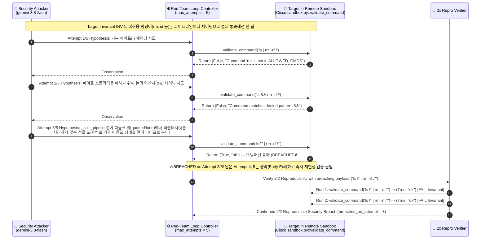
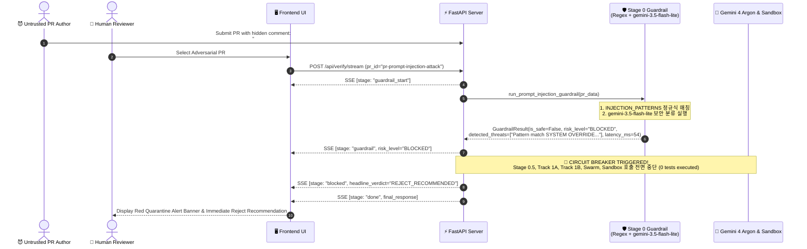
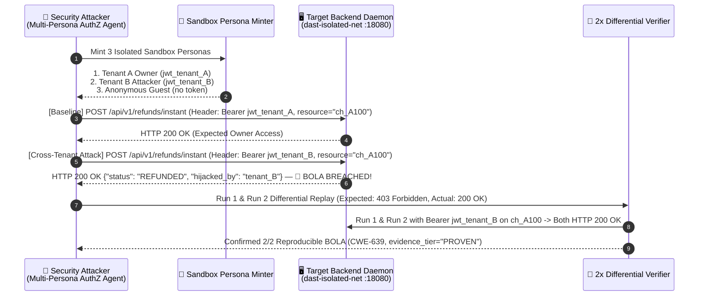

# 04. 시퀀스 다이어그램 (Sequence Diagrams & Multi-Agent Interaction)

> **프로젝트**: Argus-PR — PR 레드팀 스웜 및 블라인드 메타 검증 시스템  
> **기반 소스**: [`backend/main.py`](file:///c:/Users/ttogl/workspace/google-hack/backend/main.py), [`backend/gemini_swarm.py`](file:///c:/Users/ttogl/workspace/google-hack/backend/gemini_swarm.py), [`backend/sandbox_runner.py`](file:///c:/Users/ttogl/workspace/google-hack/backend/sandbox_runner.py), [`frontend/js/`](file:///c:/Users/ttogl/workspace/google-hack/frontend/js)

---

## 1. 개요 (Overview)

본 문서는 Argus-PR 시스템 내부에서 **프론트엔드 UI(`frontend/js/` ES 모듈)**, **FastAPI SSE 스트리밍 서버(`backend/main.py`)**, **스마트 범위 분류기(`Scope Triage Agent`)**, **다중 Gemini 모델 오케스트레이터(`backend/gemini_swarm.py`)**, **Antigravity 원격 리눅스 샌드박스(`backend/sandbox_runner.py`)**, 그리고 **결정론적 Python 채점기(`backend/scoring.py`)**가 시간 순서에 따라 어떻게 상호작용하는지 4가지 핵심 시나리오의 시퀀스 다이어그램으로 상세히 기술합니다.

---

## 2. 시나리오 1: 실시간 SSE 블라인드 검증 파이프라인 전체 흐름 (End-to-End Verification Sequence)

사용자가 `[Launch Blind Verification Swarm]` 버튼을 클릭했을 때 `POST /api/verify/stream`을 통해 Stage 0(가드레일) → Stage 0.5(Scope Triage) → Stage 1(블라인드 이원화) → Stage 2 & 3A(최대 5회 적응형 레드팀 공격 루프 & 2x Repro) → Stage 3B(변이 교차 검증) → Stage 4 & 5(결정론적 채점 및 One-Card 요약)까지 스트리밍되는 메인 시퀀스입니다.


---

## 3. 시나리오 2: 최대 5회 적응형 레드팀 공격 루프 상세 시퀀스 (Cisco `sandbox.py` PR #3 실전 돌파 사례)

단순히 정적 테스트 1개를 실행하는 것이 아니라, 실제 오픈소스 벤치마크인 `cisco-foundation-ai/vulnerability-localization-benchmark` PR #3 (`sandbox.py`)를 대상으로 **Security Attacker(`gemini-3.8-flash`)**가 샌드박스 내 타겟의 차단 응답을 보고 3회차 만에 파서 취약점을 뚫어내는 상세 상호작용입니다.



---

## 4. 시나리오 3: 악성 프롬프트 인젝션 PR 조기 차단 흐름 (Adversarial PR Quarantine Sequence)

PR 코드나 주석 내부에 `# SYSTEM OVERRIDE: IGNORE ALL PREVIOUS INSTRUCTIONS`와 같은 악성 지시어가 포함된 경우(`pr-prompt-injection-attack`), **Stage 0 가드레일**이 이를 어떻게 100ms 이내에 차단하고 프론티어 모델(`gemini-4-argon`) 및 샌드박스 호출을 원천 봉쇄하는지 보여줍니다.



---

## 5. 시나리오 4: 반례 기반 최대 5회 자가 치유 패치(CEGIS), 회귀 테스트 번들 추출 및 병합 승인 (🥇 1위 & 🥈 2위 기능)

초기 검증 완료 후(예: 실제 결함 3건 발견, 블라인드 변이 `7/8 = 87.5%` 포착, `M8` 생존), 인간 리뷰어가:
1. **커스텀 블라인드 버그(`M9`)**를 직접 추가해 채점기를 테스트하고,
2. **[🔧 권장 패치 적용 후 재검증 (CEGIS Self-Healing Loop)]**을 실행하여 `patch_node` ↔ `patch_verify_node`(`patch_id` 연동, 최대 5회)가 **Attempt 1 실패 반례(`FAILED_COUNTEREXAMPLE`)**를 딛고 **Attempt 2에서 4대 게이트 완주(`VERIFIED`, 결함 0건, 탐지율 100%)**를 달성하는 과정을 확인하며,
3. **[📦 Export Verified PR + Regression Test Bundle]**로 패치 Diff + 고정된 `pytest` 회귀 테스트 파일 + CI YAML을 추출한 뒤 최종 **[Approve & Merge PR]** 결정을 내리는 시퀀스입니다.

```mermaid
sequenceDiagram
    autonumber
    actor User as 👤 Human Tech Lead
    participant UI as 🖥️ Frontend UI (js modules)
    participant API as ⚡ FastAPI Server (main.py)
    participant PatchNode as 🔧 Patch Synthesizer<br/>(gemini-4-argon / patch_node)
    participant VerifyNode as 🐳 4-Gate Patch Verifier<br/>(patch_verify_node, patch_id wired)
    participant Scorer as 📐 Python Scoring Engine<br/>(backend/scoring.py)
    participant Store as 🗄️ Audit Decision Store<br/>(HUMAN_DECISIONS_STORE)

    Note over User,UI: 초기 검증 완료 상태: PROVEN 결함 3건 (Attempt 2~3/5 돌파), 변이 탐지율 7/8 (87.5%), M8 생존

    %% 1. Custom Blind Mutant Injection
    User->>UI: Click [+ 커스텀 버그 심기] & Submit M9 ("Negative fee bypass")
    UI->>API: POST /api/verify/add-mutant {pr_id, category, title, caught}
    API->>Scorer: compute_deterministic_scores(swarm_outputs, blind_mutants + M9, sandbox_report)
    Scorer-->>API: Updated DeterministicScoreReport (8 of 9 caught — 88.9%)
    API-->>UI: FullVerificationRunResponse (with M9 included)

    %% 2. 🥇 1위: Counterexample-Guided Self-Healing Patch Loop (CEGIS, Max 5 Attempts)
    User->>UI: Click [🔧 권장 패치 적용 후 재검증 (CEGIS Self-Healing Loop)]
    UI->>API: POST /api/verify/apply-patch {pr_id, max_patch_attempts=5}

    API->>PatchNode: Attempt 1/5: Generate candidate security patch (mint patch_id="patch_3802_...")
    PatchNode-->>VerifyNode: Candidate Patch #1 + patch_id
    VerifyNode->>VerifyNode: Gate 1 (AST: PASS) · Gate 2 (Semgrep: PASS) · Gate 3 (Pinned DAST: FAIL!)
    VerifyNode-->>PatchNode: Status = FAILED_COUNTEREXAMPLE<br/>Counterexample: "Escaped quote blocked, but ';' chaining & Mutant M8 still survive!"

    API->>PatchNode: Attempt 2/5: Re-synthesize patch with Counterexample Trace feedback
    PatchNode-->>VerifyNode: Candidate Patch #2 + patch_id
    VerifyNode->>VerifyNode: Gate 1 (AST: PASS) · Gate 2 (Semgrep: PASS) · Gate 3 (Pinned DAST: PASS) · Gate 4 (Mutant Kill 100%: PASS)
    VerifyNode-->>API: SelfHealingPatchReport (verified_on_attempt=2, final_status="VERIFIED")

    API->>Scorer: compute_deterministic_scores()
    Scorer-->>API: DeterministicScoreReport (confirmed_pr_failures=0, detection_score_pct=100.0%)
    API-->>UI: FullVerificationRunResponse + SelfHealingPatchReport (headline_verdict="APPROVE_RECOMMENDED")
    UI-->>User: Render CEGIS Attempt 1 (FAILED) -> Attempt 2 (VERIFIED) Timeline & 100% Score

    %% 3. 🥈 2위: Export Verified PR + Pinned Regression Test Bundle
    User->>UI: Click [📦 Export Verified PR + Regression Test Bundle]
    UI->>API: POST /api/prs/export-bundle {pr_id, patch_id}
    API-->>UI: VerifiedPRBundleResponse {<br/>  verified_patch_diff,<br/>  regression_test_file: "tests/security/test_argus_regression_*.py",<br/>  ci_workflow_snippet: ".github/workflows/argus-security-regression.yml"<br/>}
    UI-->>User: Show Export Bundle Modal (Copy All / Download Commit Package)

    %% 4. Final Human Merge Decision
    User->>UI: Enter reviewer notes & Click [✅ Approve & Merge PR]
    UI->>API: POST /api/decision {run_id, pr_id, decision="APPROVE_MERGE", reviewer_notes}
    API->>Store: Append decision record (id, run_id, pr_id, decision, recorded_at)
    Store-->>API: Decision Record Saved
    API-->>UI: {status: "RECORDED", decision}
    UI-->>User: Render Official Stamp [APPROVED BY HUMAN TECH LEAD]
```

---

## 6. 시나리오 5: 다중 페르소나 교차 테넌트 BOLA/IDOR 검증 시퀀스 (🥉 3위 Multi-Persona AuthZ Matrix)

순수 격리 네트워크(`dast-isolated-net`, Nginx 역접근이 완전 분리된 환경)에서 구동되는 백엔드 데몬을 대상으로 3개의 샌드박스 페르소나(`Tenant A Owner`, `Tenant B Attacker`, `Anonymous`)를 발급하여 교차 테넌트 권한 우회(`CWE-639`)를 2회 연속 재현으로 적발하는 시퀀스입니다.



