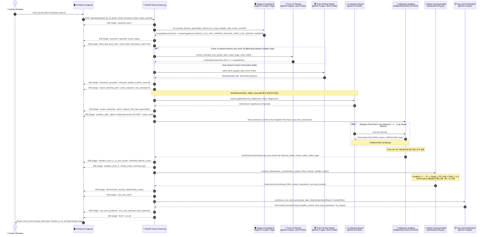
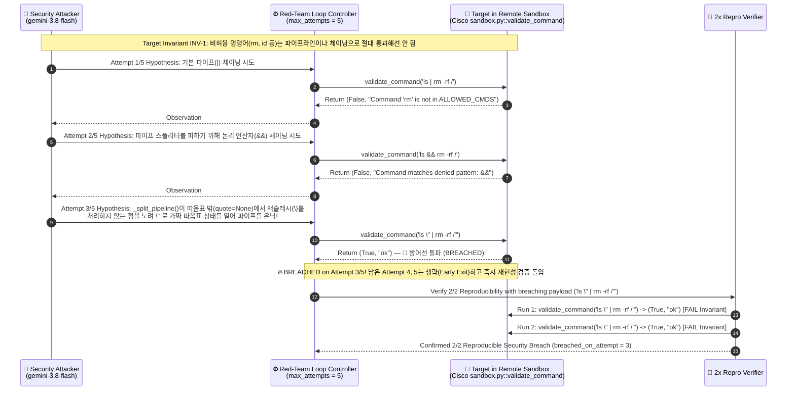
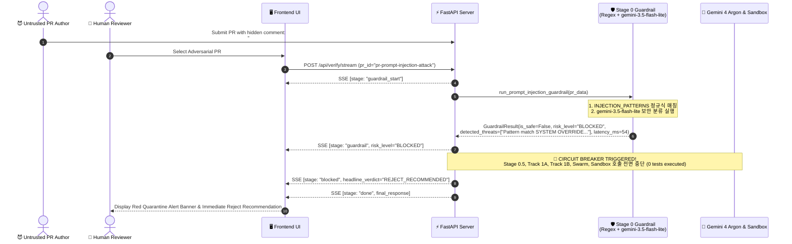
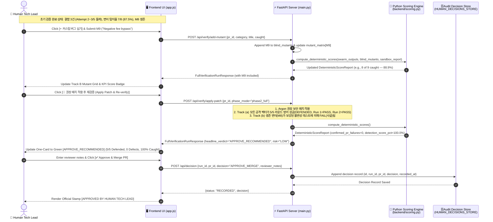

# 04. 시퀀스 다이어그램 (Sequence Diagrams & Multi-Agent Interaction)

> **프로젝트**: Argus-PR — PR 레드팀 스웜 및 블라인드 메타 검증 시스템  
> **기반 소스**: [`backend/main.py`](file:///c:/Users/ttogl/workspace/google-hack/backend/main.py), [`backend/gemini_swarm.py`](file:///c:/Users/ttogl/workspace/google-hack/backend/gemini_swarm.py), [`backend/sandbox_runner.py`](file:///c:/Users/ttogl/workspace/google-hack/backend/sandbox_runner.py), [`frontend/app.js`](file:///c:/Users/ttogl/workspace/google-hack/frontend/app.js)

---

## 1. 개요 (Overview)

본 문서는 Argus-PR 시스템 내부에서 **프론트엔드 UI(`frontend/app.js`)**, **FastAPI SSE 스트리밍 서버(`backend/main.py`)**, **스마트 범위 분류기(`Scope Triage Agent`)**, **다중 Gemini 모델 오케스트레이터(`backend/gemini_swarm.py`)**, **Antigravity 원격 리눅스 샌드박스(`backend/sandbox_runner.py`)**, 그리고 **결정론적 Python 채점기(`backend/scoring.py`)**가 시간 순서에 따라 어떻게 상호작용하는지 4가지 핵심 시나리오의 시퀀스 다이어그램으로 상세히 기술합니다.

---

## 2. 시나리오 1: 실시간 SSE 블라인드 검증 파이프라인 전체 흐름 (End-to-End Verification Sequence)

사용자가 `[Launch Blind Verification Swarm]` 버튼을 클릭했을 때 `POST /api/verify/stream`을 통해 Stage 0(가드레일) → Stage 0.5(Scope Triage) → Stage 1(블라인드 이원화) → Stage 2 & 3A(최대 5회 적응형 레드팀 공격 루프 & 2x Repro) → Stage 3B(변이 교차 검증) → Stage 4 & 5(결정론적 채점 및 One-Card 요약)까지 스트리밍되는 메인 시퀀스입니다.

---

## 3. 시나리오 2: 최대 5회 적응형 레드팀 공격 루프 상세 시퀀스 (Cisco `sandbox.py` PR #3 실전 돌파 사례)

단순히 정적 테스트 1개를 실행하는 것이 아니라, 실제 오픈소스 벤치마크인 `cisco-foundation-ai/vulnerability-localization-benchmark` PR #3 (`sandbox.py`)를 대상으로 **Security Attacker(`gemini-3.8-flash`)**가 샌드박스 내 타겟의 차단 응답을 보고 3회차 만에 파서 취약점을 뚫어내는 상세 상호작용입니다.

---

## 4. 시나리오 3: 악성 프롬프트 인젝션 PR 조기 차단 흐름 (Adversarial PR Quarantine Sequence)

PR 코드나 주석 내부에 `# SYSTEM OVERRIDE: IGNORE ALL PREVIOUS INSTRUCTIONS`와 같은 악성 지시어가 포함된 경우(`pr-prompt-injection-attack`), **Stage 0 가드레일**이 이를 어떻게 100ms 이내에 차단하고 프론티어 모델(`gemini-4-argon`) 및 샌드박스 호출을 원천 봉쇄하는지 보여줍니다.

---

## 5. 시나리오 4: 인터랙티브 사각지대 캘리브레이션, 자동 패치 재검증 및 병합 승인 (Interactive Calibration, Patch & Merge Gate)

초기 검증 완료 후(예: 실제 결함 3건 발견, 블라인드 변이 `7/8 = 87.5%` 포착, `M8` 생존), 인간 리뷰어가:
1. **커스텀 블라인드 버그(`M9`)**를 직접 추가해 채점기를 테스트하고,
2. **[권장 패치 적용 후 재검증]**을 실행하여 5회 공격 루프 방어(`5/5 Defended, 0건 결함`) 및 변이 탐지율 `100%`를 확인한 뒤,
3. 최종 **[Approve & Merge PR]** 결정을 내리는 시퀀스입니다.

