# 05. API 및 SSE 스트리밍 명세서 (API & Server-Sent Events Specification)

> **프로젝트**: Argus-PR — PR 레드팀 스웜 및 블라인드 메타 검증 시스템  
> **기반 소스**: [`backend/main.py`](file:///c:/Users/ttogl/workspace/google-hack/backend/main.py), [`backend/models.py`](file:///c:/Users/ttogl/workspace/google-hack/backend/models.py)

---

## 1. API 엔드포인트 요약 (REST API Overview)

FastAPI 서버([`backend/main.py`](file:///c:/Users/ttogl/workspace/google-hack/backend/main.py))는 정적 프론트엔드 서빙(`/`)과 함께 총 **14개의 REST/SSE 엔드포인트**를 제공합니다.

| Method | Path | 기능 요약 | 주요 요청/쿼리 파라미터 | 응답 스키마 |
| :---: | :--- | :--- | :--- | :--- |
| `GET` | `/api/health` | 서버 상태 및 `GEMINI_API_KEY` 설정 여부 확인 | 없음 | `{status, service, gemini_api_configured, time}` |
| `GET` | `/api/prs` | 사전 구축된 벤치마크 PR 시나리오 목록 조회 (Cisco 벤치마크 포함) | 없음 | `List[PRMetadata]` |
| `GET` | `/api/prs/{pr_id}` | 특정 PR의 상세 Diff, 코드, Scope Triage 정보 조회 | `pr_id` (Path) | `PRDetailObject` |
| `GET` | `/api/github/pr` | 실제 공개 GitHub PR 실시간 가져오기, **원본 코드 선택 로드(Scope Triage)** 및 Stage 0 스캔 | `url` 또는 `repo` + `prNumber`, `scope_override` (Query) | `{status: "IMPORTED", pr: {...}, scope_triage: {...}}` |
| `POST` | `/api/prs/custom` | 사용자 커스텀 PR Diff/코드 등록 및 Stage 0 + Scope Triage 스캔 | [`CustomPRRequest`](file:///c:/Users/ttogl/workspace/google-hack/backend/main.py#L101-L107) | `{status: "CREATED", pr: {...}}` |
| `POST` | `/api/workspace/slice` | **IDE/레포 엔트리 페이지 정적 Import Graph 슬라이서 (`SPARSE_PACKAGE_TREE`)** | [`WorkspaceSliceRequest`](file:///c:/Users/ttogl/workspace/google-hack/backend/main.py#L123-L133) | `{status: "SLICED", slice_result: WorkspaceSliceResult}` |
| `POST` | `/api/verify/live-dast` | **백엔드 데몬 부팅 + 실시간 HTTP DAST (5-Attempt & BOLA) + 8 서버 변이체 검증** | [`LiveDastVerifyRequest`](file:///c:/Users/ttogl/workspace/google-hack/backend/main.py#L136-L141) | [`LiveServerDastReport`](file:///c:/Users/ttogl/workspace/google-hack/backend/live_dast_runner.py#L82-L100) |
| `POST` | `/api/verify/stream` | **실시간 SSE 스트리밍 블라인드 검증 & 5회 적응형 레드팀 루프 실행** | [`VerifyRequest`](file:///c:/Users/ttogl/workspace/google-hack/backend/main.py#L79-L90) | `text/event-stream` (SSE 이벤트 시퀀스) |
| `POST` | `/api/verify` | 동기식(Synchronous) 전체 블라인드 검증 실행 | [`VerifyRequest`](file:///c:/Users/ttogl/workspace/google-hack/backend/main.py#L79-L90) | [`FullVerificationRunResponse`](file:///c:/Users/ttogl/workspace/google-hack/backend/models.py#L123-L136) |
| `POST` | `/api/verify/apply-patch` | **🥇 1위: 반례 기반 최대 5회 자가 치유 패치 루프 (`CEGIS`, `patch_id` 연동)** | [`ApplyPatchRequest`](file:///c:/Users/ttogl/workspace/google-hack/backend/main.py#L110-L112) | `FullVerificationRunResponse` (with `self_healing_report`) |
| `POST` | `/api/prs/export-bundle` | **🥈 2위: 검증 완료된 패치 Diff + 고정된 `pytest` 회귀 테스트 파일 + CI YAML 번들 추출** | `ExportBundleRequest` (`pr_id`, `patch_id`) | `VerifiedPRBundleResponse` |
| `POST` | `/api/verify/add-mutant` | 커스텀 블라인드 변이 버그(`M9` 등) 추가 및 $M/K$ 점수 재계산 | [`AddMutantRequest`](file:///c:/Users/ttogl/workspace/google-hack/backend/main.py#L115-L120) | [`FullVerificationRunResponse`](file:///c:/Users/ttogl/workspace/google-hack/backend/models.py#L123-L136) |
| `POST` | `/api/decision` | 인간 리뷰어의 최종 병합 승인/반려(`APPROVE_MERGE` / `REJECT_MERGE`) 기록 | [`DecisionRequest`](file:///c:/Users/ttogl/workspace/google-hack/backend/main.py#L93-L98) | `{status: "RECORDED", decision: {...}}` |
| `GET` | `/api/decisions` | 기록된 인간 리뷰어 의사결정 감사 로그 전체 조회 | 없음 | `List[DecisionRecord]` |

---

## 2. 주요 엔드포인트 상세 명세

### 2.1 실시간 블라인드 검증 스트리밍: `POST /api/verify/stream`
- **Content-Type**: `application/json` (Request) → `text/event-stream` (Response)
- **Request Body (`VerifyRequest`)**:
```json
{
  "pr_id": "pr-cisco-sandbox-bypass",
  "phase_mode": "phase2_full",
  "execution_mode": "replay",
  "scope_override": "auto",
  "max_redteam_attempts": 5,
  "custom_diff": null,
  "custom_code": null
}
```
  - `phase_mode`: `"phase1_mvp"` (3개 공격 에이전트, 1회 실행) 또는 `"phase2_full"` (4개 공격 에이전트 + **🥉 3위 Multi-Persona BOLA Matrix**, 최대 5회 적응형 레드팀 루프 + 2회 연속 재현 확인)
  - `execution_mode`: `"replay"` (사전 검증된 샌드박스 실행 로그 즉시 재생) 또는 `"live_api"` (실시간 Gemini & Antigravity API 호출)
  - `scope_override`: `"auto"` (Triage Agent 자동 판단), `"single_file"` (`SINGLE_FILE_UNIT`), `"sparse_package"` (`SPARSE_PACKAGE_TREE`), `"server_daemon"` (`LIVE_SERVER_DAEMON`)
  - `max_redteam_attempts`: 레드팀 에이전트가 방어선 돌파를 시도할 최대 라운드 상한 (기본값 `5`)

---

### 2.2 실제 GitHub PR 불러오기 & 워크스페이스 임포트 슬라이서: `GET /api/github/pr` & `POST /api/workspace/slice`
- **`GET /api/github/pr` Query Parameters**:
  - `url`: 예: `https://github.com/cisco-foundation-ai/vulnerability-localization-benchmark/pull/3` 또는 단축 표기 `cisco-foundation-ai/vulnerability-localization-benchmark#3`
  - `scope_override`: `"auto"` (기본값) | `"single_file"` | `"sparse_package"` | `"server_daemon"`
- **`POST /api/workspace/slice` Request Body (`WorkspaceSliceRequest`)**:
```json
{
  "entry_file": "src/pages/RefundCheckoutPage.tsx",
  "max_depth": 3,
  "repo_name": "acme-pay/fullstack-workspace",
  "register_as_pr": true
}
```
- **동작 방식**:
  1. 프론트엔드 빌드 서버를 띄우지 않고도 엔트리 페이지(`RefundCheckoutPage.tsx`)에서 로컬 `import` 그래프만 BFS로 추적하여 실제로 연결된 하위 컴포넌트/유틸/API 클라이언트 파일만 `SPARSE_PACKAGE_TREE`로 슬라이싱합니다([`backend/workspace_slicer.py`](file:///c:/Users/ttogl/workspace/google-hack/backend/workspace_slicer.py)).
  2. 백엔드 라우터가 감지되면 `LIVE_SERVER_DAEMON` 모드로 분류하여 [`POST /api/verify/live-dast`](file:///c:/Users/ttogl/workspace/google-hack/backend/live_dast_runner.py)로 연결합니다.

---

### 2.3 🥇 1위: 반례 기반 자가 치유 패치 루프 (CEGIS): `POST /api/verify/apply-patch`
- **Request Body (`ApplyPatchRequest`)**:
```json
{
  "pr_id": "pr-cisco-sandbox-bypass",
  "phase_mode": "phase2_full",
  "max_patch_attempts": 5
}
```
- **동작 방식 (`patch_node` ↔ `patch_verify_node`, Sprint 38 `TASK-3802` `patch_id` 연동)**:
  1. `patch_node`가 생성한 후보 패치와 `patch_id`를 `patch_verify_node`로 전달하여 **4대 검증 게이트**를 실행합니다:
     - **Gate 1**: AST 문법/컴파일 유효성 (`gate_1_ast_passed`)
     - **Gate 2**: Semgrep 정적 분석 신규 경고 0건 (`gate_2_semgrep_Zero_new`)
     - **Gate 3**: 2/2 재현되었던 `PROVEN` 익스플로잇 차단 여부 (`gate_3_dast_regression_blocked`)
     - **Gate 4**: 기존 단위 테스트 통과 및 블라인드 변이 탐지율($M/K$) 보존/향상 여부 (`gate_4_mutant_score_preserved`)
  2. Attempt 1에서 일부 우회 경로(예: 세미콜론 `;` 체이닝 또는 변이본 `M8` 생존)가 남아 게이트가 실패하면 **`FAILED_COUNTEREXAMPLE`** 상태와 함께 구체적 실패 반례(`counterexample_trace`)를 `gemini-4-argon`에 피드백하여 Attempt 2 패치를 재합성합니다.
  3. 4대 게이트가 모두 통과되면 `final_status = "VERIFIED"`로 확정되며, Track (a) 모든 공격 벡터 방어(`0건 결함`) 및 Track (b) 변이 탐지율 `100.0%`와 함께 `SelfHealingPatchReport`를 반환합니다.

---

### 2.4 🥈 2위: 영구 보안 회귀 테스트 & PR 번들 익스포트: `POST /api/prs/export-bundle`
- **Request Body (`ExportBundleRequest`)**:
```json
{
  "pr_id": "pr-cisco-sandbox-bypass",
  "patch_id": "patch_3802_pr-cisco-sandbox-bypass"
}
```
- **Response (`VerifiedPRBundleResponse`)**:
  - `verified_patch_diff`: CEGIS 루프를 통과해 `VERIFIED` 판정을 받은 최종 프로덕션 Unified Diff
  - `regression_test_file`: Red-Team이 2/2 재현했던 `PROVEN` 익스플로잇 페이로드들을 독립 실행 가능한 `pytest` / `pytest+httpx` 코드로 변환한 파일 (`tests/security/test_argus_regression_pr_cisco_sandbox_bypass.py`)
  - `ci_workflow_snippet`: 향후 PR마다 해당 회귀 테스트를 강제 실행하는 GitHub Actions YAML 스니펫
  - `git_apply_commands`: 원클릭 커밋을 위한 `git apply` 및 `pytest` 실행 명령어 목록

---

### 2.5 커스텀 블라인드 변이 추가: `POST /api/verify/add-mutant`
- **Request Body (`AddMutantRequest`)**:
```json
{
  "pr_id": "pr-cisco-sandbox-bypass",
  "category": "security",
  "title": "Subshell variable expansion $IFS bypass",
  "bug_description": "Custom synthetic mutation planted by human reviewer",
  "caught": true
}
```
- **동작 방식**:
  - Track B의 `blind_mutants` 목록에 `M9`(또는 `M{N+1}`) 변이를 추가하고 [`compute_deterministic_scores()`](file:///c:/Users/ttogl/workspace/google-hack/backend/scoring.py#L29-L119)를 재호출하여 즉시 새로운 $M/K$ 탐지율(예: `8 of 9 planted bugs caught (88.9%)`)을 반환합니다.

---

## 3. SSE(Server-Sent Events) 스트리밍 프로토콜 명세

`POST /api/verify/stream` 호출 시 서버는 `data: <JSON>\n\n` 형식으로 총 **11단계의 SSE 이벤트(`stage`)**를 순차적으로 푸시합니다.

### SSE Stage 진행 흐름도

```mermaid
flowchart LR
    S0["1. guardrail_start"] --> S1["2. guardrail (+ scope_triage)"]
    S1 -->|"is_safe == False"| SBlock["3a. blocked"] --> SDone["11. done"]
    S1 -->|"is_safe == True"| S2["3b. blind_dual_track_start"]
    S2 --> S3["4. invariants_extracted"]
    S3 --> S4["5. swarm_attacking_start"]
    S4 --> S5["6. swarm_attacking (attempt_history 1..5 + authz_matrix)"]
    S5 --> S6["7. sandbox_start (dast-isolated-net)"]
    S6 --> S7["8. sandbox_track_a (5-round loop + BOLA + 2x Repro)"]
    S7 --> S8["9. sandbox_track_b (M1..M8 matrix)"]
    S8 --> S9["10. deterministic_scoring"]
    S9 --> S10["10b. one_card_start / one_card_synthesis"]
    S10 --> SDone
```



### SSE 이벤트별 JSON 페이로드 구조

| 순서 | `stage` 값 | 주요 포함 필드 | 프론트엔드 UI 반응 (`frontend/js/sse.js` + `controller.js` 수신, `run.js`/`playback.js` 반영) |
| :---: | :--- | :--- | :--- |
| **1** | `guardrail_start` | `model` (`"gemini-3.5-flash-lite"`), `message` | 상단 Stepper `0. Flash-Lite Guardrail` 활성화 |
| **2** | `guardrail` | `guardrail` ([`GuardrailResult`](file:///c:/Users/ttogl/workspace/google-hack/backend/models.py#L7-L12)), `scope_triage` (`ScopeTriageResult`), `message` | `#guardrail-banner`에 `SAFE`/`BLOCKED` 및 선정된 Scope 배지(`SINGLE_FILE_UNIT` / `SPARSE_PACKAGE_TREE` / `LIVE_SERVER_DAEMON`) 렌더링 |
| **3a** | `blocked` *(차단 시)* | `message`, `final_response` | 프롬프트 인젝션 탐지 시 즉시 중단 및 `REJECT_RECOMMENDED` 카드 표시 |
| **3b** | `blind_dual_track_start` | `telemetry` (`information_wall_active: true`, `store: false`) | Stepper `1. Blind Dual-Track` 점등 & 중앙 정보 격리벽 배지 강조 |
| **4** | `invariants_extracted` | `invariants`, `attack_plans`, `sealed_mutants_count: 8`, `sealed_status` | 좌측 레인에 `INV-1..4` 표시, 우측 레인에 8개 `🔒 SEALED` 변이 슬롯 생성 |
| **5** | `swarm_attacking_start` | `model` (`"gemini-3.8-flash"`), `active_attackers`, `max_attempts: 5` | Stepper `2. 4x Flash Attacker Swarm` 점등 |
| **6** | `swarm_attacking` | `total_tests_generated`, `swarm_outputs` (각 테스트 내 `attempt_history` 및 `authz_matrix` 포함) | 좌측 레인에 공격 에이전트별 카드, **`Attempt 1..k` 우회 타임라인**, **Multi-Persona BOLA 매트릭스** 렌더링 |
| **7** | `sandbox_start` | `agent` (`"antigravity-preview-09-2026"`), `scope_mode`, `message` | 샌드박스 터미널 배지를 `RUNNING`으로 변경 |
| **8** | `sandbox_track_a` | `terminal_logs`, `pr_test_results`, `confirmed_failures_count`, `flaky_filtered_count` | Stepper `3a` 점등, 터미널에 1~5회차 레드팀 공격 루프 및 2x Repro 로그 출력, 카드에 `BREACHED (3/5) · FAIL 2/2` 또는 `DEFENDED (5/5) · PASS 2/2` 배지 부착 |
| **9** | `sandbox_track_b` | `terminal_logs`, `mutant_matrix`, `mutant_ids` | Stepper `3b` 점등, 터미널에 Track (b) 변이 사살 로그 출력 |
| **10** | `deterministic_scoring` | `engine`, `deterministic_score` ([`DeterministicScoreReport`](file:///c:/Users/ttogl/workspace/google-hack/backend/models.py#L100-L111)) | 우측 레인 변이 8개의 봉인 해제(`CAUGHT` vs `SURVIVED`) 및 $M/K$ 점수 확정 |
| **11** | `one_card_synthesis` & `done` | `one_card_summary`, `final_response`, `run_id` | Stepper `4. One-Card` 완료, 하단 `#one-card-summary` 카드, CEGIS 패치 버튼 및 PR 번들 익스포트 버튼 활성화 |

