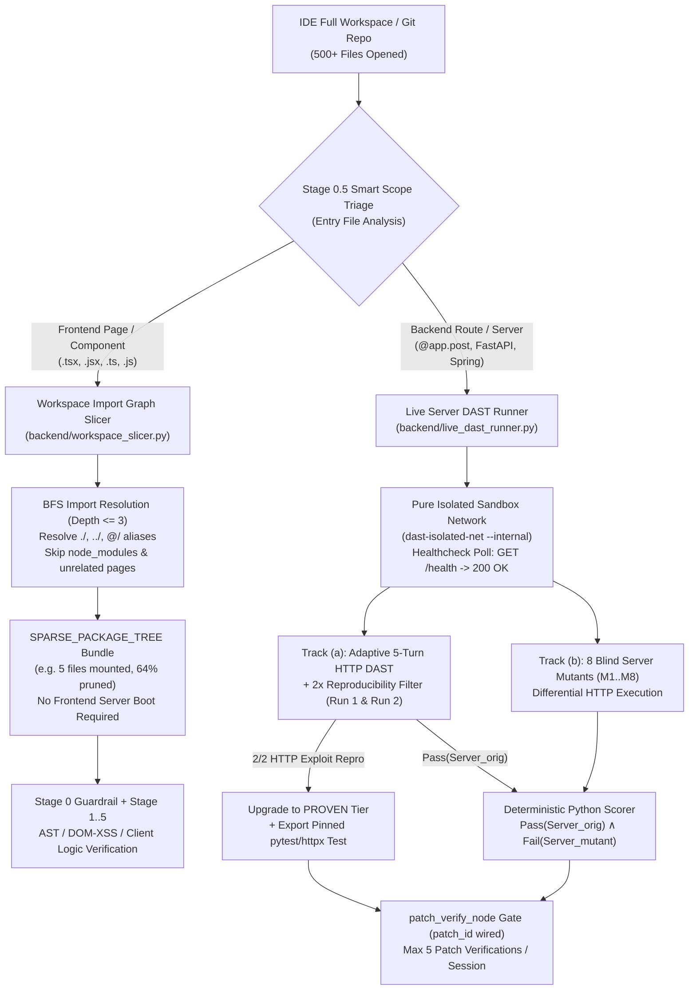
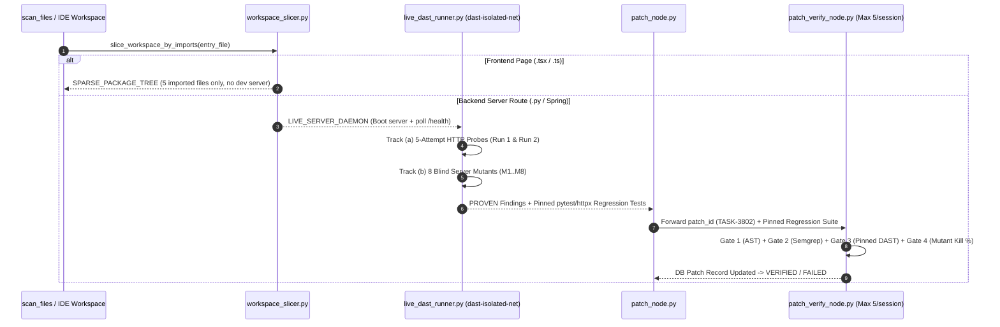

# 07. IDE Workspace Import Slicer & Live Server DAST Integration Guide

> **Document ID**: `07_Workspace_and_Live_DAST_Integration`  
> **Project**: **Argus-PR** (`google-hack`) $\leftrightarrow$ **SecureAI Editor** (`secureai-editor`) Reference Blueprint  
> **Core Modules**: [`backend/workspace_slicer.py`](file:///c:/Users/ttogl/workspace/google-hack/backend/workspace_slicer.py), [`backend/live_dast_runner.py`](file:///c:/Users/ttogl/workspace/google-hack/backend/live_dast_runner.py), [`backend/main.py`](file:///c:/Users/ttogl/workspace/google-hack/backend/main.py)

---

## 1. 설계 배경 및 핵심 목표

VSCode나 **SecureAI Editor**처럼 **레포지토리/워크스페이스 전체를 통째로 열어 분석하는 환경**에서는 모든 파일을 샌드박스에 마운트하거나 무거운 프론트엔드 빌드 서버(Next.js, Vite, Webpack)를 매번 띄우는 것이 비효율적입니다.

이를 해결하기 위해 본 프로젝트(`google-hack`)에 언제든 그대로 가져다 쓰거나 API로 호출할 수 있는 **2가지 핵심 엔진**을 구현했습니다:

1. **프론트엔드 / 페이지 단위 정적 임포트 그래프 슬라이서 (`SPARSE_PACKAGE_TREE`)** — [`backend/workspace_slicer.py`](file:///c:/Users/ttogl/workspace/google-hack/backend/workspace_slicer.py)
   - 프론트엔드 서버를 무겁게 띄우지 않고도, 검사하려는 **엔트리 페이지/컴포넌트 파일 1개**(예: `src/pages/RefundCheckoutPage.tsx`)에서 출발해 **로컬 `import` 트리(`import ... from`, `require()`, `@/` 별칭, 상대 경로)**만 BFS(너비 우선 탐색)로 추적합니다.
   - 해당 페이지에 실제로 `import`되는 하위 컴포넌트·유틸·API 클라이언트 파일들만 최소 슬라이스(Closure)로 묶어 **Prompt Injection 검사(Stage 0) + 불변성 추출(Stage 1) + 정적/단위 테스트 검증**을 수행합니다.
2. **백엔드 Live Server DAST & 이중 트랙 변이 검증기 (`LIVE_SERVER_DAEMON`)** — [`backend/live_dast_runner.py`](file:///c:/Users/ttogl/workspace/google-hack/backend/live_dast_runner.py)
   - 백엔드 라우터/서버 파일(`FastAPI`, `Flask`, `Spring Boot` 등)이 감지되면 격리 샌드박스 내부에서 **실제 서버 데몬을 부팅**하고 `/health` 준비 상태를 폴링합니다.
   - **Track (a)**: 최대 5회 적응형 Red-Team 루프(Observe $\to$ Mutate $\to$ Attack)로 실시간 HTTP 익스플로잇 요청(SQLi, Cross-Tenant IDOR, 동시성 TOCTOU Race, 음수 금액 주입 등)을 전송하며, **2회 연속 재현(`2/2 Repro`)**된 취약점만 **`PROVEN` 등급**으로 승격하고 **`pytest + httpx` 회귀 테스트로 자동 고정(Pinning)**합니다.
   - **Track (b)**: 서버 핸들러에 8개의 은밀한 버그를 심은 **8 Blind Server Mutants(`M1..M8`)**에 동일한 HTTP 베이스라인 스위트를 실행해 `Pass(Server_orig) ∧ Fail(Server_mutant)` 결정론적 탐지율($M/K$)을 산출합니다.

---

## 2. 전체 하이브리드 검증 아키텍처 (Frontend Slicer vs. Backend Live DAST)



---

## 3. 모듈별 상세 명세

### 3.1 프론트엔드/워크스페이스 임포트 슬라이서 ([`backend/workspace_slicer.py`](file:///c:/Users/ttogl/workspace/google-hack/backend/workspace_slicer.py))

| 항목 | 구현 상세 |
| :--- | :--- |
| **핵심 함수** | [`slice_workspace_by_imports(workspace_files, entry_file, max_depth=3)`](file:///c:/Users/ttogl/workspace/google-hack/backend/workspace_slicer.py#L225-L368) |
| **지원 문법 (JS/TS)** | `import ... from '...'`, `export ... from '...'`, `require('...')`, 동적 `import('...')` 정규식 파서 ([`extract_js_ts_imports`](file:///c:/Users/ttogl/workspace/google-hack/backend/workspace_slicer.py#L99-L114)) |
| **지원 문법 (Python)** | `ast.parse` 기반 `import`, `from ... import` 및 상대 임포트(`level >= 1`) 해석 ([`extract_python_imports`](file:///c:/Users/ttogl/workspace/google-hack/backend/workspace_slicer.py#L117-L157)) |
| **경로 해석기** | 상대 경로(`./`, `../`), 워크스페이스 별칭(`@/`, `~/`), 인덱스 파일(`/index.tsx`, `/__init__.py`) 자동 매칭 ([`resolve_import_to_workspace_file`](file:///c:/Users/ttogl/workspace/google-hack/backend/workspace_slicer.py#L170-L222)) |
| **무거운 파일 자동 제외** | `node_modules/`, `.next/`, `dist/`, `package-lock.json`, `pnpm-lock.yaml`, `poetry.lock` 및 임포트 그래프와 무관한 다른 페이지 컴포넌트 자동 프루닝 |

#### 실행 예시 (`RefundCheckoutPage.tsx` 기준)
전체 워크스페이스(14개 파일)에서 `src/pages/RefundCheckoutPage.tsx`를 엔트리로 지정하면 프론트엔드 서버를 띄우지 않고도 **정확히 해당 페이지가 렌더링·호출하는 5개 파일만 추출**합니다(불필요 파일 **64.3% 절감**):
1. `src/pages/RefundCheckoutPage.tsx` (Entry Page — DOM XSS sink `dangerouslySetInnerHTML`)
2. `src/components/RefundAmountInput.tsx` (Hop 1 — `../components/RefundAmountInput`)
3. `src/api/refundClient.ts` (Hop 1 — `@/api/refundClient` 별칭 해석, Unescaped HTML 생성 원점)
4. `src/utils/currencyValidator.ts` (Hop 1 — `amount <= 0` 음수 검증 누락 버그 포함)
5. `src/utils/cryptoSigner.ts` (Hop 2 — `refundClient.ts`에서 임포트된 클라이언트 하드코딩 HMAC 키 노출 버그)

---

### 3.2 백엔드 Live Server DAST & 이중 트랙 검증기 ([`backend/live_dast_runner.py`](file:///c:/Users/ttogl/workspace/google-hack/backend/live_dast_runner.py))

| 항목 | 구현 상세 |
| :--- | :--- |
| **핵심 함수** | [`run_live_server_dast_verification(repo_name, patch_id, session_patch_attempt)`](file:///c:/Users/ttogl/workspace/google-hack/backend/live_dast_runner.py#L207-L561) |
| **샌드박스 하네스 생성기** | [`build_live_dast_harness_script(probes, mutant_ids, port=18080)`](file:///c:/Users/ttogl/workspace/google-hack/backend/live_dast_runner.py#L103-L199) |
| **네트워크 격리 정책** | `dast-isolated-net` 순수 내부망 기준 (Sprint 39 `TASK-3907` / `SEC-AUD-12` 반영: OWASP ZAP용 `zap-scan-net`과 완전 분리되어 Nginx를 통한 백엔드 `/api` 역접근 경로 원천 차단) |
| **서버 부팅 및 헬스체크** | 컨테이너 내부에서 `uvicorn backend_app.server:app --host 127.0.0.1 --port 18080` 실행 후 `GET /health` HTTP 200 응답 확인 후 공격 개시 |
| **적응형 5턴 HTTP 공격 & 2x 재현** | 각 HTTP 프로브(`LiveHttpExploitProbe`)가 최대 5턴(Attempt 1..5) 동안 페이로드를 변이하며 공격하고, Run 1과 Run 2 모두에서 익스플로잇이 성공한 경우에만 `reproduced_2x = True` 및 `evidence_tier = "PROVEN"` 부여 |
| **회귀 테스트 고정 & `patch_id` 배선** | `PROVEN` 취약점마다 `PinnedHttpRegressionTest`(`pytest + httpx`)를 자동 생성하며, Sprint 38 `TASK-3802` 사양에 맞춰 `patch_id` 및 세션당 최대 5회 상한(`session_patch_attempt <= 5`) 메타데이터를 `PatchVerifyGateReport`에 연결 |

---

## 4. REST API 엔드포인트 사용법

### 4.1 `POST /api/workspace/slice` — 프론트엔드/워크스페이스 임포트 슬라이싱
워크스페이스 파일 맵(생략 시 내장 풀스택 샘플 워크스페이스 사용)과 엔트리 파일 경로를 전달하면 정적 임포트 그래프 슬라이싱 결과를 반환하고, `register_as_pr=True`일 때 즉시 검증 가능한 PR 항목(`pr-slice-...`)으로 등록합니다.

```bash
curl -X POST http://127.0.0.1:8000/api/workspace/slice \
  -H "Content-Type: application/json" \
  -d '{
    "entry_file": "src/pages/RefundCheckoutPage.tsx",
    "max_depth": 3,
    "repo_name": "acme-pay/fullstack-workspace",
    "register_as_pr": true
  }'
```

### 4.2 `POST /api/verify/live-dast` — 백엔드 Live Server DAST 이중 트랙 검증
백엔드 데몬 부팅 후 실시간 HTTP DAST 프로브(2x 재현 + `PROVEN` 승격), 고정된 `pytest + httpx` 회귀 테스트(`patch_id` 연동), 그리고 8개 서버 변이체(`M1..M8`)에 대한 결정론적 스코어링 결과를 반환합니다.

```bash
curl -X POST http://127.0.0.1:8000/api/verify/live-dast \
  -H "Content-Type: application/json" \
  -d '{
    "repo_name": "acme-pay/refund-daemon-service",
    "patch_id": "patch_3802_live_dast",
    "session_patch_attempt": 2
  }'
```

---

## 5. 차후 `secureai-editor` 이식 시 1:1 매핑 가이드



1. **프론트엔드 파일 열람 시 (`scan_files` 앞단)**: [`slice_workspace_by_imports()`](file:///c:/Users/ttogl/workspace/google-hack/backend/workspace_slicer.py#L225-L368)를 호출하여 열린 페이지에 `import`되는 로컬 파일들만 슬라이싱해 정적/샌드박스 분석에 투입합니다.
2. **백엔드 DAST 서브그래프 실행 시 (`dast_attack_node`)**: 순수 격리망 `dast-isolated-net`(Nginx가 `zap-scan-net`으로 분리된 환경)에서 [`build_live_dast_harness_script()`](file:///c:/Users/ttogl/workspace/google-hack/backend/live_dast_runner.py#L103-L199)로 서버를 띄워 2회 연속 재현(`2/2 Repro`) 여부를 확인하고 `PROVEN` 회귀 테스트를 추출합니다.
3. **패치 검증 시 (`patch_node` $\to$ `patch_verify_node`)**: `patch_node`가 생성한 `patch_id`를 [`PatchVerifyGateReport`](file:///c:/Users/ttogl/workspace/google-hack/backend/live_dast_runner.py#L69-L79)에 연결하여 세션당 최대 5회 상한 내에서 고정된 DAST 회귀 테스트 통과 여부와 변이체 사살률을 함께 검증한 뒤 DB 패치 상태를 `VERIFIED`로 확정합니다.
