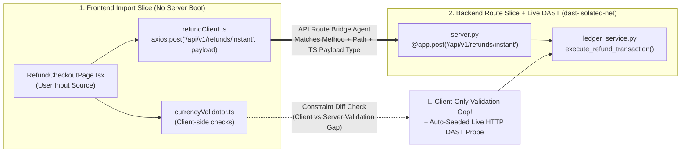
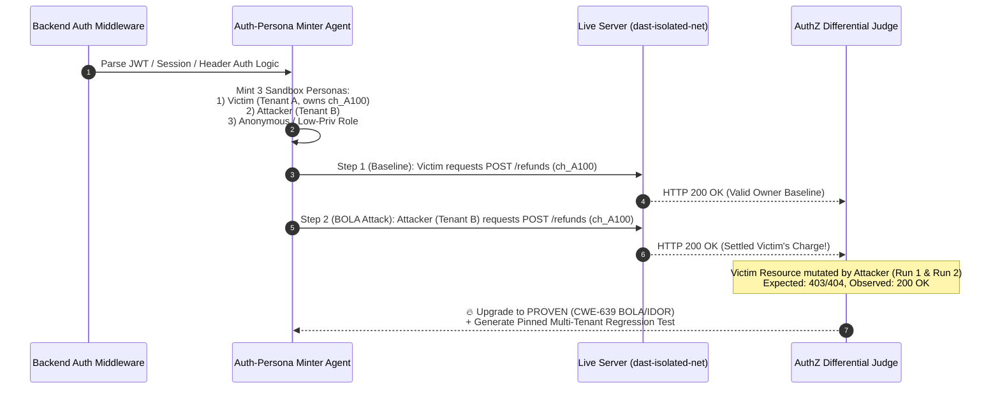
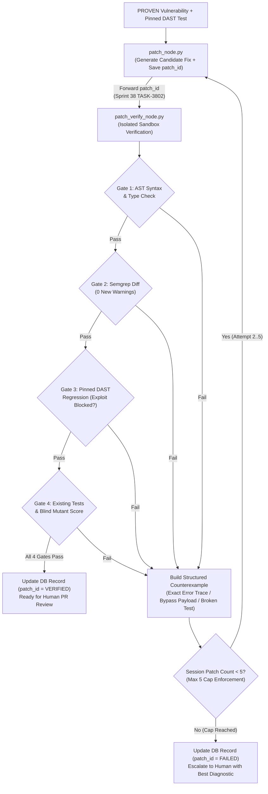
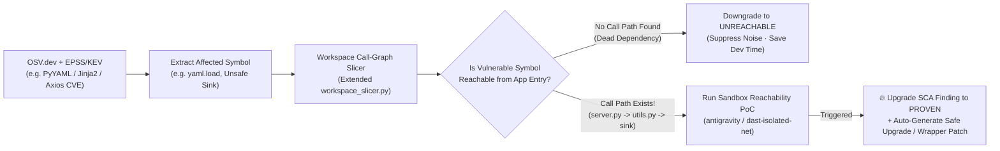

# 08. Enterprise AppSec Agent Expansion Blueprint (Next-Gen Ideas & Diagrams)

> **Document ID**: `08_Enterprise_Agent_Expansion_Ideas`  
> **Context**: `secureai-overview.html` (11-Node LangGraph + DAST Subgraph + 4-Layer Evidence Ladder + Sprint 38/39 Updates) 기반으로, **실제 현업(Enterprise DevSecOps / AppSec)에서 가장 페인포인트가 큰 영역을 에이전트화(Agentification)** 할 수 있는 5대 확장 아키텍처 제안서입니다.

---

## 한눈에 보는 5대 현업 에이전트 확장 로드맵

| 순번 | 에이전트 명칭 | 해결하는 실제 현업 문제 (Pain Point) | `secureai-editor` & `google-hack` 연결 지점 |
| :---: | :--- | :--- | :--- |
| **1** | **Frontend $\leftrightarrow$ Backend API 브릿지 에이전트** *(Cross-Boundary Contract & Taint Slicer)* | 프론트엔드 검증(`if (amount > 0)`)만 믿고 백엔드 검증을 빼먹거나, 프론트-백엔드 DTO 스키마 불일치로 발생하는 비즈니스 로직 취약점 | `workspace_slicer.py`의 `axios/fetch` 호출 문자열을 백엔드 `@app.post` 라우트와 자동 매칭하여 **Full-Stack 슬라이스 + DAST 시드** 생성 |
| **2** | **멀티 페르소나 인가(AuthZ) 매트릭스 에이전트** *(BOLA / BFLA Cross-Tenant Replay Agent)* | 현업 침투테스트 1위 취약점인 **IDOR(BOLA)** 및 **권한 상승(BFLA)**은 단순 스캐너(ZAP)가 토큰/세션 맥락을 몰라 못 찾음 | 백엔드 Auth 미들웨어(JWT/Session/Header)를 분석해 `Tenant A`, `Tenant B`, `General User`, `Admin` 테스트 토큰을 자동 발급 후 교차 호출 |
| **3** | **반례 유도 자가 치유(CEGIS) 패치 루프 에이전트** *(Counterexample-Guided Self-Healing Patch Agent)* | AI가 생성한 보안 패치가 기존 기능을 깨뜨리거나(Regression), 우회 공격에 다시 뚫렸을 때 단순 재시도는 실패를 반복함 | Sprint 38(`TASK-3802`)의 `patch_id` + **세션당 최대 5회 상한** 안에서, 실패한 **반례(Counterexample 로그 + 살아남은 변이체 Diff)**를 `patch_node`에 피드백 |
| **4** | **SCA 도달 가능성(Reachability) 증명 에이전트** *(Reachable CVE & Dependency Exploit Agent)* | `OSV.dev` / Dependabot이 수백 개 CVE 경고를 띄우지만, 실제로는 우리 코드에서 해당 함수를 호출하지 않는 경우(False Positive)가 85% 이상 | `workspace_slicer.py`의 AST 호출 그래프를 확장해 **우리 엔트리 코드 $\to$ 외부 라이브러리 취약 함수** 도달 경로가 있을 때만 샌드박스 PoC 실행 (`PROVEN` 승격) |
| **5** | **드리프트 방지 보안 회귀 테스트 PR 자산화 에이전트** *(Living Security Test Suite & CI Gatekeeper)* | 일회성 DAST 스캔 후 패치만 머지하면, 3개월 뒤 다른 개발자가 리팩토링하면서 동일한 취약점을 다시 만듦 | DAST에서 `2/2` 재현된 `PROVEN` 공격 코드를 레포지토리의 `tests/security/test_dast_regression_*.py`로 PR에 함께 커밋하여 영구 CI 게이트화 |

---

## Idea 1. 프론트엔드 $\leftrightarrow$ 백엔드 경계 연결 에이전트 (Full-Stack API Contract & Taint Bridge)

현재 [`backend/workspace_slicer.py`](file:///c:/Users/ttogl/workspace/google-hack/backend/workspace_slicer.py)는 프론트엔드 페이지(`RefundCheckoutPage.tsx`)에서 `refundClient.ts`까지 추적합니다. 여기서 한 단계 더 나아가, `refundClient.ts` 안의 `axios.post('/api/v1/refunds/instant', payload)`를 AST로 추출해 백엔드의 `@app.post('/api/v1/refunds/instant')` 핸들러와 **자동으로 다리(Bridge)를 놓는 에이전트**입니다.

### 왜 현업에서 강력할까?
1. **클라이언트 의존 보안 취약점(Client-Side Trust) 즉시 탐지**: 프론트엔드에는 `if (role !== 'admin') return;` 또는 `maxLength=20`이 있는데 백엔드 DTO에는 해당 제약이 빠져 있는 경우를 100% 찾아냅니다.
2. **Zero-Config Live DAST 시드 생성**: 백엔드 DAST를 돌릴 때 어떤 JSON 필드와 헤더(`X-Client-Signature`)를 넣어야 할지 헤맬 필요 없이, 프론트엔드 API 클라이언트 코드에서 정확한 Request Body 스키마를 추출해 Live DAST 공격기(`live_dast_runner.py`)의 초기 시드(Seed)로 바로 주입합니다.

---

## Idea 2. 멀티 페르소나 인가(AuthZ) 매트릭스 에이전트 (Automated BOLA / IDOR / BFLA Hunter)

`secureai-overview.html`의 DAST 서브그래프(`dast_attack_node`)에는 SQLi, XSS, CmdI, Path Traversal, CORS가 포함되어 있습니다. 하지만 **실제 현업 서비스(핀테크, SaaS, B2B)에서 가장 치명적인 취약점 1위는 OWASP API Top 1인 BOLA(IDOR: 타인/타 테넌트 리소스 접근)와 BFLA(일반 유저가 관리자 API 호출)**입니다. 기존 OWASP ZAP 같은 스캐너는 인증 토큰 구조와 비즈니스 소유권 개념을 몰라 이를 찾지 못합니다.

### 에이전트 동작 방식
1. **Auth Minter (인증 컨텍스트 합성기)**: 백엔드 코드의 인증 의존성(`Depends(get_current_user)`, `@PreAuthorize`, JWT Secret, `X-Tenant-Id`)을 읽고, 격리 샌드박스(`dast-isolated-net`) 안에서 **3개의 가상 페르소나 세션/토큰**을 자동 생성합니다:
   - `Persona A`: `Tenant_A` 소속 일반 유저 (`user_a`, 리소스 `charge_id = "ch_A100"` 소유)
   - `Persona B`: `Tenant_B` 소속 공격자 유저 (`user_b`)
   - `Persona C`: 비인증(`Anonymous`) 또는 `Read-Only` 권한 유저
2. **Cross-Actor Differential Replay (교차 주체 리플레이)**:
   - 먼저 `Persona A`로 정상 요청을 보내 `200 OK`와 리소스 ID(`ch_A100`)를 확인합니다 (`Baseline Pass`).
   - 즉시 동일한 엔드포인트(`GET/POST /api/v1/refunds/ch_A100`)에 **`Persona B`의 토큰/헤더를 끼워서 호출**합니다.
   - 만약 서버가 `403 Forbidden`이나 `404 Not Found`를 반환하지 않고 **`200 OK`로 타 테넌트의 데이터를 반환하거나 환불을 실행하면**, 100% 결정론적으로 **`PROVEN` BOLA/IDOR 취약점**으로 판정합니다!

---

## Idea 3. 반례 유도 자가 치유(CEGIS) 패치 루프 에이전트 (`patch_node` $\leftrightarrow$ `patch_verify_node`)

방금 공유해주신 **Sprint 38 (`TASK-3802`)**에서 `patch_node.py`가 생성한 `patch_id`를 `patch_verify_node.py`로 넘겨 DB에 `VERIFIED / FAILED`를 기록하고 **세션당 최대 5건 상한**을 두셨습니다.  
이 **5회 상한**을 단순 재시도가 아니라, 현업 프로그램 합성 기술인 **CEGIS (Counterexample-Guided Inductive Synthesis, 반례 유도 자가 치유 루프)** 에이전트로 고도화할 수 있습니다.

### 에이전트 동작 방식
- `Attempt 1`에서 생성된 패치가 `patch_verify_node`의 4개 게이트 중 하나에서 실패(`FAILED`)했다고 가정합시다:
  - **Gate 1**: AST 구문 오류
  - **Gate 2**: Semgrep 신규 경고 발생 (패치하다가 다른 취약점 유발)
  - **Gate 3**: 고정된 DAST 회귀 테스트(`PinnedHttpRegressionTest`) 실패 — 공격이 여전히 뚫림
  - **Gate 4 (Argus 확장)**: 기존 단위 테스트가 깨지거나, Blind Mutant 사살률이 급락함
- 이때 `patch_verify_node`가 단순히 `FAILED`만 찍고 끝나는 것이 아니라, **정확한 반례 아티팩트(Counterexample Bundle: 실패한 HTTP 응답 본문, Traceback, 혹은 우회에 성공한 변이 페이로드)**를 구조화해 `patch_node`에게 돌려줍니다(세션당 최대 5회 상한 내).

---

## Idea 4. SCA 오픈소스 취약점(CVE) 도달 가능성(Reachability) 증명 에이전트

`secureai-overview.html`을 보면 **Layer 2 (`OSV.dev` API)**와 **Layer 3 (EPSS + CISA KEV)**로 오픈소스 의존성(`package.json`, `requirements.txt`, `build.gradle`)의 CVE를 수집하고 점수를 매깁니다.  
현업 보안팀의 가장 큰 고민은 **"라이브러리에 CVE가 있다고 해서 무조건 버전을 올리면 호환성이 깨지는데, 정작 우리 코드는 그 라이브러리의 취약한 함수를 아예 안 쓰고 있는 경우가 85%"**라는 점입니다.

### 에이전트 동작 방식
- 우리가 만든 [`backend/workspace_slicer.py`](file:///c:/Users/ttogl/workspace/google-hack/backend/workspace_slicer.py)의 AST 분석기를 확장하여:
  1. `OSV.dev` 결과에서 취약한 패키지명과 **취약 심볼/함수명(Affected Symbols)**을 가져옵니다.
  2. 워크스페이스 전체의 Import & Call Graph를 스캔해 **우리 코드의 엔트리 포인트에서 해당 외부 패키지 심볼까지 실제 호출 경로(Call Path)가 존재하는지** 정적으로 확인합니다.
  3. 호출 경로가 없으면 `UNREACHABLE (Low Priority)`로 분류해 개발자 피로도를 줄이고, **호출 경로가 존재하면(`REACHABLE`)** 샌드박스에서 해당 경로를 자극하는 마이크로 테스트를 실행해 `DERIVED` 등급을 **`PROVEN` 등급으로 승격**합니다.

---

## Idea 5. 보안 회귀 테스트 영구 자산화 에이전트 (Living Security Regression Suite in PR)

`secureai-overview.html`의 `github_pr_node`는 검증된 보안 패치(`patch_verify_node`를 통과한 코드 수정본)로 GitHub PR을 생성합니다(`auto-merge` 금지).  
이때 **수정된 프로덕션 코드만 PR에 올리는 것**이 아니라, **DAST/샌드박스에서 취약점을 증명했던 `PinnedHttpRegressionTest` 파일(`tests/security/test_sec_reg_patch_3802.py`)을 PR 커밋에 함께 포함시켜 올리는 에이전트**입니다.

### 현업 기대 효과
- 리뷰어(Human Tech Lead)가 GitHub PR을 열었을 때 **"1) 취약점 원인이 고쳐진 코드 Diff"**와 **"2) 그 취약점을 공격하는 자동화 테스트 코드"**가 한 세트로 들어 있으므로 리뷰 신뢰도가 극대화됩니다.
- PR이 머지된 이후에도 CI/CD 파이프라인(`GitHub Actions`)에서 매 커밋마다 이 보안 테스트가 돌아가므로, 미래에 다른 개발자나 AI가 코드를 수정하다가 보안 로직을 실수로 지우면 즉시 빌드 단계에서 차단(**Zero Regression Drift**)됩니다.
