# 09. Agent Orchestration & LLM Invocation Flow (`Argus-PR`)

This document visualizes the **Multi-Agent Orchestration Graph**, details **what each Agent Node / Python Engine does**, clarifies **where AI/LLM calls happen vs. where 100% deterministic Python executes**, and explains how **Live API Mode (`GEMINI_API_KEY`) vs. Recorded Replay Mode** operates.

---

## 1. Architecture Pattern: Native Async DAG vs. LangGraph Mapping

Unlike `secureai-editor` (which wires a LangGraph `StateGraph` with `sast_node` $\to$ `dast_node` $\to$ `patch_node` $\to$ `patch_verify_node`), **`Argus-PR` (`google-hack`) uses a lightweight, zero-overhead Native Python Async DAG Orchestrator** implemented in `backend/main.py` + `backend/gemini_swarm.py` (`asyncio.gather` + `google-genai` Interactions API).

However, every stage in `Argus-PR` is **1:1 isomorphic to a LangGraph node** so it can be dropped directly into a LangGraph pipeline whenever needed.

### 1.1 Visual Multi-Agent Orchestration Flow (Mermaid)

```mermaid
flowchart TB
    %% Styling
    classDef userNode fill:#1e293b,stroke:#94a3b8,color:#f8fafc,stroke-width:2px
    classDef llmLite fill:#065f46,stroke:#10b981,color:#ecfdf5,stroke-width:2px
    classDef llmArgon fill:#312e81,stroke:#818cf8,color:#eef2ff,stroke-width:2px
    classDef llmFlash fill:#581c87,stroke:#c084fc,color:#faf5ff,stroke-width:2px
    classDef detPython fill:#0f172a,stroke:#38bdf8,color:#e0f2fe,stroke-width:2px
    classDef sandboxNode fill:#7c2d12,stroke:#fb923c,color:#fff7ed,stroke-width:2px

    User(["👤 User / Developer<br/>Selects PR or Uploads Workspace<br/>(mode-toggle: Replay vs Live API)"]):::userNode

    subgraph Stage0_Group ["Stage 0 & 0.5: Perimeter Defense & Smart Scope Triage"]
        direction LR
        Node_Guardrail["🤖 [LLM Node 1] Guardrail Router<br/>Model: gemini-3.5-flash-lite (store=False)<br/>Func: run_prompt_injection_guardrail()<br/>+ Regex Pre-Filter (INJECTION_PATTERNS)"]:::llmLite
        Node_Slicer["⚙️ [Deterministic Python] Scope Triage & Import Slicer<br/>Func: analyze_scope_triage() / slice_workspace_by_imports()<br/>AST/Regex Import Graph BFS (Depth <= 3)"]:::detPython
        Node_Guardrail -->|"is_safe == True"| Node_Slicer
    end

    User -->|"POST /api/verify or /api/verify/stream"| Node_Guardrail
    Node_Guardrail -.->|"is_safe == False (Quarantined)"| BlockedEnd(["🛑 Halted Immediately<br/>Zero Argon/Sandbox Calls"]):::userNode

    subgraph Stage1_Group ["Stage 1: Blind Dual-Track Split (Information Wall: store=False)"]
        direction LR
        Node_Planner["🧠 [LLM Node 2A] Track 1A: Attack Planner<br/>Model: gemini-4-argon (store=False)<br/>Func: extract_invariants_and_plan()<br/>Outputs: Formal Invariants (INV-1..4) & Attack Plans"]:::llmArgon
        Wall["🧱 STRICT INFORMATION WALL<br/>Zero Shared Context / Separate API Calls"]
        Node_Planter["🧬 [LLM Node 2B] Track 1B: Blind Bug Planter<br/>Model: gemini-4-argon (store=False)<br/>Func: plant_blind_bugs()<br/>Outputs: 8 Secret Mutants (M1..M8)"]:::llmArgon
    end

    Node_Slicer -->|"Mounted PR Diff & Code"| Node_Planner
    Node_Slicer -->|"Original Code Only"| Node_Planter

    subgraph Stage2_Group ["Stage 2: Parallel Red-Team Attacker Swarm (asyncio.gather)"]
        direction LR
        Att_Sec["⚡ [LLM Node 3-1] Security Attacker<br/>Model: gemini-3.8-flash<br/>5-Attempt Red-Team + Multi-Persona BOLA"]:::llmFlash
        Att_Edge["⚡ [LLM Node 3-2] Edge Cases Attacker<br/>Model: gemini-3.8-flash<br/>Boundary / Off-by-One / DivZero"]:::llmFlash
        Att_State["⚡ [LLM Node 3-3] State & Concurrency Attacker<br/>Model: gemini-3.8-flash<br/>Race Condition / Idempotency"]:::llmFlash
        Att_Reg["⚡ [LLM Node 3-4] Regression & Contract Attacker<br/>Model: gemini-3.8-flash<br/>API Schema & Backwards Compat"]:::llmFlash
    end

    Node_Planner -->|"InvariantExtractionPlan"| Att_Sec & Att_Edge & Att_State & Att_Reg

    subgraph Stage3_Group ["Stage 3: Isolated Sandbox Execution (Antigravity / Subprocess + dast-isolated-net)"]
        direction TB
        Sandbox_TrackA["🐳 [Sandbox Node 4A] Track (a): Original PR Verification<br/>Agent: antigravity-preview-09-2026 / run_sandbox()<br/>Runs 5-Attempt Payloads + 2x Repro Check + Live DAST BOLA"]:::sandboxNode
        Sandbox_TrackB["🐳 [Sandbox Node 4B] Track (b): 8 Blind Mutants Differential Run<br/>Executes Passed Baseline Tests against M1..M8<br/>Builds mutant_matrix[M_i][test_j]"]:::sandboxNode
        Sandbox_TrackA -->|"Tests where Pass(PR_orig) == True"| Sandbox_TrackB
    end

    Att_Sec & Att_Edge & Att_State & Att_Reg -->|"Generated pytest Suites"| Sandbox_TrackA
    Node_Planter -->|"Sealed Mutants (M1..M8)"| Sandbox_TrackB

    Node_Scoring["📐 [Deterministic Python Engine] Scoring Calculator<br/>File: backend/scoring.py -> compute_deterministic_scores()<br/>NO LLM ALLOWED: Computes exact M/K Kill Score & 2/2 Failures"]:::detPython

    Sandbox_TrackA & Sandbox_TrackB -->|"SandboxExecutionReport"| Node_Scoring

    Node_Synth["🧾 [LLM Node 5] One-Card Executive Synthesizer<br/>Model: gemini-4-argon (store=False)<br/>Func: synthesize_one_card_summary()<br/>Takes immutable Python M/K numbers & writes explanation + patch"]:::llmArgon

    Node_Scoring -->|"DeterministicScoreReport"| Node_Synth

    subgraph Stage4_CEGIS ["Stage 4 (Post-Review): Top 1 & Top 2 Self-Healing Patch Loop & PR Bundle Export"]
        direction LR
        Patch_Node["🛠️ [LLM Node 6 / LangGraph: patch_node]<br/>Model: gemini-4-argon<br/>Generates/Refines Candidate Diff (patch_id)"]:::llmArgon
        Verify_Node["🔬 [Sandbox Gate / LangGraph: patch_verify_node]<br/>4-Gate Verifier (AST + Semgrep + DAST + Mutants)<br/>Max 5 Attempts per Session (TASK-3802)"]:::sandboxNode
        Export_Node["📦 [Deterministic Python] PR & Regression Exporter<br/>Endpoint: POST /api/prs/export-bundle<br/>Exports Diff + test_argus_regression_*.py + CI YAML"]:::detPython

        Patch_Node -->|"patch_id + candidate_diff"| Verify_Node
        Verify_Node -->|"FAILED_COUNTEREXAMPLE (Attempts 1..4)"| Patch_Node
        Verify_Node -->|"VERIFIED (All 4 Gates PASS)"| Export_Node
    end

    Node_Synth -->|"User clicks 'Apply Patch & Re-Verify'"| Patch_Node
```

---

## 2. Where is AI / LLM Invoked on the User Flow?

To make it crystal clear where AI models are invoked versus where pure deterministic Python code runs during the **User Flow (`01_User_Flow.md`)**, here is the stage-by-stage breakdown:

```mermaid
sequenceDiagram
    autonumber
    actor User as 👤 User (Browser UI)
    participant API as ⚙️ FastAPI (backend/main.py)
    participant Lite as 🤖 Gemini 3.5 Flash-Lite
    participant Argon as 🧠 Gemini 4 Argon (store=False)
    participant Flash as ⚡ 4x Gemini 3.8 Flash
    participant Sandbox as 🐳 Antigravity Sandbox / Subprocess
    participant PyScore as 📐 Python scoring.py (No LLM)

    User->>API: 1. Upload Workspace / Select PR & Click "Launch Swarm"
    Note over API: Stage 0.5 Smart Scope Triage & AST Import Slicer<br/>(100% Deterministic Python — 0 LLM calls)

    rect rgb(6, 78, 59)
        Note over API,Lite: [AI CALL #1] Stage 0 Guardrail
        API->>Lite: run_prompt_injection_guardrail(diff, comments)
        Lite-->>API: GuardrailResult (SAFE or BLOCKED)
    end

    rect rgb(49, 46, 129)
        Note over API,Argon: [AI CALL #2A & #2B] Stage 1 Blind Dual-Track (Zero Shared State)
        par Track 1A: Attack Planner
            API->>Argon: extract_invariants_and_plan(PR_diff, PR_code) [store=False]
            Argon-->>API: InvariantExtractionPlan (INV-1..4 + Attack Plans)
        and Track 1B: Blind Bug Planter
            API->>Argon: plant_blind_bugs(PR_code) [store=False]
            Argon-->>API: BlindMutantSet (M1..M8 Mutated Modules)
        end
    end

    rect rgb(88, 28, 135)
        Note over API,Flash: [AI CALL #3-1..#3-4] Stage 2 Parallel Attacker Swarm (asyncio.gather)
        API->>Flash: run_parallel_attacker_swarm(plan, PR_code, max_attempts=5)
        Flash-->>API: 4x AttackerSwarmOutput (Python pytest functions + 5-attempt red-team steps)
    end

    rect rgb(124, 45, 18)
        Note over API,Sandbox: [SANDBOX EXECUTION] Stage 3a & 3b Dual-Track Execution
        API->>Sandbox: run_sandbox(PR_code, M1..M8, swarm_tests)
        Sandbox-->>API: SandboxExecutionReport (2x Repro Results + Mutant Matrix)
    end

    rect rgb(15, 23, 42)
        Note over API,PyScore: [100% DETERMINISTIC PYTHON — NO AI] Stage 4a Scoring
        API->>PyScore: compute_deterministic_scores(swarm_outputs, blind_mutants, sandbox_report)
        PyScore-->>API: DeterministicScoreReport (Exact M/K Score: e.g., 7/8 = 87.5%)
    end

    rect rgb(49, 46, 129)
        Note over API,Argon: [AI CALL #4] Stage 4b One-Card Executive Summary
        API->>Argon: synthesize_one_card_summary(score_report, invariant_plan)
        Argon-->>API: OneCardExecutiveSummary (Verdict, Blind Spot Explanation, Patch Diff)
    end

    API-->>User: Render Swimlane, Terminal Logs, 7/8 Matrix & One-Card Summary

    opt User clicks "Apply Recommended Patch (Self-Healing CEGIS Loop)"
        rect rgb(49, 46, 129)
            Note over API,Sandbox: [AI CALL #5 + SANDBOX GATES] Up to 5 Attempts (patch_node <-> patch_verify_node)
            API->>Argon: Attempt k: Synthesize/refine patch from counterexample
            API->>Sandbox: Verify Gate 1 (AST), Gate 2 (Semgrep), Gate 3 (DAST), Gate 4 (Mutants)
            Sandbox-->>User: SelfHealingPatchReport (Attempt 1 FAILED_COUNTEREXAMPLE -> Attempt 2 VERIFIED)
        end
    end
```

---

## 3. Detailed Node & Function Reference Table

| Node ID | Role / Name | File & Function | Execution Type | Model / Runtime | LangGraph Equivalent (`secureai-editor`) | Description & Key Responsibility |
| :--- | :--- | :--- | :--- | :--- | :--- | :--- |
| **Node 0** | **Prompt-Injection Guardrail** | [`backend/gemini_swarm.py`](file:///c:/Users/ttogl/workspace/google-hack/backend/gemini_swarm.py#L41-L100) `run_prompt_injection_guardrail()` | **Hybrid (Regex + AI LLM)** | `gemini-3.5-flash-lite` (`store=False`) | Pre-flight Guardrail Node | Scans untrusted PR diffs/comments for adversarial instructions (`IGNORE PREVIOUS INSTRUCTIONS`, etc.) before passing to Argon. |
| **Node 0.5** | **Smart Scope Triage & Import Slicer** | [`backend/sample_prs.py`](file:///c:/Users/ttogl/workspace/google-hack/backend/sample_prs.py) `analyze_scope_triage()` & [`backend/workspace_slicer.py`](file:///c:/Users/ttogl/workspace/google-hack/backend/workspace_slicer.py) `slice_workspace_by_imports()` | **100% Deterministic Python** | Python `ast` + ES Module Regex BFS | Workspace Loader / Slicer Node | Traverses static `import` statements (depth $\le 3$) from an entry page/route, stripping 70~90% of unrelated repo files. |
| **Node 1A** | **Track 1A: Invariant & Attack Planner** | [`backend/gemini_swarm.py`](file:///c:/Users/ttogl/workspace/google-hack/backend/gemini_swarm.py#L103-L152) `extract_invariants_and_plan()` | **AI LLM (Structured JSON)** | `gemini-4-argon` (`store=False`) | `sast_analyze_node` / Planner | Extracts formal security, boundary, state, and contract invariants (`INV-1..4`) and creates targeted attack plans. |
| **Node 1B** | **Track 1B: Blind Bug Planter** | [`backend/gemini_swarm.py`](file:///c:/Users/ttogl/workspace/google-hack/backend/gemini_swarm.py#L155-L186) `plant_blind_bugs()` | **AI LLM (Structured JSON)** | `gemini-4-argon` (`store=False`) | Blind Calibration Planter Node | Independently injects 8 subtle single-bug mutations (`M1..M8`) into shadow copies of the PR code. Sealed behind the Information Wall. |
| **Node 2** | **Parallel Attacker Swarm (4x Agents)** | [`backend/gemini_swarm.py`](file:///c:/Users/ttogl/workspace/google-hack/backend/gemini_swarm.py#L189-L261) `run_parallel_attacker_swarm()` | **AI LLM (`asyncio.gather` 4x Concurrent)** | `4x gemini-3.8-flash` (`thinking_level="medium"`) | `exploit_gen_node` / Red-Team Swarm | Generates executable `pytest` functions and 5-attempt adaptive red-team sequences across `security`, `edge_cases`, `state`, and `regression`. |
| **Node 3A/3B** | **Dual-Track Sandbox & Live DAST** | [`backend/sandbox_runner.py`](file:///c:/Users/ttogl/workspace/google-hack/backend/sandbox_runner.py) `run_sandbox()` & [`backend/live_dast_runner.py`](file:///c:/Users/ttogl/workspace/google-hack/backend/live_dast_runner.py) | **Isolated Container / Subprocess + Remote Agent** | `antigravity-preview-09-2026` + Local Python Subprocess | `dast_verify_node` (`dast-isolated-net`) | Executes tests twice (`2/2` repro filter) against `PR_orig` (Track a) and against `M1..M8` (Track b), plus Multi-Persona BOLA probes. |
| **Node 4** | **Deterministic Score Calculator** | [`backend/scoring.py`](file:///c:/Users/ttogl/workspace/google-hack/backend/scoring.py) `compute_deterministic_scores()` | **100% Deterministic Python (Zero LLM)** | Pure Python Set Algebra | Deterministic Evaluator | Computes $\text{Caught}(M_i) \iff \exists t: \text{Pass}(t, \text{PR}_{\text{orig}}) \land \text{Fail}(t, M_i)$. LLMs are strictly forbidden from estimating scores. |
| **Node 5** | **One-Card Executive Synthesizer** | [`backend/gemini_swarm.py`](file:///c:/Users/ttogl/workspace/google-hack/backend/gemini_swarm.py#L264-L306) `synthesize_one_card_summary()` | **AI LLM (Grounded on Python Facts)** | `gemini-4-argon` (`store=False`) | Report Synthesizer Node | Receives immutable Python-computed `M/K` scores and `2/2` failures to write the human review card, blind-spot analysis, and fix snippet. |
| **Node 6** | **CEGIS Self-Healing Patch Loop** | [`backend/main.py`](file:///c:/Users/ttogl/workspace/google-hack/backend/main.py#L667-L747) `POST /api/verify/apply-patch` | **AI LLM + 4-Gate Sandbox Loop** | `gemini-4-argon` + Sandbox Verifier | `patch_node` $\leftrightarrow$ `patch_verify_node` (`TASK-3802`) | Up to 5 attempts per session: feeds AST/Semgrep/DAST/Mutant counterexamples back to Argon until all 4 gates pass (`VERIFIED`). |

---

## 4. Does the App Actually Call the AI / LLM? (API Key & Mode Status)

### 4.1 Current Environment Status
- **`GEMINI_API_KEY` & `GOOGLE_API_KEY`**: Currently **SET** in your system environment variables (injected at process/shell level, even without a `.env` file in the project root).
- **Dual Execution Modes (`replay` vs. `live_api`)**:
  1. **Default UI Mode — `기록 재생 안전 모드 (Recorded Sandbox Replay)` (`execution_mode="replay"`)**:
     - By default, the checkbox `#mode-toggle` (`기록 재생 안전 모드`) in the top navigation bar is **checked (`true`)**.
     - In this mode, the backend (`backend/main.py` line 944 & 1002) uses pre-recorded, high-fidelity benchmark traces stored in `backend/sample_prs.py` and **still runs the real deterministic Python scoring engine (`backend/scoring.py`)** in real time. This guarantees instant (<1.5s), zero-cost, 100% reproducible hackathon demos.
  2. **Live AI Mode — Uncheck `기록 재생 안전 모드` (`execution_mode="live_api"`)**:
     - When you **uncheck** `#mode-toggle` in the UI (or pass `"execution_mode": "live_api"` to `POST /api/verify` or `POST /api/verify/stream`), `backend/main.py` checks `bool(os.getenv("GEMINI_API_KEY"))` (which is `True`) and invokes `backend/gemini_swarm.py` (`genai.Client().interactions.create(...)`) and `backend/sandbox_runner.py` (`run_sandbox(..., live_api=True)`).
     - **Built-in Fail-Safe Fallback**: Because the hackathon architecture specifies preview model identifiers (`gemini-4-argon`, `gemini-3.8-flash`, `gemini-3.5-flash-lite`, `antigravity-preview-09-2026`), every LLM call in `backend/gemini_swarm.py` and `backend/sandbox_runner.py` is wrapped in a `try ... except Exception:` block that gracefully falls back to the local Python subprocess runner (`_run_local_isolated_sandbox`) or recorded benchmark response if the remote preview model ID is unavailable on the current API key tier.
