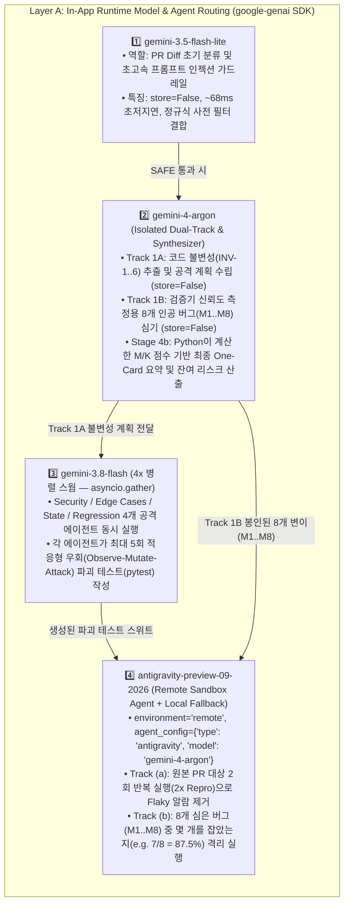
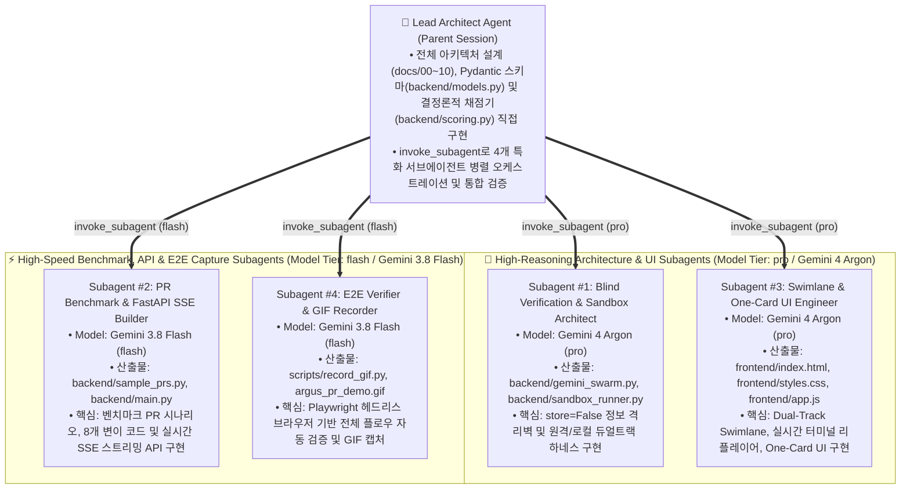

# 09. Agent Orchestration & LLM Invocation Flow (`Argus-PR`)

This document visualizes the **Multi-Agent Orchestration Graph**, details **what each Agent Node / Python Engine does**, clarifies **where AI/LLM calls happen vs. where 100% deterministic Python executes**, and explains how **Live API Mode (`GEMINI_API_KEY`) vs. Recorded Replay Mode** operates.

---

## 1. Architecture Pattern: Native Async DAG vs. LangGraph Mapping

Unlike `secureai-editor` (which wires a LangGraph `StateGraph` with `sast_node` $\to$ `dast_node` $\to$ `patch_node` $\to$ `patch_verify_node`), **`Argus-PR` (`google-hack`) uses a lightweight, zero-overhead Native Python Async DAG Orchestrator** implemented in `backend/main.py` + `backend/gemini_swarm.py` (`asyncio.gather` + `google-genai` Interactions API).

However, every stage in `Argus-PR` is **1:1 isomorphic to a LangGraph node** so it can be dropped directly into a LangGraph pipeline whenever needed.

### 1.1 Visual Multi-Agent Orchestration Flow (Mermaid)

---

## 2. Where is AI / LLM Invoked on the User Flow?

To make it crystal clear where AI models are invoked versus where pure deterministic Python code runs during the **User Flow (`01_User_Flow.md`)**, here is the stage-by-stage breakdown:

```mermaid
sequenceDiagram
    autonumber
    actor User as 👤 User (Browser UI)
    participant API as ⚙️ FastAPI (backend/main.py)
    participant Lite as 🤖 Gemini 3.5 Flash-Lite
    participant Argon as 🧠 Gemini 4 Argon (store=False)
    participant Flash as ⚡ 4x Gemini 3.8 Flash
    participant Sandbox as 🐳 Antigravity Sandbox / Subprocess
    participant PyScore as 📐 Python scoring.py (No LLM)

    User->>API: 1. Upload Workspace / Select PR & Click "Launch Swarm"
    Note over API: Stage 0.5 Smart Scope Triage & AST Import Slicer<br/>(100% Deterministic Python — 0 LLM calls)

    rect rgb(6, 78, 59)
        Note over API,Lite: [AI CALL #1] Stage 0 Guardrail
        API->>Lite: run_prompt_injection_guardrail(diff, comments)
        Lite-->>API: GuardrailResult (SAFE or BLOCKED)
    end

    rect rgb(49, 46, 129)
        Note over API,Argon: [AI CALL #2A & #2B] Stage 1 Blind Dual-Track (Zero Shared State)
        par Track 1A: Attack Planner
            API->>Argon: extract_invariants_and_plan(PR_diff, PR_code) [store=False]
            Argon-->>API: InvariantExtractionPlan (INV-1..4 + Attack Plans)
        and Track 1B: Blind Bug Planter
            API->>Argon: plant_blind_bugs(PR_code) [store=False]
            Argon-->>API: BlindMutantSet (M1..M8 Mutated Modules)
        end
    end

    rect rgb(88, 28, 135)
        Note over API,Flash: [AI CALL #3-1..#3-4] Stage 2 Parallel Attacker Swarm (asyncio.gather)
        API->>Flash: run_parallel_attacker_swarm(plan, PR_code, max_attempts=5)
        Flash-->>API: 4x AttackerSwarmOutput (Python pytest functions + 5-attempt red-team steps)
    end

    rect rgb(124, 45, 18)
        Note over API,Sandbox: [SANDBOX EXECUTION] Stage 3a & 3b Dual-Track Execution
        API->>Sandbox: run_sandbox(PR_code, M1..M8, swarm_tests)
        Sandbox-->>API: SandboxExecutionReport (2x Repro Results + Mutant Matrix)
    end

    rect rgb(15, 23, 42)
        Note over API,PyScore: [100% DETERMINISTIC PYTHON — NO AI] Stage 4a Scoring
        API->>PyScore: compute_deterministic_scores(swarm_outputs, blind_mutants, sandbox_report)
        PyScore-->>API: DeterministicScoreReport (Exact M/K Score: e.g., 7/8 = 87.5%)
    end

    rect rgb(49, 46, 129)
        Note over API,Argon: [AI CALL #4] Stage 4b One-Card Executive Summary
        API->>Argon: synthesize_one_card_summary(score_report, invariant_plan)
        Argon-->>API: OneCardExecutiveSummary (Verdict, Blind Spot Explanation, Patch Diff)
    end

    API-->>User: Render Swimlane, Terminal Logs, 7/8 Matrix & One-Card Summary

    opt User clicks "Apply Recommended Patch (Self-Healing CEGIS Loop)"
        rect rgb(49, 46, 129)
            Note over API,Sandbox: [AI CALL #5 + SANDBOX GATES] Up to 5 Attempts (patch_node <-> patch_verify_node)
            API->>Argon: Attempt k: Synthesize/refine patch from counterexample
            API->>Sandbox: Verify Gate 1 (AST), Gate 2 (Semgrep), Gate 3 (DAST), Gate 4 (Mutants)
            Sandbox-->>User: SelfHealingPatchReport (Attempt 1 FAILED_COUNTEREXAMPLE -> Attempt 2 VERIFIED)
        end
    end
```

---

## 3. Detailed Node & Function Reference Table

| Node ID | Role / Name | File & Function | Execution Type | Model / Runtime | LangGraph Equivalent (`secureai-editor`) | Description & Key Responsibility |
| :--- | :--- | :--- | :--- | :--- | :--- | :--- |
| **Node 0** | **Prompt-Injection Guardrail** | [`backend/gemini_swarm.py`](file:///c:/Users/ttogl/workspace/google-hack/backend/gemini_swarm.py#L41-L100) `run_prompt_injection_guardrail()` | **Hybrid (Regex + AI LLM)** | `gemini-3.5-flash-lite` (`store=False`) | Pre-flight Guardrail Node | Scans untrusted PR diffs/comments for adversarial instructions (`IGNORE PREVIOUS INSTRUCTIONS`, etc.) before passing to Argon. |
| **Node 0.5** | **Smart Scope Triage & Import Slicer** | [`backend/sample_prs.py`](file:///c:/Users/ttogl/workspace/google-hack/backend/sample_prs.py) `analyze_scope_triage()` & [`backend/workspace_slicer.py`](file:///c:/Users/ttogl/workspace/google-hack/backend/workspace_slicer.py) `slice_workspace_by_imports()` | **100% Deterministic Python** | Python `ast` + ES Module Regex BFS | Workspace Loader / Slicer Node | Traverses static `import` statements (depth $\le 3$) from an entry page/route, stripping 70~90% of unrelated repo files. |
| **Node 1A** | **Track 1A: Invariant & Attack Planner** | [`backend/gemini_swarm.py`](file:///c:/Users/ttogl/workspace/google-hack/backend/gemini_swarm.py#L103-L152) `extract_invariants_and_plan()` | **AI LLM (Structured JSON)** | `gemini-4-argon` (`store=False`) | `sast_analyze_node` / Planner | Extracts formal security, boundary, state, and contract invariants (`INV-1..4`) and creates targeted attack plans. |
| **Node 1B** | **Track 1B: Blind Bug Planter** | [`backend/gemini_swarm.py`](file:///c:/Users/ttogl/workspace/google-hack/backend/gemini_swarm.py#L155-L186) `plant_blind_bugs()` | **AI LLM (Structured JSON)** | `gemini-4-argon` (`store=False`) | Blind Calibration Planter Node | Independently injects 8 subtle single-bug mutations (`M1..M8`) into shadow copies of the PR code. Sealed behind the Information Wall. |
| **Node 2** | **Parallel Attacker Swarm (4x Agents)** | [`backend/gemini_swarm.py`](file:///c:/Users/ttogl/workspace/google-hack/backend/gemini_swarm.py#L189-L261) `run_parallel_attacker_swarm()` | **AI LLM (`asyncio.gather` 4x Concurrent)** | `4x gemini-3.8-flash` (`thinking_level="medium"`) | `exploit_gen_node` / Red-Team Swarm | Generates executable `pytest` functions and 5-attempt adaptive red-team sequences across `security`, `edge_cases`, `state`, and `regression`. |
| **Node 3A/3B** | **Dual-Track Sandbox & Live DAST** | [`backend/sandbox_runner.py`](file:///c:/Users/ttogl/workspace/google-hack/backend/sandbox_runner.py) `run_sandbox()` & [`backend/live_dast_runner.py`](file:///c:/Users/ttogl/workspace/google-hack/backend/live_dast_runner.py) | **Isolated Container / Subprocess + Remote Agent** | `antigravity-preview-09-2026` + Local Python Subprocess | `dast_verify_node` (`dast-isolated-net`) | Executes tests twice (`2/2` repro filter) against `PR_orig` (Track a) and against `M1..M8` (Track b), plus Multi-Persona BOLA probes. |
| **Node 4** | **Deterministic Score Calculator** | [`backend/scoring.py`](file:///c:/Users/ttogl/workspace/google-hack/backend/scoring.py) `compute_deterministic_scores()` | **100% Deterministic Python (Zero LLM)** | Pure Python Set Algebra | Deterministic Evaluator | Computes $\text{Caught}(M_i) \iff \exists t: \text{Pass}(t, \text{PR}_{\text{orig}}) \land \text{Fail}(t, M_i)$. LLMs are strictly forbidden from estimating scores. |
| **Node 5** | **One-Card Executive Synthesizer** | [`backend/gemini_swarm.py`](file:///c:/Users/ttogl/workspace/google-hack/backend/gemini_swarm.py#L264-L306) `synthesize_one_card_summary()` | **AI LLM (Grounded on Python Facts)** | `gemini-4-argon` (`store=False`) | Report Synthesizer Node | Receives immutable Python-computed `M/K` scores and `2/2` failures to write the human review card, blind-spot analysis, and fix snippet. |
| **Node 6** | **CEGIS Self-Healing Patch Loop** | [`backend/main.py`](file:///c:/Users/ttogl/workspace/google-hack/backend/main.py#L667-L747) `POST /api/verify/apply-patch` | **AI LLM + 4-Gate Sandbox Loop** | `gemini-4-argon` + Sandbox Verifier | `patch_node` $\leftrightarrow$ `patch_verify_node` (`TASK-3802`) | Up to 5 attempts per session: feeds AST/Semgrep/DAST/Mutant counterexamples back to Argon until all 4 gates pass (`VERIFIED`). |

---

## 4. Does the App Actually Call the AI / LLM? (API Key & Mode Status)

### 4.1 Current Environment Status
- **`GEMINI_API_KEY` & `GOOGLE_API_KEY`**: Currently **SET** in your system environment variables (injected at process/shell level, even without a `.env` file in the project root).
- **Dual Execution Modes (`replay` vs. `live_api`)**:
  1. **Default UI Mode — `기록 재생 안전 모드 (Recorded Sandbox Replay)` (`execution_mode="replay"`)**:
     - By default, the checkbox `#mode-toggle` (`기록 재생 안전 모드`) in the top navigation bar is **checked (`true`)**.
     - In this mode, the backend (`backend/main.py` line 944 & 1002) uses pre-recorded, high-fidelity benchmark traces stored in `backend/sample_prs.py` and **still runs the real deterministic Python scoring engine (`backend/scoring.py`)** in real time. This guarantees instant (<1.5s), zero-cost, 100% reproducible hackathon demos.
  2. **Live AI Mode — Uncheck `기록 재생 안전 모드` (`execution_mode="live_api"`)**:
     - When you **uncheck** `#mode-toggle` in the UI (or pass `"execution_mode": "live_api"` to `POST /api/verify` or `POST /api/verify/stream`), `backend/main.py` checks `bool(os.getenv("GEMINI_API_KEY"))` (which is `True`) and invokes `backend/gemini_swarm.py` (`genai.Client().interactions.create(...)`) and `backend/sandbox_runner.py` (`run_sandbox(..., live_api=True)`).
     - **Built-in Fail-Safe Fallback**: Because the hackathon architecture specifies preview model identifiers (`gemini-4-argon`, `gemini-3.8-flash`, `gemini-3.5-flash-lite`, `antigravity-preview-09-2026`), every LLM call in `backend/gemini_swarm.py` and `backend/sandbox_runner.py` is wrapped in a `try ... except Exception:` block that gracefully falls back to the local Python subprocess runner (`_run_local_isolated_sandbox`) or recorded benchmark response if the remote preview model ID is unavailable on the current API key tier.

---

## 5. Dual-Layer Multi-Agent Architecture: (A) In-App Runtime Routing vs. (B) Build-Time Subagent Swarm

이 프로젝트(`Argus-PR`)는 **1) 앱 내부에서 PR을 검증할 때 동작하는 런타임 AI 모델/에이전트 라우팅(`google-genai` Interactions API)**과 **2) 이 시스템 자체를 설계·구현·검증할 때 사용한 개발용 서브에이전트 병렬 오케스트레이션(`invoke_subagent`)**의 **이중(Dual-Layer) 멀티 에이전트 구조**로 설계되어 있습니다.

---

### 5.1 [Layer A] 앱 내부 모델/에이전트 라우팅 (`google-genai` Interactions API)

앱 내부에서 사용자가 PR 검증(`Launch Blind Verification Swarm`)을 실행하면, 각 단계의 난이도·지연시간·격리 요구사항에 맞춰 **4종의 특화 모델/에이전트**가 호출됩니다:

#### 앱 내부 모델별 호출 파라미터 및 실제 코드 위치 상세

| 호출 모델 / 에이전트 | 담당 단계 및 핵심 역할 | SDK 호출 방식 (`client.interactions.create`) 및 핵심 옵션 | 구현 파일 및 함수 |
| :--- | :--- | :--- | :--- |
| **`gemini-3.5-flash-lite`** | **Stage 0: PR Diff 초기 분류 및 빠른 가드레일 라우팅** • PR 제목, 본문, Diff, 주석 내 숨겨진 프롬프트 인젝션(`IGNORE PREVIOUS INSTRUCTIONS` 등) 탐지 및 즉시 차단 | • `model="gemini-3.5-flash-lite"` • `store=False` • `response_format` $\to$ `GuardrailResult.model_json_schema()` | [`backend/gemini_swarm.py`](file:///c:/Users/ttogl/workspace/google-hack/backend/gemini_swarm.py#L41-L100) `run_prompt_injection_guardrail()` |
| **`gemini-4-argon`** | **Stage 1A: 불변성(Invariants) 추출 & 공격 계획 수립** • PR 코드에서 반드시 지켜져야 할 불변 조건(`INV-1..6`) 추출 및 4개 Flash 공격 에이전트용 타겟 플랜 생성 **Stage 1B: 블라인드 인공 버그(`M1..M8`) 심기** • 공격 스웜과 완전히 분리된 컨텍스트에서 검증기 신뢰도($M/K$) 측정용 8개 변이 코드 생성 **Stage 4b: 최종 One-Card 요약 및 잔여 리스크(Residual Risk) 산출** • Python `scoring.py`가 확정한 $M/K$ 수치와 살아남은 변이(`M8`)를 바탕으로 인간 리뷰어용 요약 및 패치 코드 생성 | • `model="gemini-4-argon"` • **`store=False` (Track 1A와 Track 1B 간 서버 상태 공유 완전 차단 — Information Wall)** • `generation_config={"thinking_level": "high"}` • `response_format` $\to$ `InvariantExtractionPlan` / `BlindMutantSet` / `OneCardExecutiveSummary` | [`backend/gemini_swarm.py`](file:///c:/Users/ttogl/workspace/google-hack/backend/gemini_swarm.py#L103-L186) `extract_invariants_and_plan()` `plant_blind_bugs()` `synthesize_one_card_summary()` |
| **`gemini-3.8-flash`** *(4x 병렬 스웜)* | **Stage 2: 4대 공격 에이전트 동시 파괴 테스트 작성** • `security` (보안/권한/인젝션) • `edge_cases` (경계값/0나누기/Off-by-one) • `state` (동시성 레이스/멱등성/상태 전이) • `regression` (하위 호환성/스키마 계약) 4개 에이전트가 동시에 최대 5회 적응형 공격(`attempt_history`)이 포함된 `pytest` 코드 생성 | • `model="gemini-3.8-flash"` • `asyncio.gather` + `asyncio.to_thread` 4개 동시 비동기 호출 • `store=False`, `thinking_level="medium"` • `response_format` $\to$ `AttackerSwarmOutput.model_json_schema()` | [`backend/gemini_swarm.py`](file:///c:/Users/ttogl/workspace/google-hack/backend/gemini_swarm.py#L189-L261) `_run_single_flash_attacker()` `run_parallel_attacker_swarm()` |
| **`antigravity-preview-09-2026`** | **Stage 3a & 3b: 격리 샌드박스 듀얼 트랙 실행** • `/workspace/harness/run_dual_track_verification.py` 마운트 후 실행 • **Track (a)**: 원본 PR 코드에 테스트를 **2회 반복 실행(2x Repro)**하여 `2/2` 재현된 진짜 실패만 보고하고 `1/2` 일시적 오류(Flaky)는 필터링 • **Track (b)**: 원본에서 통과(`Pass(PR_orig)`)한 테스트만 `M1..M8`에 실행하여 몇 개를 잡았는지(`7 of 8 planted bugs caught`) 측정 | • `agent="antigravity-preview-09-2026"` • `environment={"type": "remote", "sources": [...]}` • `agent_config={"type": "antigravity", "model": "gemini-4-argon"}` • 데모/오프라인 환경용 로컬 격리 서브프로세스(`_run_local_isolated_sandbox`) 자동 폴백 내장 | [`backend/sandbox_runner.py`](file:///c:/Users/ttogl/workspace/google-hack/backend/sandbox_runner.py#L168-L353) `build_dual_track_harness_script()` `run_sandbox()` |

---

### 5.2 [Layer B] 작업 구현을 위한 서브에이전트 병렬 호출 (`invoke_subagent`)

이 프로젝트(`Argus-PR`)를 구축할 때에도 단일 에이전트가 순차적으로 코드를 짜는 대신, **Antigravity의 `invoke_subagent` 도구**를 사용해 작업 성격(고난도 아키텍처/UI 설계 vs. 빠른 병렬 데이터/스크립트/GIF 캡처 구현)에 맞춰 **`Gemini 4 Argon (pro)`**과 **`Gemini 3.8 Flash (flash)`** 서브에이전트에게 역할을 분담하여 병렬로 개발했습니다.

#### 개발 서브에이전트(`invoke_subagent`) 역할 배분 요약표

| 서브에이전트 역할 (Role) | 할당 모델 티어 | 담당 구현 파일 (Deliverables) | 해당 모델을 배정한 이유 (Routing Rationale) |
| :--- | :--- | :--- | :--- |
| **1. Blind Verification & Sandbox Architect** | **`Gemini 4 Argon` (`pro`)** | [`backend/gemini_swarm.py`](file:///c:/Users/ttogl/workspace/google-hack/backend/gemini_swarm.py) [`backend/sandbox_runner.py`](file:///c:/Users/ttogl/workspace/google-hack/backend/sandbox_runner.py) | `google-genai` Interactions API의 `store=False` 정보 격리 보장, Pydantic JSON 스키마 바인딩, 그리고 샌드박스 안에서 동적으로 생성·실행되는 듀얼 트랙 하네스(`run_dual_track_verification.py`) 설계에 깊은 추론력이 필요함. |
| **2. PR Benchmark & FastAPI Builder** | **`Gemini 3.8 Flash` (`flash`)** | [`backend/sample_prs.py`](file:///c:/Users/ttogl/workspace/google-hack/backend/sample_prs.py) [`backend/main.py`](file:///c:/Users/ttogl/workspace/google-hack/backend/main.py) | 방대한 양의 벤치마크 PR 데이터(`pr-checkout-race`, `pr-ratelimiter-offbyone`, `pr-prompt-injection-attack`)와 FastAPI SSE 스트리밍 엔드포인트 보일러플레이트를 빠르고 정확하게 병렬 생성하는 데 최적화됨. |
| **3. Swimlane & One-Card UI Engineer** | **`Gemini 4 Argon` (`pro`)** | [`frontend/index.html`](file:///c:/Users/ttogl/workspace/google-hack/frontend/index.html) [`frontend/styles.css`](file:///c:/Users/ttogl/workspace/google-hack/frontend/styles.css) [`frontend/app.js`](file:///c:/Users/ttogl/workspace/google-hack/frontend/app.js) | 복잡한 실시간 SSE 이벤트 상태 머신, Dual-Track Swimlane(정보 격리벽 시각화), 8-세그먼트 변이 매트릭스, 다크/화이트 테마, 그리고 멀티 에이전트 토폴로지 다이어그램 UI를 정교하게 설계해야 함. |
| **4. E2E Verifier & GIF Recorder** | **`Gemini 3.8 Flash` (`flash`)** | [`scripts/record_gif.py`](file:///c:/Users/ttogl/workspace/google-hack/scripts/record_gif.py) `argus_pr_demo.gif` | 로컬 FastAPI 서버를 띄우고 Playwright Chromium으로 전체 사용자 시나리오(PR Diff 확인 $\to$ 스웜 실행 $\to$ 7/8 점수 산출 $\to$ Merge 거절 $\to$ Guardrail 차단)를 프레임 단위로 캡처해 애니메이션 GIF로 합성하는 자동화 작업에 적합함. |
