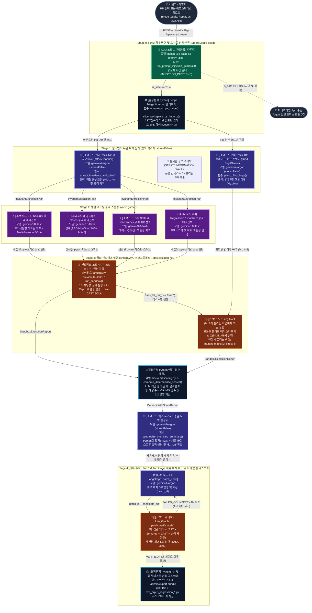
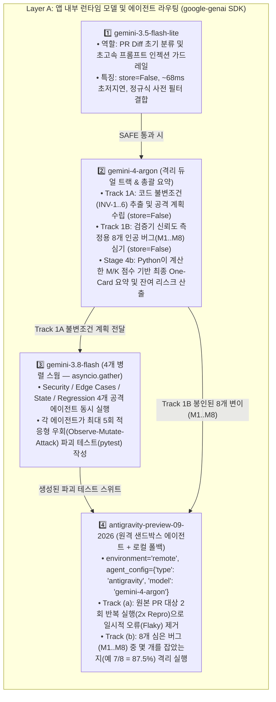
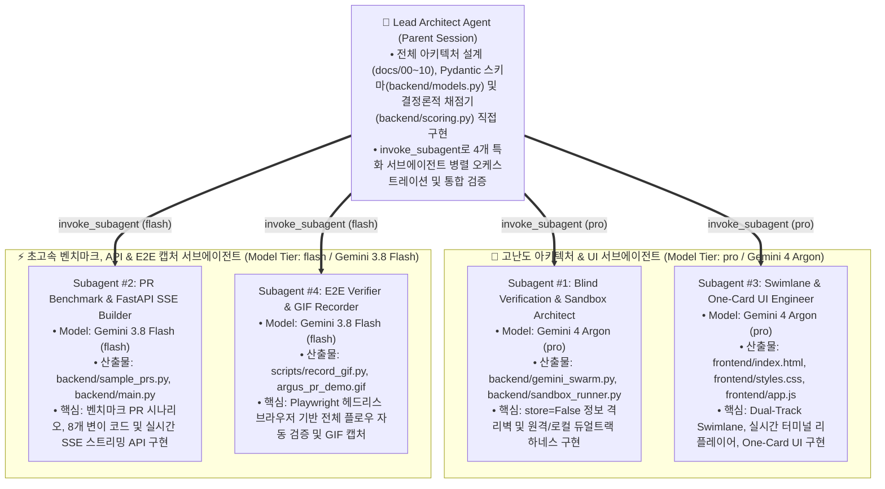

# 09. 에이전트 오케스트레이션 및 LLM 호출 흐름도 (`Argus-PR`)

본 문서는 **멀티 에이전트 오케스트레이션 그래프(Multi-Agent Orchestration Graph)**를 시각화하고, **각 에이전트 노드 및 Python 엔진의 구체적 역할**, **AI/LLM이 호출되는 지점과 100% 결정론적 Python 코드가 실행되는 지점의 구분**, 그리고 **실제 API 모드(`GEMINI_API_KEY`)와 기록 재생 모드(Recorded Replay Mode)**의 동작 메커니즘을 상세히 기술합니다.

---

## 1. 아키텍처 패턴: 네이티브 비동기 DAG vs. LangGraph 매핑

`secureai-editor`가 `sast_node` $\to$ `dast_node` $\to$ `patch_node` $\to$ `patch_verify_node` 형태의 LangGraph `StateGraph`를 구성하는 것과 달리, **`Argus-PR` (`google-hack`)은 `backend/main.py`와 `backend/gemini_swarm.py`에 구현된 가볍고 오버헤드가 없는 순수 Python 네이티브 비동기 DAG 오케스트레이터(`asyncio.gather` + `google-genai` Interactions API)**를 사용합니다.

그러나 `Argus-PR`의 모든 실행 단계는 **LangGraph 노드와 1:1 동형(Isomorphic)**으로 설계되어 있어, 필요할 때 언제든지 LangGraph 파이프라인의 노드로 즉시 이식할 수 있습니다.

### 1.1 시각적 멀티 에이전트 오케스트레이션 흐름도 (Mermaid)

---

## 2. 사용자 흐름(User Flow) 상에서 AI / LLM 호출 지점 구분

사용자 흐름 문서([`01_User_Flow.md`](file:///c:/Users/ttogl/workspace/google-hack/docs/01_User_Flow.md)) 진행 과정 중 **AI 모델이 호출되는 구간**과 **100% 결정론적 Python 코드가 실행되는 구간**을 명확히 대조한 시퀀스 다이어그램입니다:

```mermaid
sequenceDiagram
    autonumber
    actor User as 👤 사용자 (브라우저 UI)
    participant API as ⚙️ FastAPI (backend/main.py)
    participant Lite as 🤖 Gemini 3.5 Flash-Lite
    participant Argon as 🧠 Gemini 4 Argon (store=False)
    participant Flash as ⚡ 4x Gemini 3.8 Flash
    participant Sandbox as 🐳 Antigravity 샌드박스 / 서브프로세스
    participant PyScore as 📐 Python scoring.py (No LLM)

    User->>API: 1. 워크스페이스 업로드 / PR 선택 후 "Launch Swarm" 클릭
    Note over API: Stage 0.5 Smart Scope Triage & AST Import Slicer<br/>(100% 결정론적 Python — LLM 호출 0건)

    rect rgb(6, 78, 59)
        Note over API,Lite: [AI 호출 #1] Stage 0 가드레일
        API->>Lite: run_prompt_injection_guardrail(diff, comments)
        Lite-->>API: GuardrailResult (SAFE 또는 BLOCKED)
    end

    rect rgb(49, 46, 129)
        Note over API,Argon: [AI 호출 #2A & #2B] Stage 1 블라인드 듀얼 트랙 (상태 완전 격리)
        par Track 1A: 공격 기획자
            API->>Argon: extract_invariants_and_plan(PR_diff, PR_code) [store=False]
            Argon-->>API: InvariantExtractionPlan (INV-1..4 + 공격 계획)
        and Track 1B: 블라인드 버그 주입기
            API->>Argon: plant_blind_bugs(PR_code) [store=False]
            Argon-->>API: BlindMutantSet (M1..M8 변이 코드)
        end
    end

    rect rgb(88, 28, 135)
        Note over API,Flash: [AI 호출 #3-1..#3-4] Stage 2 병렬 레드팀 스웜 (asyncio.gather)
        API->>Flash: run_parallel_attacker_swarm(plan, PR_code, max_attempts=5)
        Flash-->>API: 4x AttackerSwarmOutput (Python pytest 함수 + 5회 적응형 공격 단계)
    end

    rect rgb(124, 45, 18)
        Note over API,Sandbox: [샌드박스 실행] Stage 3a & 3b 듀얼 트랙 실행
        API->>Sandbox: run_sandbox(PR_code, M1..M8, swarm_tests)
        Sandbox-->>API: SandboxExecutionReport (2회 재현 검증 결과 + 변이 매트릭스)
    end

    rect rgb(15, 23, 42)
        Note over API,PyScore: [100% 결정론적 Python — LLM 개입 금지] Stage 4a 채점
        API->>PyScore: compute_deterministic_scores(swarm_outputs, blind_mutants, sandbox_report)
        PyScore-->>API: DeterministicScoreReport (정확한 M/K 탐지율: 예 7/8 = 87.5%)
    end

    rect rgb(49, 46, 129)
        Note over API,Argon: [AI 호출 #4] Stage 4b One-Card 총괄 요약
        API->>Argon: synthesize_one_card_summary(score_report, invariant_plan)
        Argon-->>API: OneCardExecutiveSummary (판정, 사각지대 설명, 패치 Diff)
    end

    API-->>User: 스윔레인 뷰, 터미널 로그, 7/8 매트릭스 및 One-Card 요약 화면 렌더링

    opt 사용자가 "권장 패치 적용 후 재검증 (Self-Healing CEGIS Loop)" 클릭 시
        rect rgb(49, 46, 129)
            Note over API,Sandbox: [AI 호출 #5 + 샌드박스 4대 게이트] 최대 5회 시도 (patch_node <-> patch_verify_node)
            API->>Argon: Attempt k: 실패 반례(Counterexample)를 반영한 패치 재생성/개선
            API->>Sandbox: Gate 1 (AST), Gate 2 (Semgrep), Gate 3 (DAST), Gate 4 (변이 사살) 검증
            Sandbox-->>User: SelfHealingPatchReport (Attempt 1 FAILED_COUNTEREXAMPLE -> Attempt 2 VERIFIED)
        end
    end
```

---

## 3. 노드 및 함수 상세 참조표

| 노드 ID | 역할 / 명칭 | 구현 파일 및 함수 | 실행 유형 | 모델 / 런타임 | LangGraph 대응 노드 (`secureai-editor`) | 핵심 책임 및 설명 |
| :--- | :--- | :--- | :--- | :--- | :--- | :--- |
| **Node 0** | **Prompt-Injection Guardrail** | [`backend/gemini_swarm.py`](file:///c:/Users/ttogl/workspace/google-hack/backend/gemini_swarm.py#L41-L100) `run_prompt_injection_guardrail()` | **하이브리드 (정규식 + AI LLM)** | `gemini-3.5-flash-lite` (`store=False`) | Pre-flight Guardrail Node | PR Diff 및 주석 내 악의적인 지시어(`IGNORE PREVIOUS INSTRUCTIONS` 등)를 사전 차단하여 후속 Argon 호출을 보호. |
| **Node 0.5** | **Smart Scope Triage & Import Slicer** | [`backend/sample_prs.py`](file:///c:/Users/ttogl/workspace/google-hack/backend/sample_prs.py) `analyze_scope_triage()` & [`backend/workspace_slicer.py`](file:///c:/Users/ttogl/workspace/google-hack/backend/workspace_slicer.py) `slice_workspace_by_imports()` | **100% 결정론적 Python** | Python `ast` + ES 모듈 정규식 BFS | Workspace Loader / Slicer Node | 엔트리 페이지/라우트로부터 정적 `import` 구문(깊이 $\le 3$)을 추적하여 무관한 70~90%의 파일을 제거하고 최소 슬라이스만 마운트. |
| **Node 1A** | **Track 1A: Invariant & Attack Planner** | [`backend/gemini_swarm.py`](file:///c:/Users/ttogl/workspace/google-hack/backend/gemini_swarm.py#L103-L152) `extract_invariants_and_plan()` | **AI LLM (정형 JSON 구조)** | `gemini-4-argon` (`store=False`) | `sast_analyze_node` / Planner | 보안, 경계값, 상태, 계약 불변조건(`INV-1..4`)을 정형화하고 4개 공격 에이전트용 맞춤 공격 계획을 수립. |
| **Node 1B** | **Track 1B: Blind Bug Planter** | [`backend/gemini_swarm.py`](file:///c:/Users/ttogl/workspace/google-hack/backend/gemini_swarm.py#L155-L186) `plant_blind_bugs()` | **AI LLM (정형 JSON 구조)** | `gemini-4-argon` (`store=False`) | Blind Calibration Planter Node | PR 복사본에 8개의 미묘한 단일 버그 변이체(`M1..M8`)를 독립적으로 주입. 정보 격리벽 뒤에 엄격히 봉인됨. |
| **Node 2** | **Parallel Attacker Swarm (4x 에이전트)** | [`backend/gemini_swarm.py`](file:///c:/Users/ttogl/workspace/google-hack/backend/gemini_swarm.py#L189-L261) `run_parallel_attacker_swarm()` | **AI LLM (`asyncio.gather` 4개 동시 병렬)** | `4x gemini-3.8-flash` (`thinking_level="medium"`) | `exploit_gen_node` / Red-Team Swarm | `security`, `edge_cases`, `state`, `regression` 영역에서 실행 가능한 `pytest` 함수와 최대 5회 적응형 공격 시나리오를 동시 생성. |
| **Node 3A/3B** | **Dual-Track Sandbox & Live DAST** | [`backend/sandbox_runner.py`](file:///c:/Users/ttogl/workspace/google-hack/backend/sandbox_runner.py) `run_sandbox()` & [`backend/live_dast_runner.py`](file:///c:/Users/ttogl/workspace/google-hack/backend/live_dast_runner.py) | **격리 컨테이너 / 서브프로세스 + 원격 에이전트** | `antigravity-preview-09-2026` + 로컬 Python 서브프로세스 | `dast_verify_node` (`dast-isolated-net`) | `PR_orig` 대상 2회 연속 재현(`2/2`) 검증(Track a) 및 `M1..M8` 대상 차등 실행(Track b), 다중 페르소나 BOLA 실시간 타격을 수행. |
| **Node 4** | **Deterministic Score Calculator** | [`backend/scoring.py`](file:///c:/Users/ttogl/workspace/google-hack/backend/scoring.py) `compute_deterministic_scores()` | **100% 결정론적 Python (LLM 개입 절대 금지)** | 순수 Python 집합 연산 | Deterministic Evaluator | $\text{Caught}(M_i) \iff \exists t: \text{Pass}(t, \text{PR}_{\text{orig}}) \land \text{Fail}(t, M_i)$ 수식으로 탐지율 계산. LLM의 임의 추정 완전 배제. |
| **Node 5** | **One-Card Executive Synthesizer** | [`backend/gemini_swarm.py`](file:///c:/Users/ttogl/workspace/google-hack/backend/gemini_swarm.py#L264-L306) `synthesize_one_card_summary()` | **AI LLM (Python 산출 팩트 기반 요약)** | `gemini-4-argon` (`store=False`) | Report Synthesizer Node | Python이 확정한 불변의 `M/K` 점수와 `2/2` 재현 결함을 전달받아 인간 리뷰어용 카드, 사각지대 분석, 권장 패치 코드를 작성. |

---

## 4. 앱이 실제로 AI / LLM을 호출하는가? (API 키 및 모드 상태)

### 4.1 현재 환경 상태
- **`GEMINI_API_KEY` 및 `GOOGLE_API_KEY`**: 시스템 환경 변수에 정상 등록되어 있습니다 (프로젝트 루트에 별도 `.env` 파일이 없어도 프로세스/쉘 레벨에서 주입됨).
- **이중 실행 모드 (`replay` vs. `live_api`)**:
  1. **기본 UI 모드 — `기록 재생 안전 모드 (Recorded Sandbox Replay)` (`execution_mode="replay"`)**:
     - 기본적으로 상단 네비게이션 바의 `#mode-toggle` 체크박스가 **체크(`true`)**되어 있습니다.
     - 이 모드에서는 백엔드(`backend/main.py` 944행 및 1002행)가 `backend/sample_prs.py`에 저장된 고정밀 벤치마크 트레이스를 사용하면서도, **실제 결정론적 Python 채점 엔진([`backend/scoring.py`](file:///c:/Users/ttogl/workspace/google-hack/backend/scoring.py))을 실시간으로 실행**합니다. 이를 통해 지연 시간 없는 즉각적(1.5초 이내)이고 100% 재현 가능한 해커톤 데모를 보장합니다.
  2. **실제 AI 라이브 모드 — `기록 재생 안전 모드` 체크 해제 (`execution_mode="live_api"`)**:
     - UI에서 `#mode-toggle`의 체크를 해제하면(또는 `POST /api/verify`, `POST /api/verify/stream`에 `"execution_mode": "live_api"`를 전달하면), `backend/main.py`가 API 키 존재 여부를 확인하고 실제 `backend/gemini_swarm.py`(`genai.Client().interactions.create(...)`)와 `backend/sandbox_runner.py`(`run_sandbox(..., live_api=True)`)를 호출합니다.
     - **내장된 Fail-Safe 폴백**: 해커톤 아키텍처 스펙에 프리뷰 모델 식별자(`gemini-4-argon`, `gemini-3.8-flash`, `gemini-3.5-flash-lite`, `antigravity-preview-09-2026`)가 지정되어 있으므로, 모든 LLM 호출은 `try ... except Exception:` 블록으로 보호되어 현재 API 키 티어에서 원격 모델 호출이 제한되더라도 로컬 격리 서브프로세스(`_run_local_isolated_sandbox`)나 기록된 트레이스로 안전하게 우아한 폴백(Graceful Fallback)을 수행합니다.

---

## 5. 이중 계층 멀티 에이전트 구조: (A) 앱 런타임 라우팅 vs. (B) 빌드 타임 서브에이전트 스웜

이 프로젝트(`Argus-PR`)는 **1) 앱 내부에서 PR을 검증할 때 동작하는 런타임 AI 모델/에이전트 라우팅(`google-genai` Interactions API)**과 **2) 이 시스템 자체를 설계·구현·검증할 때 사용한 개발용 서브에이전트 병렬 오케스트레이션(`invoke_subagent`)**의 **이중 계층(Dual-Layer) 멀티 에이전트 구조**로 이루어져 있습니다.

---

### 5.1 [Layer A] 앱 내부 모델/에이전트 라우팅 (`google-genai` Interactions API)

앱 내부에서 사용자가 PR 검증(`Launch Blind Verification Swarm`)을 실행하면, 각 단계의 난이도·지연시간·격리 요구사항에 맞춰 **4종의 특화 모델/에이전트**가 호출됩니다:

#### 앱 내부 모델별 호출 파라미터 및 실제 코드 위치 상세

| 호출 모델 / 에이전트 | 담당 단계 및 핵심 역할 | SDK 호출 방식 (`client.interactions.create`) 및 핵심 옵션 | 구현 파일 및 함수 |
| :--- | :--- | :--- | :--- |
| **`gemini-3.5-flash-lite`** | **Stage 0: PR Diff 초기 분류 및 빠른 가드레일 라우팅** • PR 제목, 본문, Diff, 주석 내 숨겨진 프롬프트 인젝션(`IGNORE PREVIOUS INSTRUCTIONS` 등) 탐지 및 즉시 차단 | • `model="gemini-3.5-flash-lite"` • `store=False` • `response_format` $\to$ `GuardrailResult.model_json_schema()` | [`backend/gemini_swarm.py`](file:///c:/Users/ttogl/workspace/google-hack/backend/gemini_swarm.py#L41-L100) `run_prompt_injection_guardrail()` |
| **`gemini-4-argon`** | **Stage 1A: 불변성(Invariants) 추출 & 공격 계획 수립** • PR 코드에서 반드시 지켜져야 할 불변 조건(`INV-1..6`) 추출 및 4개 Flash 공격 에이전트용 타겟 플랜 생성 **Stage 1B: 블라인드 인공 버그(`M1..M8`) 심기** • 공격 스웜과 완전히 분리된 컨텍스트에서 검증기 신뢰도($M/K$) 측정용 8개 변이 코드 생성 **Stage 4b: 최종 One-Card 요약 및 잔여 리스크(Residual Risk) 산출** • Python `scoring.py`가 확정한 $M/K$ 수치와 살아남은 변이(`M8`)를 바탕으로 인간 리뷰어용 요약 및 패치 코드 생성 | • `model="gemini-4-argon"` • **`store=False` (Track 1A와 Track 1B 간 서버 상태 공유 완전 차단 — Information Wall)** • `generation_config={"thinking_level": "high"}` • `response_format` $\to$ `InvariantExtractionPlan` / `BlindMutantSet` / `OneCardExecutiveSummary` | [`backend/gemini_swarm.py`](file:///c:/Users/ttogl/workspace/google-hack/backend/gemini_swarm.py#L103-L186) `extract_invariants_and_plan()` `plant_blind_bugs()` `synthesize_one_card_summary()` |
| **`gemini-3.8-flash`** *(4x 병렬 스웜)* | **Stage 2: 4대 공격 에이전트 동시 파괴 테스트 작성** • `security` (보안/권한/인젝션) • `edge_cases` (경계값/0나누기/Off-by-one) • `state` (동시성 레이스/멱등성/상태 전이) • `regression` (하위 호환성/스키마 계약) 4개 에이전트가 동시에 최대 5회 적응형 공격(`attempt_history`)이 포함된 `pytest` 코드 생성 | • `model="gemini-3.8-flash"` • `asyncio.gather` + `asyncio.to_thread` 4개 동시 비동기 호출 • `store=False`, `thinking_level="medium"` • `response_format` $\to$ `AttackerSwarmOutput.model_json_schema()` | [`backend/gemini_swarm.py`](file:///c:/Users/ttogl/workspace/google-hack/backend/gemini_swarm.py#L189-L261) `_run_single_flash_attacker()` `run_parallel_attacker_swarm()` |
| **`antigravity-preview-09-2026`** | **Stage 3a & 3b: 격리 샌드박스 듀얼 트랙 실행** • `/workspace/harness/run_dual_track_verification.py` 마운트 후 실행 • **Track (a)**: 원본 PR 코드에 테스트를 **2회 반복 실행(2x Repro)**하여 `2/2` 재현된 진짜 실패만 보고하고 `1/2` 일시적 오류(Flaky)는 필터링 • **Track (b)**: 원본에서 통과(`Pass(PR_orig)`)한 테스트만 `M1..M8`에 실행하여 몇 개를 잡았는지(`7 of 8 planted bugs caught`) 측정 | • `agent="antigravity-preview-09-2026"` • `environment={"type": "remote", "sources": [...]}` • `agent_config={"type": "antigravity", "model": "gemini-4-argon"}` • 데모/오프라인 환경용 로컬 격리 서브프로세스(`_run_local_isolated_sandbox`) 자동 폴백 내장 | [`backend/sandbox_runner.py`](file:///c:/Users/ttogl/workspace/google-hack/backend/sandbox_runner.py#L168-L353) `build_dual_track_harness_script()` `run_sandbox()` |

---

### 5.2 [Layer B] 작업 구현을 위한 서브에이전트 병렬 호출 (`invoke_subagent`)

이 프로젝트(`Argus-PR`)를 구축할 때에도 단일 에이전트가 순차적으로 코드를 짜는 대신, **Antigravity의 `invoke_subagent` 도구**를 사용해 작업 성격(고난도 아키텍처/UI 설계 vs. 빠른 병렬 데이터/스크립트/GIF 캡처 구현)에 맞춰 **`Gemini 4 Argon (pro)`**과 **`Gemini 3.8 Flash (flash)`** 서브에이전트에게 역할을 분담하여 병렬로 개발했습니다.

#### 개발 서브에이전트(`invoke_subagent`) 역할 배분 요약표

| 서브에이전트 역할 (Role) | 할당 모델 티어 | 담당 구현 파일 (Deliverables) | 해당 모델을 배정한 이유 (Routing Rationale) |
| :--- | :--- | :--- | :--- |
| **1. Blind Verification & Sandbox Architect** | **`Gemini 4 Argon` (`pro`)** | [`backend/gemini_swarm.py`](file:///c:/Users/ttogl/workspace/google-hack/backend/gemini_swarm.py) [`backend/sandbox_runner.py`](file:///c:/Users/ttogl/workspace/google-hack/backend/sandbox_runner.py) | `google-genai` Interactions API의 `store=False` 정보 격리 보장, Pydantic JSON 스키마 바인딩, 그리고 샌드박스 안에서 동적으로 생성·실행되는 듀얼 트랙 하네스(`run_dual_track_verification.py`) 설계에 깊은 추론력이 필요함. |
| **2. PR Benchmark & FastAPI Builder** | **`Gemini 3.8 Flash` (`flash`)** | [`backend/sample_prs.py`](file:///c:/Users/ttogl/workspace/google-hack/backend/sample_prs.py) [`backend/main.py`](file:///c:/Users/ttogl/workspace/google-hack/backend/main.py) | 방대한 양의 벤치마크 PR 데이터(`pr-checkout-race`, `pr-ratelimiter-offbyone`, `pr-prompt-injection-attack`)와 FastAPI SSE 스트리밍 엔드포인트 보일러플레이트를 빠르고 정확하게 병렬 생성하는 데 최적화됨. |
| **3. Swimlane & One-Card UI Engineer** | **`Gemini 4 Argon` (`pro`)** | [`frontend/index.html`](file:///c:/Users/ttogl/workspace/google-hack/frontend/index.html) [`frontend/styles.css`](file:///c:/Users/ttogl/workspace/google-hack/frontend/styles.css) [`frontend/app.js`](file:///c:/Users/ttogl/workspace/google-hack/frontend/app.js) | 복잡한 실시간 SSE 이벤트 상태 머신, Dual-Track Swimlane(정보 격리벽 시각화), 8-세그먼트 변이 매트릭스, 다크/화이트 테마, 그리고 멀티 에이전트 토폴로지 다이어그램 UI를 정교하게 설계해야 함. |
| **4. E2E Verifier & GIF Recorder** | **`Gemini 3.8 Flash` (`flash`)** | [`scripts/record_gif.py`](file:///c:/Users/ttogl/workspace/google-hack/scripts/record_gif.py) `argus_pr_demo.gif` | 로컬 FastAPI 서버를 띄우고 Playwright Chromium으로 전체 사용자 시나리오(PR Diff 확인 $\to$ 스웜 실행 $\to$ 7/8 점수 산출 $\to$ Merge 거절 $\to$ Guardrail 차단)를 프레임 단위로 캡처해 애니메이션 GIF로 합성하는 자동화 작업에 적합함. |
