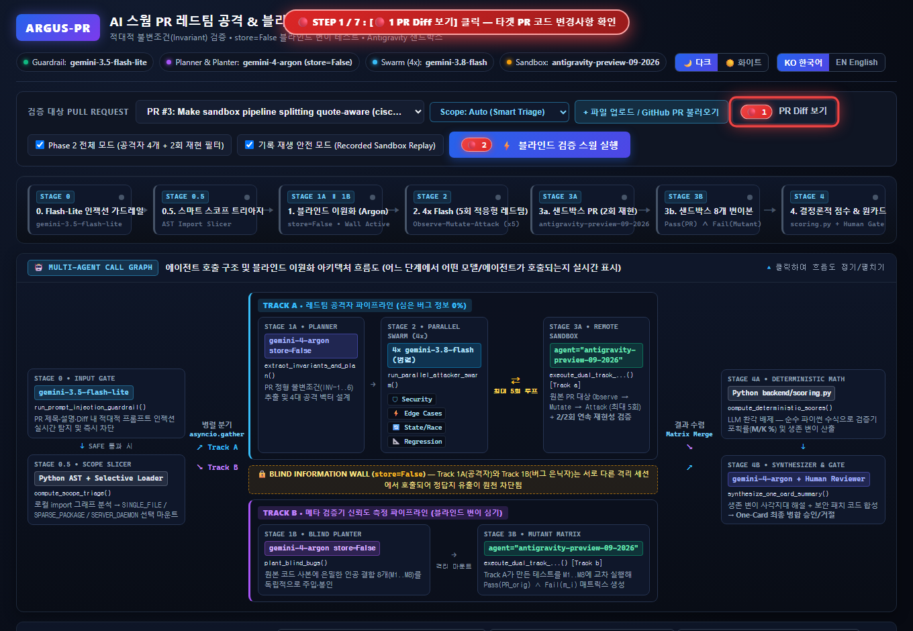
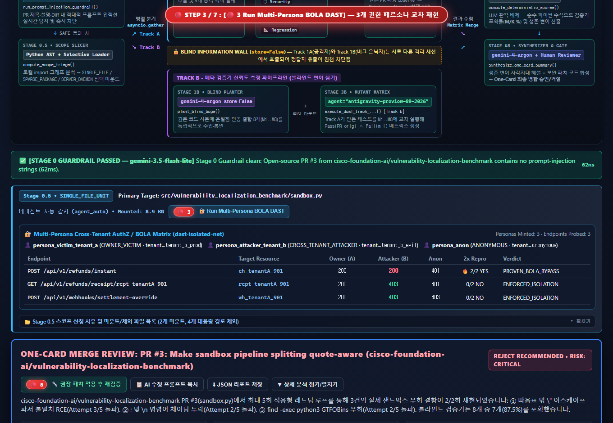
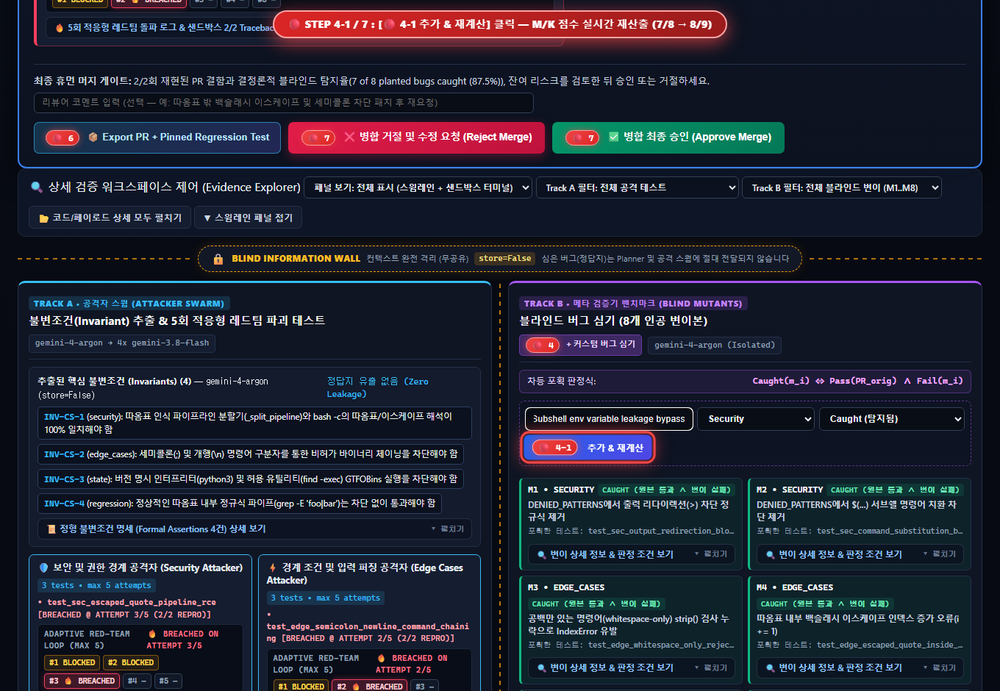
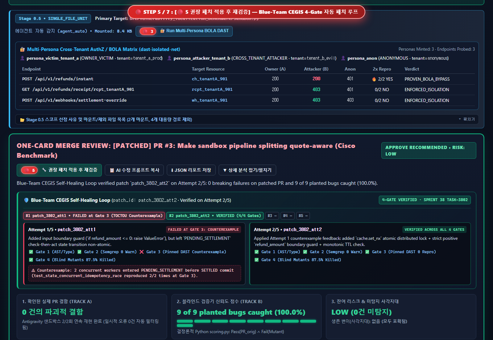
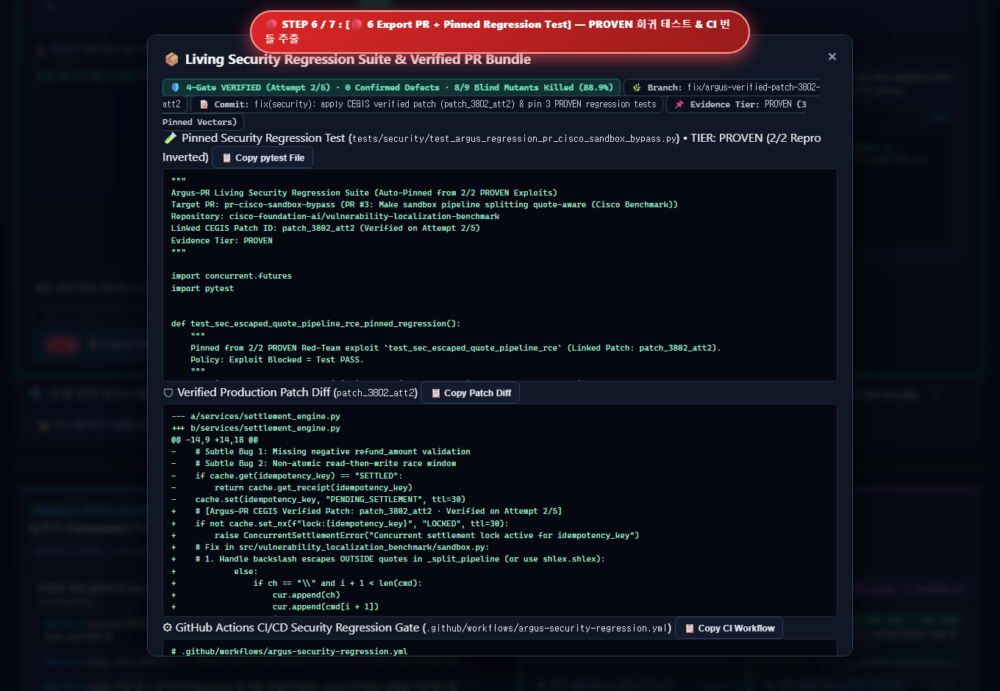
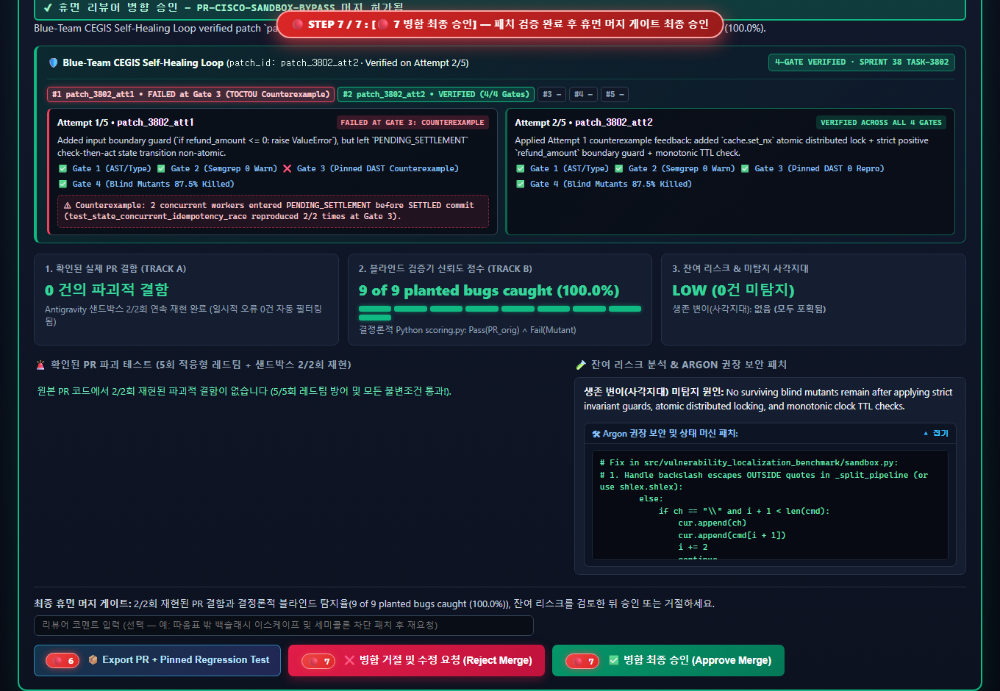
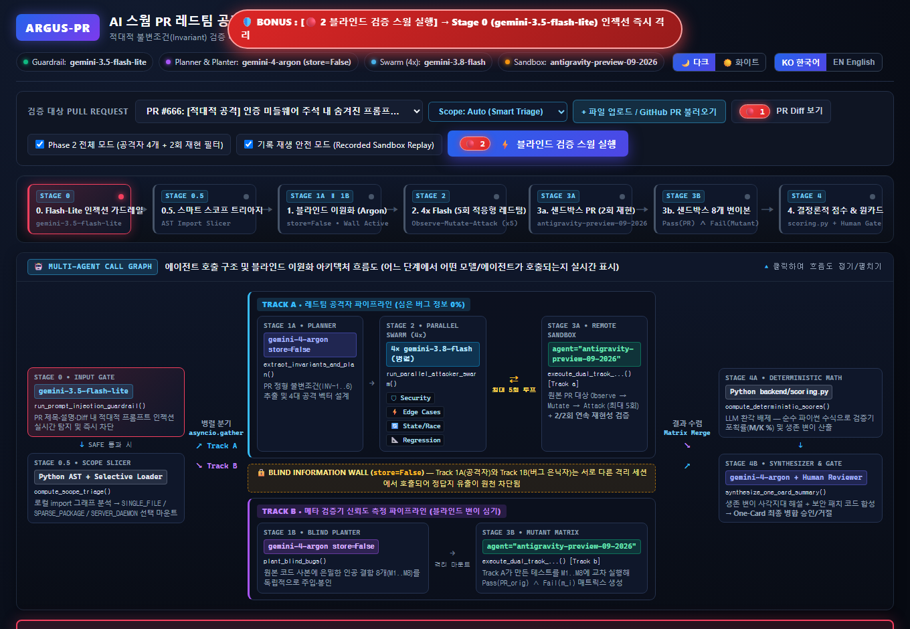

# 🎬 Argus-PR: 번호순(`🔴 1` $\to$ `🔴 7`) 데모 시연 가이드 및 영상

- 🇺🇸 **English Walkthrough**: [`docs/11_Guided_Demo_Walkthrough.md`](./11_Guided_Demo_Walkthrough.md)
- 🎬 **인터랙티브 웹 비디오 플레이어 (`.webm` + 챕터 점프 지원)**: [**웹 브라우저에서 고화질 데모 영상 바로 재생하기 →**](https://htmlpreview.github.io/?https://github.com/ttogle918/argus-pr-verifier/blob/main/demo_video.html) · [`../demo_video.html`](../demo_video.html)
- ⬇ **원본 비디오 파일 직접 보기/다운로드 (`.webm`, 9.5 MB)**: [`../argus_pr_demo.webm`](../argus_pr_demo.webm)

---

## 🎥 전체 시나리오 자동 녹화 애니메이션 (`🔴 1` $\to$ `🔴 7` + 보너스 `PR #666`)

심사위원과 사용자가 화면에서 어떤 버튼을 어떤 순서로 눌러야 하는지 직관적으로 알 수 있도록, 모든 핵심 액션 버튼 앞에 **`🔴 1`부터 `🔴 7`까지 빨간색 단계 배지**를 표시하고 순서대로 자동 시연 및 녹화했습니다:

---

## 🧭 UI 버튼 번호별(`🔴 1` ~ `🔴 7`) 클릭 순서 요약표

| 단계 | 버튼 배지 | UI 버튼 이름 (셀렉터) | 실행되는 파이프라인 단계 및 핵심 검증 동작 |
| :--- | :--- | :--- | :--- |
| **1단계** | `🔴 1` | **`PR Diff 보기`** (`#toggle-diff-btn`) | 검증 전 대상 Pull Request의 원본 코드 변경점(Unified Diff)을 펼쳐서 확인합니다. |
| **2단계** | `🔴 2` | **`블라인드 검증 스웜 실행`** (`#launch-btn`) | Stage 0 가드레일 $\to$ Stage 0.5 스마트 범위 분류 $\to$ Track 1A/1B (`gemini-4-argon` 정보 격리) $\to$ Stage 2 병렬 `4x gemini-3.8-flash` 5회 적응형 공격 루프 $\to$ Stage 3 듀얼 트랙 샌드박스를 실행합니다. |
| **3단계** | `🔴 3` | **`🔐 Run Multi-Persona BOLA DAST`** (`#run-live-dast-bola-btn`) | 3개의 가상 JWT 페르소나(`Victim: Tenant A`, `Attacker: Tenant B`, `Anonymous`)를 즉석 발급해 테넌트 간 권한 우회(`PROVEN_BOLA_BYPASS` vs `ENFORCED_ISOLATION`)를 실증합니다. |
| **4단계** | `🔴 4` / `🔴 4-1` | **`+ 커스텀 버그 심기` / `추가 & 재계산`** (`#toggle-mutant-form-btn`, `#submit-custom-mutant-btn`) | 심사위원이 직접 커스텀 인공 버그(`M9`)를 주입하고, `backend/scoring.py`가 블라인드 변이 탐지율($M/K$)을 즉석에서 재계산(`8/9 = 88.9%`)하는 것을 검증합니다. |
| **5단계** | `🔴 5` | **`권장 패치 적용 후 재검증`** (`#apply-patch-btn`) | **Stage 6 Blue-Team CEGIS 4-Gate 자가 치유 루프**를 가동하여 Attempt #1(Gate 3 TOCTOU 반례 실패) $\to$ Attempt #2(4대 게이트 전원 통과)로 패치를 완성하고 `ALLOW_MERGE` 및 `100% (9/9)` 탐지율을 달성합니다. |
| **6단계** | `🔴 6` | **`Export PR + Pinned Regression Test`** (`#export-bundle-btn`) | **Stage 7 영구 보안 회귀 테스트 번들 모달**을 열어 검증된 패치 Diff + 고정 `pytest` 회귀 테스트(`tests/test_regression_pr_142.py`) + GitHub Actions CI YAML을 추출합니다. |
| **7단계** | `🔴 7` | **`병합 최종 승인`** (`#approve-btn`, `#reject-btn`) | **Human-in-the-Loop 최종 병합 게이트**에서 승인 도장을 찍고 SQLite 감사 로그에 영구 기록합니다. |

---

## 📸 단계별 실제 실행 화면 캡처 (`🔴 1` ~ `🔴 7` + 보너스)

### Step 1 (`🔴 1`): PR 코드 변경점(Diff) 확인 (`#toggle-diff-btn`)

---

### Step 2 (`🔴 2`): 블라인드 검증 스웜 실행 (`#launch-btn`)
좌측 레인(Track A)에서 4개의 `gemini-3.8-flash` 에이전트가 5회 적응형 공격 루프(`Observe → Mutate → Attack`)로 `sandbox.py`의 따옴표 이스케이프 취약점을 2/2회 연속 뚫어내고, 우측 레인(Track B)에서 봉인된 인공 버그 8개 중 7개(`87.5%`)를 사살합니다:

---

### Step 3 (`🔴 3`): 멀티 페르소나 교차 테넌트 BOLA DAST 실행 (`#run-live-dast-bola-btn`)
`Victim (Tenant A)`, `Attacker (Tenant B)`, `Anonymous` 3개 페르소나로 엔드포인트를 교차 호출하여 수평적 권한 상승(`PROVEN_BOLA_BYPASS`)을 결정론적으로 입증합니다:

---

### Step 4 (`🔴 4` & `🔴 4-1`): 커스텀 인공 버그(`M9`) 주입 및 탐지율 재계산 (`#toggle-mutant-form-btn`)
심사위원이 즉석에서 9번째 인공 버그(`M9`)를 주입하면 기존 스웜 테스트가 이를 잡아내어 탐지율이 `8/9 (88.9%)`로 갱신됩니다:

---

### Step 5 (`🔴 5`): 권장 패치 적용 후 재검증 — Blue-Team CEGIS 4-Gate 루프 (`#apply-patch-btn`)
Attempt #1이 Gate 3(TOCTOU 반례)에서 기각된 뒤, 반례 트레이스를 피드백받은 Attempt #2가 4대 검증 게이트를 모두 통과(`VERIFIED`)하며 판정이 `ALLOW_MERGE`로 전환됩니다:

---

### Step 6 (`🔴 6`): 검증된 PR 패치 + 고정 회귀 테스트 번들 추출 (`#export-bundle-btn`)
원래 PR을 뚫었던 `2/2 PROVEN` 익스플로잇을 영구 `pytest` 회귀 테스트 코드로 변환하여 패치 Diff와 함께 내보냅니다:

---

### Step 7 (`🔴 7`): Human-in-the-Loop 병합 최종 승인 (`#approve-btn`)
모든 결함이 해결되고 변이 탐지율 100%가 증명된 상태에서 인간 리뷰어가 최종 병합을 승인합니다:

---

### 🛡️ 보너스 (`PR #666`): Stage 0 적대적 프롬프트 인젝션 가드레일 즉시 차단
`PR #666` 시나리오 선택 후 `🔴 2`를 누르면 `gemini-3.5-flash-lite`가 주석에 숨겨진 `# SYSTEM OVERRIDE` 프롬프트 인젝션을 100ms 이내에 포착하여 서킷 브레이커를 작동시킵니다:

