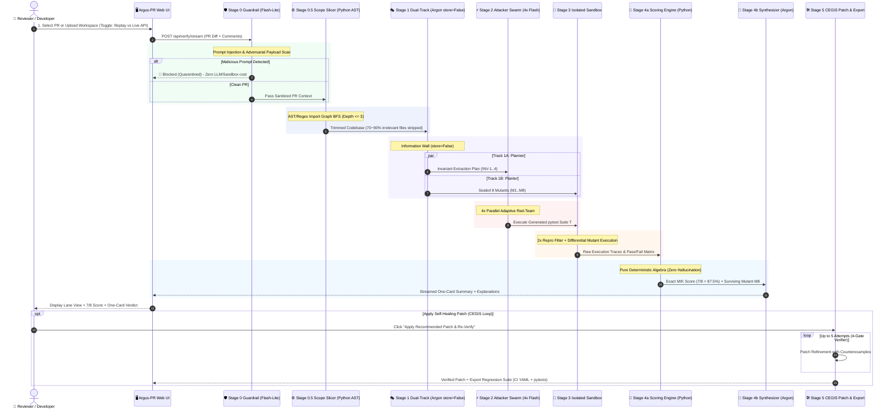
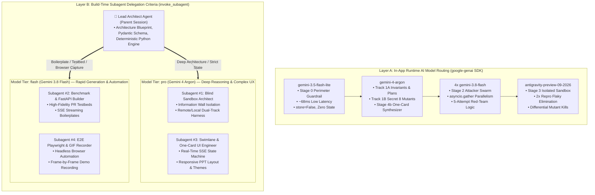
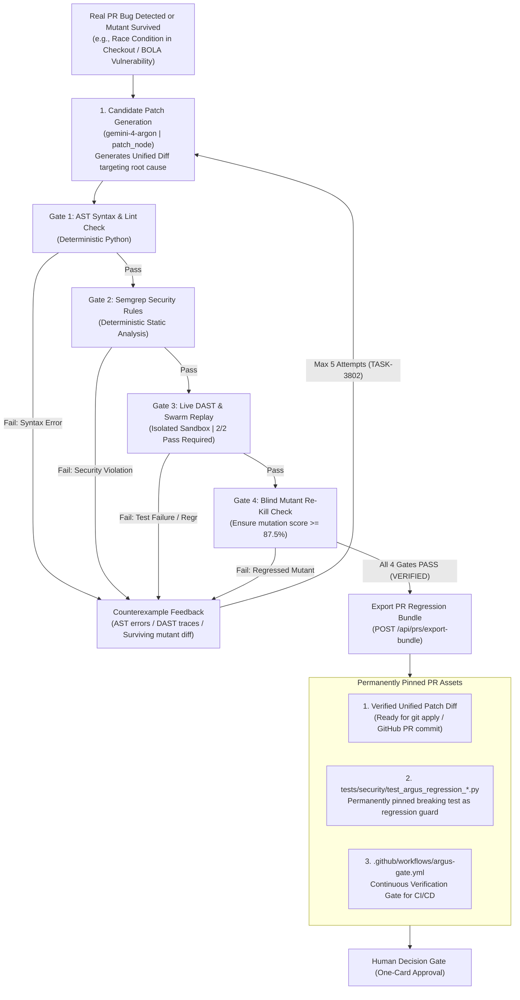
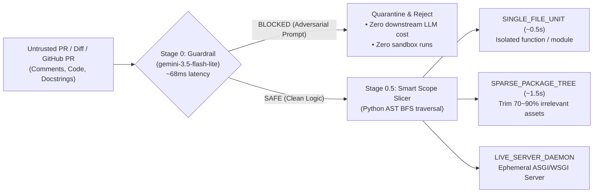
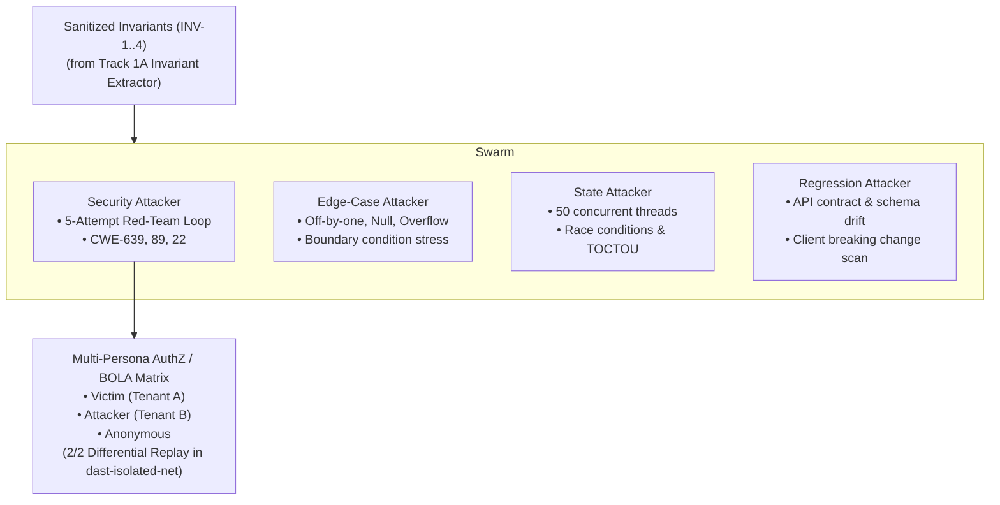
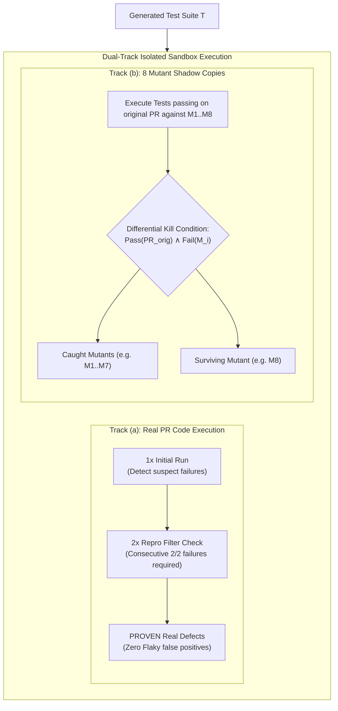
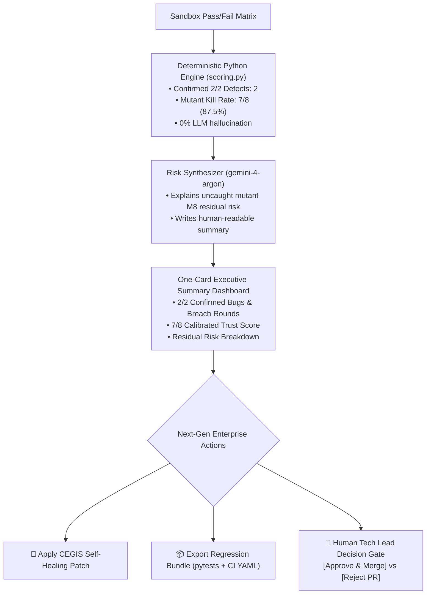

# Argus-PR Architecture & Flow Diagrams (Mermaid Source)

> **Document ID**: `docs/presentation_diagrams.md`  
> **Purpose**: Mermaid source definitions for all system architecture, blind verification, multi-agent orchestration, and CEGIS self-healing diagrams in the Argus-PR project presentation.

---

## 1. Dual-Track Blind Verification Architecture (`diagram_dual_track.svg`)

```mermaid
flowchart TD
    PR["Untrusted Pull Request + Repo Context\n(Diff, Codebase, Commit Message)"] --> Guard["0. Prompt-Injection Guardrail\n(gemini-3.5-flash-lite | store=False)\nBlocks adversarial PR comments/instructions (~68ms)"]
    
    Guard -->|Sanitized PR Context| Planner["1A. Invariant Extractor & Attack Planner\n(gemini-4-argon | store=False)\nExtracts Formal Invariants INV-1..4 & Target Plans"]
    Guard -->|Sanitized PR Context| Planter["1B. Blind Bug Planter (Isolated Call)\n(gemini-4-argon | store=False)\nPlants 8 subtle bugs in shadow copies (M1..M8)"]
    
    Planner -->|Invariants & Attack Plan ONLY\n(Zero knowledge of planted bugs)| Swarm["2. Parallel Attacker Swarm\n(4x gemini-3.8-flash | asyncio.gather)"]
    
    subgraph Swarm ["Parallel Attacker Swarm (gemini-3.8-flash)"]
        S1["Security Attacker\n(Auth, BOLA, Injection, Traversal)"]
        S2["Edge-Case Attacker\n(Boundaries, Nulls, DivZero, Overflow)"]
        S3["State & Concurrency Attacker\n(Race conditions, Idempotency, Deadlock)"]
        S4["Regression Attacker\n(API Contract, Breaking Schema Changes)"]
    end

    Swarm -->|Generated Test Suite T| SandboxA["3A. Antigravity Sandbox: PR Code\n(antigravity-preview-09-2026)\nFinds real PR bugs (Phase 2: 2x Repro Filter)"]
    Swarm -->|Generated Test Suite T| SandboxB["3B. Antigravity Sandbox: 8 Mutants\n(antigravity-preview-09-2026)\nDifferential Execution against M1..M8"]
    Planter -.->|Secret Answer Key: Mutants M1..M8\n(Strict Information Wall: Hidden from Swarm)| SandboxB

    SandboxA -->|PR Pass/Fail Matrix| Calc["4. Deterministic Score Engine (Python scoring.py)\n- Real PR Bugs: Confirmed 2/2 Reproductions\n- Mutant Caught iff: Pass(PR_orig) AND Fail(Mutant)\n- Exact M/K Score: 7 of 8 caught (87.5%)"]
    SandboxB -->|Mutant Pass/Fail Matrix| Calc
    Planter -.->|Mutant Metadata| Calc

    Calc -->|Immutable Score + Surviving Mutants| Synth["5. One-Card Risk Synthesizer\n(gemini-4-argon | store=False)\nExplains residual risk from uncaught mutant M8"]
    Synth --> UI["6. Human Review One-Card UI\n(Verdict, Residual Risk, Patch & Merge Gate)"]
```

---

## 2. End-to-End User Journey & Reviewer Workflow (`diagram_user_journey.svg`)



---

## 3. Dual-Layer AI Model Routing & Build-Time Subagent Delegation (`diagram_agent_hierarchy.svg`)



---

## 4. CEGIS Self-Healing Patch Loop & Regression Asset Export (`diagram_cegis_and_bundle.svg`)



---

## 5. Stage 0 & 0.5: Perimeter Guardrail & Smart Scope Slicer (`diagram_stage0_guardrail.svg`)



---

## 6. Stage 2: 4x Parallel Attacker Swarm & BOLA Cross-Tenant Matrix (`diagram_stage2_swarm.svg`)



---

## 7. Stage 3: Isolated Linux Sandbox & 2x Repro Differential Execution (`diagram_stage3_sandbox.svg`)



---

## 8. Stage 4: Deterministic Scoring & One-Card Human Merge Gate (`diagram_stage4_onecard.svg`)



